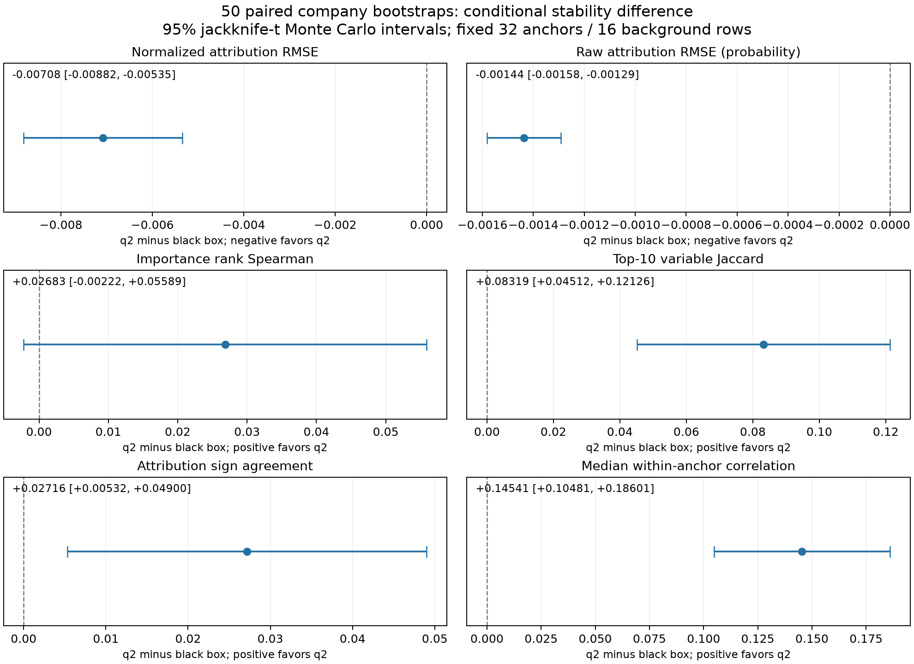

# 50 次配对 bootstrap 稳定性扩展

[结果与解释](STABILITY_RESULTS_ZH.md) · [冻结协议](PROTOCOL_ZH.md) · [指标区间](stability_intervals.csv) · [执行回执](execution_receipt.json)

固定制造业样本与原 q2/黑箱配置；复用 8 对，新增 42 对，共 50 对。原始企业、参数与解释数组不发布。所有结果为 PROVISIONAL、事后探索性。

复现：`python -m experiments.bootstrap_stability_50_v1.prepare --run UNIQUE_RUN --parent OLD_RUN`；完整测试后提交代码，再 `prepare --run UNIQUE_RUN --repo REPO --freeze`；`hetero-run UNIQUE_RUN/formal.py` 使用两机独立任务；完成后 `python -m experiments.bootstrap_stability_50_v1.evaluate --run UNIQUE_RUN --job JOB_ID`、`python -m experiments.bootstrap_stability_50_v1.report --run UNIQUE_RUN`。环境与原基线一致，见 environment.json / requirements.lock。需要私有服务器输入，仓库汇总不能还原企业明细。
