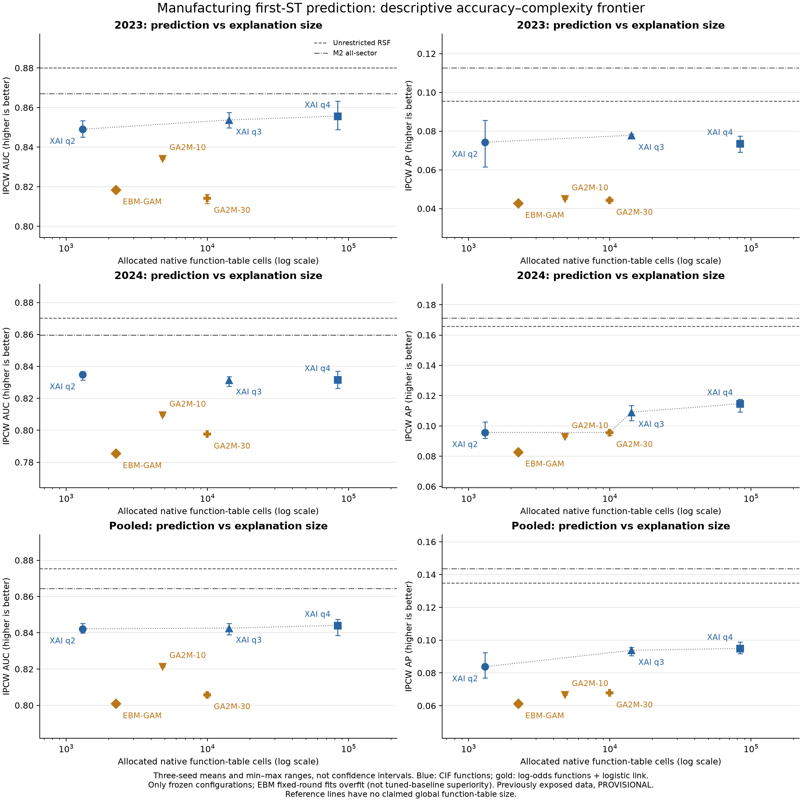

# 可解释基线、结构恢复与SHAP配对审计

**本轮完成261个正式任务：33个真实数据拟合、210个模拟拟合、18个SHAP计算任务，失败0；另3个试运行。** 55项测试通过，含2项独立R检查。用户选择同一制造业2023/2024，全部为后暴露探索性比较，PROVISIONAL／INCONCLUSIVE。

主要结果：q2在配对重抽样下的部分归因稳定性较好；但受控模拟揭示真实交互被森林等权平均明显稀释。真实EBM固定轮数训练出现严重过拟合，本轮前沿不能证明相对充分调优EBM的优势。SHAP与本方法都能加回预测，黑箱SHAP增加计算预算后归因误差明显降低。

|内容|入口|
|---|---|
|研究结论与可写/不可写的论文表述|[METHOD_INNOVATION_DECISION_ZH.md](METHOD_INNOVATION_DECISION_ZH.md)|
|年度/合并预测、校准、Top20/25与前沿|[PREDICTION_FRONTIER_ZH.md](PREDICTION_FRONTIER_ZH.md)|
|EBM过拟合与强基线有效性限制|[EBM_BASELINE_VALIDITY_ZH.md](EBM_BASELINE_VALIDITY_ZH.md)|
|结构恢复、幅度恢复与逐树信号稀释|[SIMULATION_STRUCTURE_RECOVERY_ZH.md](SIMULATION_STRUCTURE_RECOVERY_ZH.md)|
|SHAP精确参考、计算噪声与共同重抽样|[SHAP_FIDELITY_STABILITY_ZH.md](SHAP_FIDELITY_STABILITY_ZH.md)|
|执行、数据、环境及失败/修复记录|[EXECUTION_AND_DATA_AUDIT_ZH.md](EXECUTION_AND_DATA_AUDIT_ZH.md)|
|初始冻结协议及配置|[PROTOCOL_ZH.md](PROTOCOL_ZH.md)、[frozen_protocol.json](frozen_protocol.json)|
|补齐当前覆盖版本的时间顺序|[SIMULATION_COVERAGE_AMENDMENT_ZH.md](SIMULATION_COVERAGE_AMENDMENT_ZH.md)|
|执行与交付核验|[execution_receipt.json](execution_receipt.json)、[delivery_validation.json](delivery_validation.json)|

其他研究图：[结构恢复](figures/simulation_structure_recovery.png)、[SHAP忠实性与稳定性](figures/shap_fidelity_stability.png)。PNG及SVG均保存，配图来源表及说明位于figures/。

EBM-GAM和GA²M式EBM属于同一实现家族。EBM是12个月IPCW端点分类器，其原生项在log-odds尺度，经logistic链接重构概率；森林原生函数直接分解CIF。完整解释表大小不等于单一的认知负担评分。黑箱SHAP审计对象为同后端制造业不限阶数森林，不是原M2。

模拟中的q2是全8变量候选的阶数原型，q2_coverage对应当前约三分之一变量资格策略；两者必须区分。当前覆盖版35个模拟是发现设计遗漏后的固定补齐，未将原结果删除或改名冒充预注册。原226任务、评价快照和代码保留。

复现环境：`python -m pip install -e '.[dev,benchmarks]'`；完整依赖锁见requirements.lock。设置CRFOREST_RSCRIPT与EW_RLIB运行完整55项测试。一般只装dev时，两项外部解释器测试会因缺少可选依赖跳过，不能称完整测试通过。本轮隔离环境没有跳过。

在新的唯一私有目录按顺序运行prepare.py、stages.py freeze、Slurm pilot及gate、formal及gate。补齐覆盖版由supplement.py建立独立快照并提交35任务。随后evaluate.py、supplementary_audits.py、validate.py、report.py、plot.py生成指标、审计和研究图；研究结论是人工依据这些实测证据撰写。参数可由各入口--help查看。禁止覆盖已完成的运行目录。

私有目录：`/home/oliver/MainDiskData/xai_rsf_interpretable_baselines_v1_20261027_hw9gdrol/`。Slurm2529/2530/2531。初轮训练提交11656465b379b7e36d31118431785defb362c4ff；覆盖补齐提交ebd09da3179609015e0c5e56ead5af5b14d1ef54。原模型代码未改，拟合模型和企业解释/阈值均不提交Git。全部真实数据时钟限制沿用原制造业审计。
