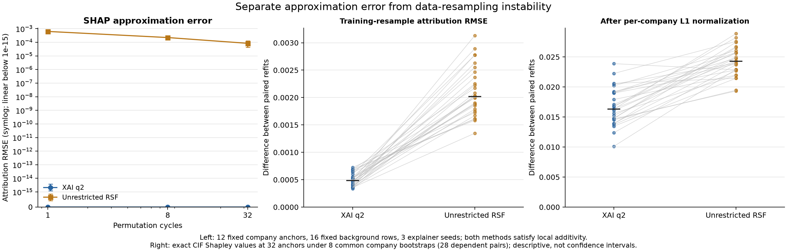

# 黑箱SHAP的忠实性与稳定性实测

固定同一365日目标CIF、背景和解释样本，q2及黑箱不限阶数森林均计算官方Permutation SHAP。有限背景精确参考经全子集穷举和官方ExactExplainer测试，不用近似的高预算SHAP冒充真值。此黑箱是同后端制造业森林，不是M2；未声称测过原M2模型的SHAP。

## 局部加和与归因估计误差分开

|模型|双向排列循环|归因RMSE均值|最小|最大|归因MAE均值|最大单项误差|最大加和误差|SHAP秒均值|
|---|---|---|---|---|---|---|---|---|
|q2|1|1.43987e-18|1.10219e-18|1.66895e-18|4.18077e-19|2.0383e-17|1.38778e-17|0.232559|
|q2|8|7.52752e-19|7.06318e-19|7.90429e-19|1.91625e-19|1.38778e-17|1.38778e-17|1.63823|
|q2|32|6.84357e-19|6.45489e-19|7.36608e-19|1.6648e-19|1.04083e-17|1.38778e-17|4.59157|
|unrestricted|1|0.000624153|0.000604364|0.00065956|0.000121916|0.0128064|5.55112e-17|0.259896|
|unrestricted|8|0.00022204|0.000159369|0.000258216|4.21673e-05|0.006264|5.55112e-17|1.78624|
|unrestricted|32|8.35948e-05|4.40526e-05|0.000129161|1.80899e-05|0.00276739|1.11022e-16|4.46744|

12个按公司抽取的固定评价锚点、16个训练背景公司各一条记录、3个解释器种子。背景不按结局选择。Permutation SHAP本来就满足局部加和；加和精确不能证明Shapley近似收敛，也不是本方法独有优势。q2函数在原始坐标下至多二阶，双向排列的低阶性质使其可能在一次循环已精确；这验证计算性质，不证明q2的真实预测或统计解释更正确。逐种子近似随机性见shap_computation_stability.csv。

## 同一8次训练公司组bootstrap

|模型|归因差RMSE中位|最小|最大|L1归一后RMSE中位|重要性秩相关中位|Top10重合中位|符号一致率中位|
|---|---|---|---|---|---|---|---|
|q2|0.000484839|0.000338027|0.000723717|0.0163397|0.742717|0.666667|0.52666|
|unrestricted|0.00201775|0.00134752|0.00313021|0.0242832|0.674313|0.428571|0.4631|

这部分用精确CIF Shapley（共同16行经验联合背景、32个公司锚点），去掉解释器Monte Carlo噪声后比较训练样本扰动。固定模型随机种子42，三个模型每次读取同一组训练公司抽样；不同重复的样本多重性影响内部树bootstrap，这是训练不确定性的组成部分。28个两两组合有依赖，不能冒充28次独立重抽样或据此算过窄置信区间。原始RMSE受模型风险振幅影响，因此同时列每家公司归因L1归一后的差异。

## 固定模型，仅改变背景

|模型|背景变化RMSE中位|最小|最大|Top10重合中位|重要性秩相关中位|
|---|---|---|---|---|---|
|q2|0.000311188|0.000138525|0.000537566|0.666667|0.997384|
|unrestricted|0.000620635|0.000402559|0.00186739|0.742424|0.903326|

每次背景取自同一对应训练bootstrap，模型固定为原seed42。它与重训敏感性是两个实验，不相加，也不能把背景敏感性误报为训练不稳定。

## 原生函数的重抽样稳定性

|模型|全部函数集合Jaccard中位|二元集合Jaccard中位|共同非恒定函数相关中位|
|---|---|---|---|
|ebm_ga2m10|0.789474|0|0.463589|
|q2|0.436508|0.346683|0.850712|

q2原生函数在CIF尺度，EBM在log-odds尺度；不能逐项相减作忠实性排名。共同函数相关只在32个固定锚点测量，不能代表全域函数形状。EBM默认保留全部主效应会机械提高全部集合Jaccard，因此必须同时看二元集合与预测效果。q2的原生交互表与SHAP单变量分摊是不同对象；本实验没有把二者强行一一对应。

完整函数重构、SHAP局部加和、精确Shapley近似误差、真结构恢复以及抽样稳定性是五个不同问题。任何单项好都不自动证明统计可辨识或因果正确。

外层bootstrap重复公司使用克隆组ID以维持内部森林bootstrap的抽样多重性；它们是重复抽样单位，不能计作新增独立企业。原始独立企业/事件数始终按冻结原数据报告。
