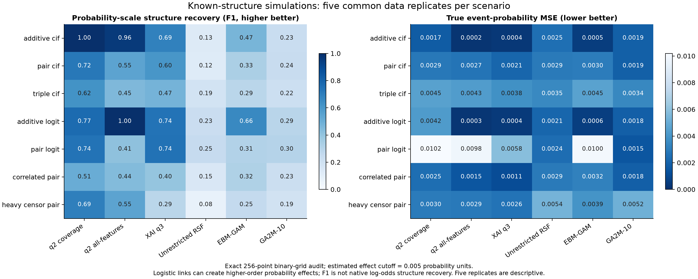

# 模拟中的结构恢复

七种已知DGP、五次共同数据重复、初轮每种五个模型，再补当前方法固定覆盖版本，共210拟合。8个二值输入允许在完整256点均匀网格上精确求全部阶数Walsh系数。初轮q2/q3为全部8候选的阶数原型；q2_coverage才对应当前每树约三分之一变量的覆盖版本（3/8）。补齐时间顺序及旧结果保留见SIMULATION_COVERAGE_AMENDMENT_ZH.md，不将它包装成初始预注册设计。真非零判据1e-10，估计结构选择阈值预先固定0.005概率单位，未根据结果调整。F1评价概率尺度结构；对数几率低阶经非线性链接会产生概率高阶，不能误解为GA²M实现错误。native_coefficient_rmse在各模型原生尺度分别计算，仅可在同尺度内解释。

|场景|模型|结构F1均值|最小|最大|二阶precision|二阶recall|概率系数RMSE|原生系数RMSE|均匀网格风险MSE|观察分布风险MSE|真概率归因RMSE|
|---|---|---|---|---|---|---|---|---|---|---|---|
|additive_cif|ebm_ga2m10|0.233609|0.210526|0.25|0|—|0.00269928|0.0190436|0.00189135|0.00189137|0.0119238|
|additive_cif|ebm_gam|0.466667|0.444444|0.5|0|—|0.00145201|0.010198|0.000567169|0.000541472|0.00774444|
|additive_cif|q2|0.96|0.8|1|0|—|0.000833276|0.000833276|0.000223439|0.000227685|0.004455|
|additive_cif|q2_coverage|1|1|1|—|—|0.0025823|0.0025823|0.00172559|0.00174554|0.0145625|
|additive_cif|q3|0.686667|0.5|0.8|0|—|0.00116786|0.00116786|0.000364499|0.000357792|0.00554497|
|additive_cif|unrestricted|0.129893|0.111111|0.16|0|—|0.00316423|0.00316423|0.00256163|0.00250414|0.0117141|
|additive_logit|ebm_ga2m10|0.29065|0.24|0.333333|0.0893551|1|0.002633|0.0244825|0.00178975|0.00184784|0.0115081|
|additive_logit|ebm_gam|0.657143|0.428571|0.857143|0.74|1|0.00145887|0.0116156|0.000576795|0.000564717|0.00775761|
|additive_logit|q2|1|1|1|1|1|0.000889124|0.000889124|0.000269967|0.000269966|0.00453254|
|additive_logit|q2_coverage|0.773333|0.666667|0.8|—|0|0.00404964|0.00404964|0.00421001|0.00424144|0.0219797|
|additive_logit|q3|0.741429|0.6|0.857143|0.433333|1|0.00123454|0.00123454|0.000429714|0.000434977|0.00591182|
|additive_logit|unrestricted|0.228912|0.206897|0.285714|0.118571|1|0.00293135|0.00293135|0.00222218|0.00214948|0.0111515|
|correlated_pair|ebm_ga2m10|0.226433|0.210526|0.266667|0.100404|1|0.00325043|0.0227076|0.00274012|0.00183933|0.0148367|
|correlated_pair|ebm_gam|0.320476|0.25|0.4|0|0|0.00355135|0.0260246|0.00326794|0.00321123|0.0156261|
|correlated_pair|q2|0.44|0.4|0.5|0|0|0.00363757|0.00363757|0.00342423|0.00148873|0.0152034|
|correlated_pair|q2_coverage|0.506667|0|0.8|0.666667|0.4|0.00336476|0.00336476|0.00297406|0.00246414|0.0153533|
|correlated_pair|q3|0.397172|0.333333|0.444444|0.306667|1|0.00304964|0.00304964|0.00243675|0.00114786|0.0135041|
|correlated_pair|unrestricted|0.150741|0.125|0.222222|0.110642|1|0.00381987|0.00381987|0.00380569|0.00292677|0.0155986|
|heavy_censor_pair|ebm_ga2m10|0.187556|0.16|0.222222|0.0963636|1|0.00435575|0.0297221|0.00510153|0.00518097|0.0192684|
|heavy_censor_pair|ebm_gam|0.254618|0.181818|0.333333|0|0|0.00382203|0.0274432|0.00387614|0.00392423|0.017424|
|heavy_censor_pair|q2|0.546667|0.4|0.666667|0|0|0.00327998|0.00327998|0.00287339|0.00287453|0.0137192|
|heavy_censor_pair|q2_coverage|0.693333|0.4|0.8|1|0.6|0.00332012|0.00332012|0.00295296|0.0029702|0.014767|
|heavy_censor_pair|q3|0.286869|0.181818|0.363636|0.123333|0.6|0.00316043|0.00316043|0.00267115|0.00263484|0.0135153|
|heavy_censor_pair|unrestricted|0.0776855|0.0645161|0.0851064|0.0687179|1|0.00460708|0.00460708|0.00554857|0.00537158|0.01774|
|pair_cif|ebm_ga2m10|0.240751|0.210526|0.285714|0.105|1|0.0026856|0.0193562|0.00188519|0.00187558|0.011759|
|pair_cif|ebm_gam|0.33381|0.25|0.4|—|0|0.00340505|0.0249038|0.00298232|0.00301339|0.0145357|
|pair_cif|q2|0.546667|0.4|0.666667|0|0|0.00320965|0.00320965|0.00265344|0.00267764|0.013188|
|pair_cif|q2_coverage|0.72|0.666667|0.8|1|0.4|0.0033136|0.0033136|0.00283695|0.00285592|0.0148474|
|pair_cif|q3|0.602222|0.4|1|0.583333|0.8|0.0028443|0.0028443|0.00209723|0.0021133|0.0119087|
|pair_cif|unrestricted|0.122481|0.111111|0.148148|0.103408|1|0.00335833|0.00335833|0.0029079|0.00291725|0.0127893|
|pair_logit|ebm_ga2m10|0.303063|0.26087|0.352941|0.102222|1|0.00239323|0.020195|0.00148779|0.00148641|0.0103653|
|pair_logit|ebm_gam|0.310952|0.25|0.4|0|0|0.00627425|0.0511462|0.0100551|0.010016|0.024985|
|pair_logit|q2|0.413333|0.333333|0.5|0|0|0.0062115|0.0062115|0.00986219|0.00980134|0.0244791|
|pair_logit|q2_coverage|0.74|0.5|0.8|1|0.8|0.00633315|0.00633315|0.010282|0.0101919|0.0272143|
|pair_logit|q3|0.742857|0.5|0.857143|0.75|1|0.00472024|0.00472024|0.0058537|0.00582414|0.0188965|
|pair_logit|unrestricted|0.24798|0.222222|0.272727|0.151667|1|0.00308409|0.00308409|0.00248237|0.00241186|0.0117768|
|triple_cif|ebm_ga2m10|0.216984|0.190476|0.25|0.0988889|1|0.00367183|0.0291143|0.00349626|0.00344885|0.0143248|
|triple_cif|ebm_gam|0.285556|0.222222|0.4|—|0|0.00421884|0.0342231|0.00458062|0.00454803|0.0166191|
|triple_cif|q2|0.45|0.25|0.5|0|0|0.00409929|0.00409929|0.00433648|0.00433493|0.0156422|
|triple_cif|q2_coverage|0.62|0.5|0.8|1|0.4|0.0041891|0.0041891|0.00452886|0.00451861|0.0170573|
|triple_cif|q3|0.473016|0.222222|0.666667|0.433333|0.8|0.00381776|0.00381776|0.00377717|0.00379195|0.0145453|
|triple_cif|unrestricted|0.187438|0.153846|0.214286|0.108658|1|0.00368004|0.00368004|0.00351928|0.00349862|0.0136912|

二阶真项/选择项分母为0时recall/precision未定义，表中留空；原任务诊断里的零分母占位0已在评价阶段从计数恢复为缺失，不改拟合或预测。总体F1的真结构包括主效应，分母始终有定义。

相关场景保留均匀乘积参考和实际观察分布两个误差，不能将稀少组合上的恢复误差当成同等频率现实错误。竞争事件依赖额外变量，目标CIF真结构不依赖它；森林可能为联合事件建模使用该变量。五次Monte Carlo不足以声称稳定的显著差异。该二值实验不能回答连续财务切点定位精度。

真概率尺度Shapley来自完整Walsh系数的精确均匀乘积分配，用来衡量真信号恢复，不把SHAP单变量归因当作交互结构发现器。结构支持由完整函数展开单独评价。未选有利种子，所有场景和失败计数完整保留。

## 必须结合幅度恢复看F1

在pair_cif场景，真实二元系数为0.05。当前q2_coverage的平均估计仅0.004588，约为真实值的9.18%；GA²M-10平均0.048510。q2_coverage的总体F1为0.72，高于GA²M-10的0.24，但真实二元项超过0.005阈值的召回率只有40%，而GA²M-10为100%。较高F1主要反映更少额外项，不能等同于重要真实作用已正确恢复。

|模型|真系数|估计均值|最小|最大|
|---|---|---|---|---|
|ebm_ga2m10|0.05|0.0485102|0.0451432|0.0506953|
|ebm_gam|0.05|-0.000152596|-0.000846045|6.74434e-05|
|q2|0.05|0.000706757|-3.03577e-18|0.00353378|
|q2_coverage|0.05|0.00458806|0.0017802|0.00792881|
|q3|0.05|0.00972988|0.00344767|0.0180066|
|unrestricted|0.05|0.0371113|0.0339213|0.043868|

只读逐树审计显示：当前覆盖版本的32棵树中，仅1—5棵具有该真实二元项的非零概率系数。这些树内的平均系数为0.0412—0.0570，接近0.05，但固定等权平均后变为0.00178—0.00793。下表是保存模型的精确分解，未重新训练。

|种子|总树数|具有真二元项的树|比例|这些树的平均系数|全森林系数|真系数|
|---|---|---|---|---|---|---|
|101|32|3|0.09375|0.0504997|0.00473435|0.05|
|42|32|4|0.125|0.0473673|0.00592092|0.05|
|303|32|5|0.15625|0.0507444|0.00792881|0.05|
|202|32|1|0.03125|0.0569664|0.0017802|0.05|
|404|32|2|0.0625|0.0412168|0.00257605|0.05|

该结果定位了一个实际的信号稀释现象：少量树学到了交互，但整片森林的平均贡献被稀释。它与每树变量资格及贪心分裂的组合一致；本轮未通过进一步消融分别识别两者的因果贡献，也不据此自动修改森林聚合或启动新搜索。
