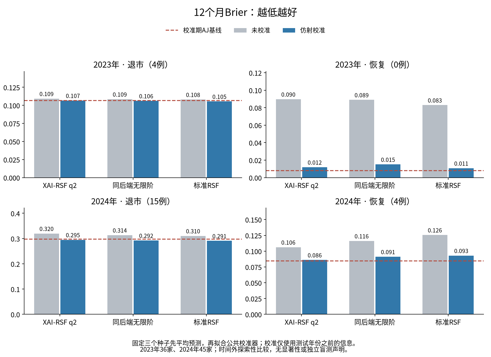
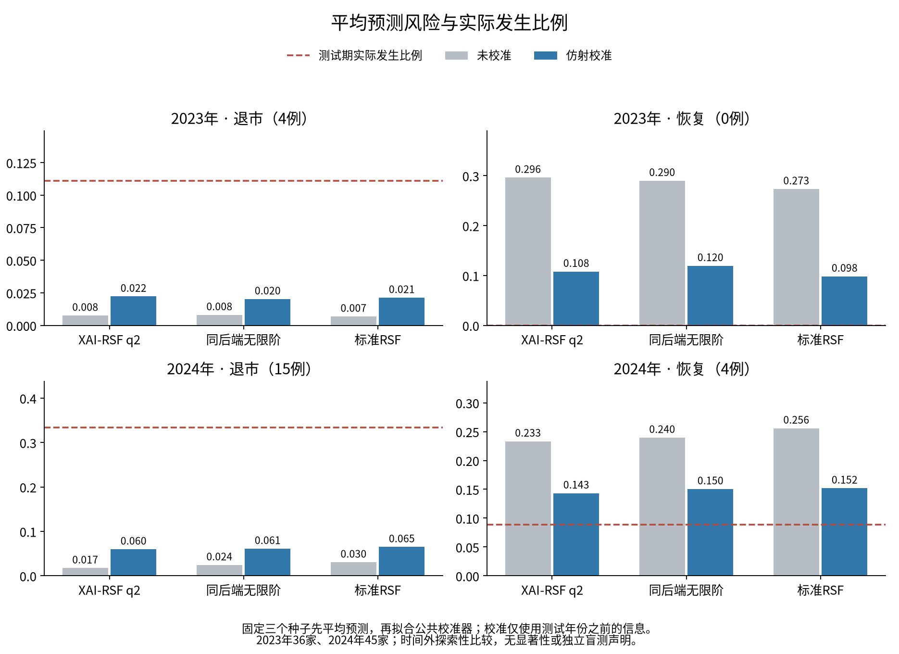

# 2023／2024仿射再校准结果

**实际完成18个森林、24个校准器、2个4树试运行。两年分别评价，观察期均为12个日历月。** 主要结果为固定三个种子预测先平均，再拟合一个公共仿射校准器；不是各自校准后再平均，也不是三个指标简单平均。逐种子全部结果另存CSV。

## 退市

| test_year | model | state | known_target_events | auc | ap | brier | risk_mean | ipcw_observed_incidence |
| --- | --- | --- | --- | --- | --- | --- | --- | --- |
| 2023 | XAI-RSF q2 | uncalibrated | 4 | 0.640625 | 0.172917 | 0.109322 | 0.00758147 | 0.111111 |
| 2023 | XAI-RSF q2 | affine | 4 | 0.640625 | 0.172917 | 0.106667 | 0.0222222 | 0.111111 |
| 2023 | 同后端无限阶 | uncalibrated | 4 | 0.671875 | 0.367816 | 0.108541 | 0.00805062 | 0.111111 |
| 2023 | 同后端无限阶 | affine | 4 | 0.671875 | 0.367816 | 0.106195 | 0.0201979 | 0.111111 |
| 2023 | 标准RSF | uncalibrated | 4 | 0.945312 | 0.75 | 0.108053 | 0.00685741 | 0.111111 |
| 2023 | 标准RSF | affine | 4 | 0.945312 | 0.75 | 0.105446 | 0.0212388 | 0.111111 |
| 2023 | 训练AJ | baseline | 4 | 0.5 | 0.111111 | 0.109258 | 0.00867716 | 0.111111 |
| 2023 | 校准期AJ | baseline | 4 | 0.5 | 0.111111 | 0.106667 | 0.0222222 | 0.111111 |
| 2024 | XAI-RSF q2 | uncalibrated | 15 | 0.742222 | 0.623799 | 0.319896 | 0.0173314 | 0.333333 |
| 2024 | XAI-RSF q2 | affine | 15 | 0.742222 | 0.623799 | 0.29498 | 0.0597478 | 0.333333 |
| 2024 | 同后端无限阶 | uncalibrated | 15 | 0.753333 | 0.527966 | 0.313632 | 0.0242872 | 0.333333 |
| 2024 | 同后端无限阶 | affine | 15 | 0.753333 | 0.527966 | 0.292438 | 0.060998 | 0.333333 |
| 2024 | 标准RSF | uncalibrated | 15 | 0.671111 | 0.496813 | 0.310493 | 0.0304483 | 0.333333 |
| 2024 | 标准RSF | affine | 15 | 0.671111 | 0.496813 | 0.290925 | 0.0648929 | 0.333333 |
| 2024 | 训练AJ | baseline | 15 | 0.5 | 0.333333 | 0.322991 | 0.0158925 | 0.333333 |
| 2024 | 校准期AJ | baseline | 15 | 0.5 | 0.333333 | 0.297097 | 0.0597015 | 0.333333 |

q2退市Brier：2023由0.109322降至0.106667；2024由0.319896降至0.294980。AUC/AP和Top20/25名单完全不变。2023 q2退市斜率触及预先规定的正数下界，概率差异接近消失；数学排序保留不表示仍有足够可用的概率分辨幅度。其Brier与仅使用近期发生水平的校准期AJ几乎相同。2024 q2略低于校准期AJ的0.297097，但没有不确定性证据支持稳定优越性。

2024 q2退市平均风险由1.73%升至5.97%，实际15/45=33.33%；历史校准没有解决大幅低估。2023实际4/36=11.11%，校准后2.22%，仍低估。校准器看不到未来制度的真实发生率，不能把概率约束或结构保持等同于消除漂移。

2023标准RSF的AUC为0.9453，但只有4个退市事件，不能据此宣称稳定高精度。所有模型排序数值均来自本轮基础森林，不是仿射校准带来的AUC增益。

## 恢复

| test_year | model | state | known_target_events | auc | ap | brier | risk_mean | ipcw_observed_incidence |
| --- | --- | --- | --- | --- | --- | --- | --- | --- |
| 2023 | XAI-RSF q2 | uncalibrated | 0 | NA | NA | 0.0896956 | 0.296316 | 0 |
| 2023 | XAI-RSF q2 | affine | 0 | NA | NA | 0.0119007 | 0.107933 | 0 |
| 2023 | 同后端无限阶 | uncalibrated | 0 | NA | NA | 0.0889453 | 0.290059 | 0 |
| 2023 | 同后端无限阶 | affine | 0 | NA | NA | 0.0150969 | 0.1195 | 0 |
| 2023 | 标准RSF | uncalibrated | 0 | NA | NA | 0.0829514 | 0.273318 | 0 |
| 2023 | 标准RSF | affine | 0 | NA | NA | 0.0107385 | 0.0983397 | 0 |
| 2023 | 训练AJ | baseline | 0 | NA | NA | 0.083336 | 0.28868 | 0 |
| 2023 | 校准期AJ | baseline | 0 | NA | NA | 0.00790123 | 0.0888889 | 0 |
| 2024 | XAI-RSF q2 | uncalibrated | 4 | 0.414634 | 0.147834 | 0.10625 | 0.233275 | 0.0888889 |
| 2024 | XAI-RSF q2 | affine | 4 | 0.414634 | 0.147834 | 0.086029 | 0.14323 | 0.0888889 |
| 2024 | 同后端无限阶 | uncalibrated | 4 | 0.347561 | 0.0848069 | 0.116148 | 0.23957 | 0.0888889 |
| 2024 | 同后端无限阶 | affine | 4 | 0.347561 | 0.0848069 | 0.0911816 | 0.150485 | 0.0888889 |
| 2024 | 标准RSF | uncalibrated | 4 | 0.323171 | 0.0938034 | 0.125607 | 0.255827 | 0.0888889 |
| 2024 | 标准RSF | affine | 4 | 0.323171 | 0.0938034 | 0.0929902 | 0.151893 | 0.0888889 |
| 2024 | 训练AJ | baseline | 4 | 0.5 | 0.0888889 | 0.115241 | 0.273966 | 0.0888889 |
| 2024 | 校准期AJ | baseline | 4 | 0.5 | 0.0888889 | 0.0843555 | 0.146922 | 0.0888889 |

2023没有12个月内先恢复事件，恢复AUC/AP为NA，不能填0。2024只有4例恢复，q2 AUC0.4146，恢复区分度仍弱。q2恢复Brier在两年均下降，但两年都高于校准期无变量AJ。恢复的平均预测从29.63%降到10.79%（实际0%），从23.33%降到14.32%（实际8.89%）。

24个校准器的两原因测试Brier均有所下降，包含全部18个单种子与6个集成组合；这是一轮探索性观察，不是保证未来总会改善，也没有显著性声明。使用联合两原因Brier拟合校准，未按测试结果挑选校准版本。

本轮为留出独立校准集而使用更早、更小的森林训练集；不能将本轮AUC与此前全训练集／24个月或2025实验直接比较，归因于仿射校准或模型机制改进。2023/2024历史结局已被研究接触，状态为PROVISIONAL_EXPLORATORY_TEMPORAL_CALIBRATION。
