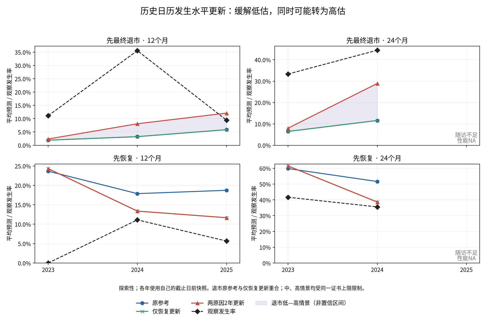

# 日历人时线性水平更新：探索性结果

**主方案缓解了2023、2024年的退市风险低估，但没有消除；2025年12个月转为高估。完整精确解释与合法CIF可以同时保留，代价包括跨年排序变化和部分恢复误差上升。** 不据此更换当前参考模型，不选择敏感性方案。

本轮森林拟合0、校准器拟合0、倍率/窗口搜索0。只对已保存的83变量、q2、深度4、直接父节点AJ10参考森林的三种子均值做固定规则映射。2023—2025已暴露；窗口与方案是在查看reporting-drift公开CALENDAR_INCIDENCE后设计的，不是独立确认实验。原始财报版本PROVISIONAL限制继续存在。

## 退市低估缓解了多少

O/E=观察发生率/平均预测；大于1是群体低估，小于1是群体高估，不是单家企业概率真值。表中风险为0—1比例，最后一列是平均概率绝对偏差的相对减少百分数。

| scope | months | observed | reference_mean | updated_mean | reference_OE | updated_OE | reference_brier | updated_brier | absolute_gap_reduction_pct |
| --- | --- | --- | --- | --- | --- | --- | --- | --- | --- |
| 2023 | 12 | 0.1111 | 0.0191 | 0.0236 | 5.8229 | 4.7116 | 0.1065 | 0.1056 | 4.8908 |
| 2024 | 12 | 0.3556 | 0.0324 | 0.0807 | 10.9851 | 4.4034 | 0.3285 | 0.2923 | 14.9692 |
| 2025 | 12 | 0.0943 | 0.0585 | 0.1208 | 1.6114 | 0.7809 | 0.0847 | 0.0837 | 26.0651 |
| 2023 | 24 | 0.3333 | 0.0647 | 0.0799 | 5.1535 | 4.1699 | 0.2860 | 0.2762 | 5.6792 |
| 2024 | 24 | 0.4444 | 0.1158 | 0.2889 | 3.8376 | 1.5383 | 0.3396 | 0.2383 | 52.6742 |

2024年12个月仍明显低估：更新8.07%，观察35.56%，差27.48个百分点，O/E仍4.4034。2024年24个月由11.58%升至28.89%，观察44.44%，仍差15.55个百分点。2025年12个月由5.85%升至12.08%，超过观察9.43%约2.65个百分点，即相对观察率高28.05%；O/E降到0.7809。虽退市Brier略降，但其差值区间跨0，不能据此声称2025改善可靠。

## 截止日前实际有多少上调信息

只用每个Jan1截止点自己的train与origin/stop快照，分别309/345/390家公司、14/26/49例历史退市。未使用reporting-drift后来快照的日历表回填。实际天数÷(365.25/12)为人月；[origin,stop)分配暴露，事件按stop归入，最多24日历月。近期不成熟公司贡献其已观察的人时。

| year | window | cause | historical_events | window_events | historical_person_months | window_person_months | raw_ratio | requested | lower95 | upper95 | bootstrap_sparse_fallback |
| --- | --- | --- | --- | --- | --- | --- | --- | --- | --- | --- | --- |
| 2023 | 2y | 1 | 14 | 11 | 4604.3860 | 1485.7002 | 2.4350 | 2.4350 | 1.0000 | 3.1755 | 73 |
| 2023 | 2y | 2 | 184 | 61 | 4604.3860 | 1485.7002 | 1.0274 | 1.0274 | 0.8383 | 1.2382 | 0 |
| 2023 | 1y | 1 | 14 | 8 | 4604.3860 | 675.6140 | 3.8944 | 3.8944 | 1.0000 | 4.0000 | 334 |
| 2023 | 1y | 2 | 184 | 22 | 4604.3860 | 675.6140 | 0.8149 | 0.8149 | 0.5347 | 1.1443 | 0 |
| 2024 | 2y | 1 | 26 | 20 | 5190.0780 | 1261.3060 | 3.1653 | 3.1653 | 2.4063 | 3.9758 | 0 |
| 2024 | 2y | 2 | 198 | 36 | 5190.0780 | 1261.3060 | 0.7482 | 0.7482 | 0.5415 | 0.9603 | 0 |
| 2024 | 1y | 1 | 26 | 12 | 5190.0780 | 584.0821 | 4.1012 | 4.0000 | 1.0000 | 4.0000 | 33 |
| 2024 | 1y | 2 | 198 | 14 | 5190.0780 | 584.0821 | 0.6283 | 0.6283 | 0.5000 | 1.0000 | 12 |
| 2025 | 2y | 1 | 49 | 35 | 5796.6982 | 1190.7023 | 3.4774 | 3.4774 | 2.7435 | 4.0000 | 0 |
| 2025 | 2y | 2 | 211 | 27 | 5796.6982 | 1190.7023 | 0.6230 | 0.6230 | 0.5000 | 0.8222 | 0 |
| 2025 | 1y | 1 | 49 | 23 | 5796.6982 | 605.1745 | 4.4961 | 4.0000 | 3.1489 | 4.0000 | 0 |
| 2025 | 1y | 2 | 211 | 13 | 5796.6982 | 605.1745 | 0.5901 | 0.5901 | 0.5000 | 1.0000 | 22 |

cause1退市、2恢复；2y主窗口、1y敏感性。点估计没有触发少于5独立事件公司的回退；2024/2025的1年退市原始倍率4.1012/4.4961触及上限4。训练公司1000次重抽样、独立种子2026110203，区间是门槛和边界处理后的请求倍率描述性区间；重复抽中同家公司不增加独立事件支持。稀少原因回退次数和未定义原始比值次数均保留。

日历人时发生率比不是累计发生概率比。其部署假设是近期日历发生水平可作为下一批入组公司的风险幅度提示；它没有调整入组后时长、风险集构成或竞争原因构成，不能称为一致校准估计器或政策因果效应。

与实际事后所需O/E的差距如下。事后O/E只用于诊断，从未输入倍率计算。

| year | months | requested_g | certified_g | required_oe | required_minus_requested |
| --- | --- | --- | --- | --- | --- |
| 2023 | 12 | 2.4350 | 1.2359 | 5.8229 | 3.3879 |
| 2024 | 12 | 3.1653 | 2.4947 | 10.9851 | 7.8198 |
| 2025 | 12 | 3.4774 | 2.0634 | 1.6114 | -1.8660 |
| 2023 | 24 | 2.4350 | 1.2359 | 5.1535 | 2.7184 |
| 2024 | 24 | 3.1653 | 2.4947 | 3.8376 | 0.6723 |

## 全输入概率证书限制了多少

先合并96棵树，再对终端叶CIF凸包作Minkowski包络。保留恢复斜率，将退市斜率降低至证书允许的最大值；不是按评价样本裁剪概率。包络允许不一定同时可达的跨树叶组合，因而是充分而可能保守的证书。

| year | requested_termination | certified_termination | certified_recovery | termination_reduction | reduction_pct | requested_bound | actual_bound |
| --- | --- | --- | --- | --- | --- | --- | --- |
| 2023 | 2.4350 | 1.2359 | 1.0274 | 1.1992 | 49.2458 | 1.0905 | 1.0000 |
| 2024 | 3.1653 | 2.4947 | 0.7482 | 0.6706 | 21.1857 | 1.1745 | 1.0000 |
| 2025 | 3.4774 | 2.0634 | 0.6230 | 1.4140 | 40.6630 | 1.5279 | 1.0000 |

2023恢复斜率略大于1，占用了概率余量，退市请求倍率被削减约49.25%；2024削减21.19%；2025削减40.66%。三年主要方案证书上限均为1。uncertified_2y单列为诊断，不能称为合法模型：2023/2024在检查到的样本上未出现违规，但全输入证书未通过；2025在全部原生时间检查中有78家训练、10家评价公司至少一次两原因之和超过1，最大1.2420。证书最大和1.5279是包络上界，不等于实际样本最大和。

## recovery_only 与 both_2y 的事实比较

两者恢复预测逐元素完全相同，恢复AUC/AP、O/E、Brier也相同。recovery_only的退市预测与reference完全相同；both_2y才提高退市水平。两原因联合Brier定义为两原因平方误差之和，不包括无事件第三状态；不能与三状态Brier或平均两项的指标混称。

| scope | months | reference | recovery_only | both_2y |
| --- | --- | --- | --- | --- |
| 2023 | 12 | 0.1658 | 0.1691 | 0.1681 |
| 2023 | 24 | 0.5389 | 0.5448 | 0.5350 |
| 2024 | 12 | 0.4335 | 0.4286 | 0.3925 |
| 2024 | 24 | 0.5739 | 0.5521 | 0.4509 |
| 2025 | 12 | 0.1525 | 0.1393 | 0.1383 |
| pooled | 12 | 0.2504 | 0.2444 | 0.2316 |
| pooled | 24 | 0.5583 | 0.5489 | 0.4883 |

2023恢复12个月Brier0.05923→0.06253、24个月0.25288→0.25881，均变差。2024/2025的恢复Brier下降。2023年12个月both_2y联合Brier0.16576→0.16810，仍变差；其他可评价窗口联合Brier下降。以上只陈述预设各臂结果，不替研究者选择方案。

## 排序保持与跨年变化

每年每原因都乘同一正数，年度AUC、AP、Top20以及配对数加权的年内AUC逐值保持。所有排序、并列关系、sklearn与纯配对核验通过。退市年度参考指标如下（捕获1—4的小计在公开CSV抑制；名额按年ceil(0.2n)，合并先逐年选取）：

| scope | months | pooled_auc | ap | precision | coverage |
| --- | --- | --- | --- | --- | --- |
| 2023 | 12 | 0.6953 | 0.1990 | 0.1250 | 0.2500 |
| 2024 | 12 | 0.8060 | 0.7184 | 0.6667 | 0.3750 |
| 2025 | 12 | 0.7000 | 0.1813 | 0.1818 | 0.4000 |
| 2023 | 24 | 0.7465 | 0.5223 | 0.5000 | 0.3333 |
| 2024 | 24 | 0.7700 | 0.7820 | 0.8889 | 0.4000 |

跨年采用不同倍率，因此pooled会变。下表在合并公司上重算，不是年度指标平均。

| months | arm | within_year_auc | pooled_auc | ap | brier | observed_expected |
| --- | --- | --- | --- | --- | --- | --- |
| 12 | reference | 0.7584 | 0.6451 | 0.2469 | 0.1724 | 4.7651 |
| 12 | recovery_only | 0.7584 | 0.6451 | 0.2469 | 0.1724 | 4.7651 |
| 12 | both_2y | 0.7584 | 0.6547 | 0.2579 | 0.1596 | 2.2967 |
| 12 | both_1y | 0.7584 | 0.6745 | 0.2647 | 0.1567 | 2.0152 |
| 12 | uncertified_2y | 0.7584 | 0.6268 | 0.2384 | 0.1590 | 1.4643 |
| 24 | reference | 0.7614 | 0.7296 | 0.6817 | 0.3157 | 4.2440 |
| 24 | recovery_only | 0.7614 | 0.7296 | 0.6817 | 0.3157 | 4.2440 |
| 24 | both_2y | 0.7614 | 0.6945 | 0.6638 | 0.2552 | 2.0152 |
| 24 | both_1y | 0.7614 | 0.7347 | 0.6843 | 0.2268 | 1.5428 |
| 24 | uncertified_2y | 0.7614 | 0.7124 | 0.6718 | 0.2235 | 1.4436 |

both_2y的12个月pooled AUC/AP由0.6451/0.2469升至0.6547/0.2579；24个月由0.7296/0.6817降至0.6945/0.6638。年内AUC分别保持0.7584、0.7614。both_1y虽有部分更好点估计，仍只是预设敏感性结果，未据此替换主窗口。uncertified_2y的Brier列仅为诊断平方误差，不证明概率模型合法。

主方案退市Brier相对reference的差值及固定预测条件区间：

| scope | months | estimate | lower95 | upper95 | undefined_repeats |
| --- | --- | --- | --- | --- | --- |
| 2023 | 12 | -0.0010 | -0.0022 | -0.0000 | 0 |
| 2024 | 12 | -0.0361 | -0.0526 | -0.0193 | 0 |
| 2025 | 12 | -0.0010 | -0.0152 | 0.0101 | 0 |
| pooled | 12 | -0.0128 | -0.0208 | -0.0053 | 0 |
| 2023 | 24 | -0.0098 | -0.0155 | -0.0042 | 0 |
| 2024 | 24 | -0.1013 | -0.1575 | -0.0491 | 0 |
| pooled | 24 | -0.0606 | -0.0915 | -0.0323 | 0 |

评价bootstrap逐元素复用cause-support的1000组公司索引，按测试年分层、种子2026110201；斜率与模型固定，不包含训练、水平参数估计或此前多轮选择不确定性。所有指标的未定义次数保留。2023年12个月恢复观察为0，abs(log(O/E))为正无穷，相应差值不可定义，不能填0或把退化重抽样解释为真实风险确定为0。

## 水平情景

低为退市倍率1，中为主方案证书倍率，高为截止日前最近5个完整日历年的最高粗率比，先限制[0.5,4]再证书约束；全部使用主方案的恢复倍率。高情景未另加用户未要求的年度5事件门槛。三年高、中均被证书压到相同上限。保留标签，不重新排序、不据观察结果扩宽。

| year | months | low_mean | middle_mean | high_mean | observed | observed_inside |
| --- | --- | --- | --- | --- | --- | --- |
| 2023 | 12 | 0.0191 | 0.0236 | 0.0236 | 0.1111 | False |
| 2024 | 12 | 0.0324 | 0.0807 | 0.0807 | 0.3556 | False |
| 2025 | 12 | 0.0585 | 0.1208 | 0.1208 | 0.0943 | True |
| 2023 | 24 | 0.0647 | 0.0799 | 0.0799 | 0.3333 | False |
| 2024 | 24 | 0.1158 | 0.2889 | 0.2889 | 0.4444 | False |
| 2025 | 24 | 0.1400 | 0.2890 | 0.2890 | NA | NA |

可评价的5个窗口中，1个观察率落在低—高区间内。 落入者为2025年12个月。 2023/2024观察率仍高于上界；区间不是置信区间，也没有覆盖保证。

## 数值、执行与限制

协议提交bea1601877f7efe50227ea817946cede93997ad2后才读取本轮评价标签，五个指定参考O/E全部复现。三个年度任务、18套完整表示均完成；全部训练和评价公司、全部原生时间、两个原因，最大重构/显式求和/保存重载误差见FUNCTION_VALIDATION.csv，均小于1e-10。q2结构未变，所有函数按对应原因统一缩放；不修复相对交互幅度、变量选择或排序。

2025年24个月仅输出私有预测和合法性检查，性能NA。纯Python逐公司人时与向量实现一致，独立倍率算式一致；跨年、闰年24月上限、删失、零事件、独立事件门槛、截止日隔离测试通过。旧模型、旧报告、CURRENT指针和输入哈希保持不变。

Slurm2619申请两节点池，3项短任务实际均由oliver先领取，约25.17秒完成计算、含队列26.78秒；lemon依赖已核验，但没有虚报其完成任务，也未为填两节点记录重复计算。峰值内存与每项耗时在回执中。完整pytest含独立R检查，已知EBM缺失值可视化警告保留。

本轮无失败计算任务、无追加拟合、无参数搜索、无概率裁剪。公开检查最初把15处汇总小数的内部数字误匹配为公司代码；逐个CSV单元核对均为较长小数的片段，完整公司标识匹配为0，原始告警留在私有目录，未改动数值。尚不能回答新队列泛化、2025年24月校准、单家企业概率真值或政策因果机制。保持当前参考模型；前向规则见FORWARD_VALIDATION_PLAN_ZH.md。

已有temporal-affine独立校准仅作描述性引用，未重算，具体来源及对照见PAPER_NOTE_ZH.md。
