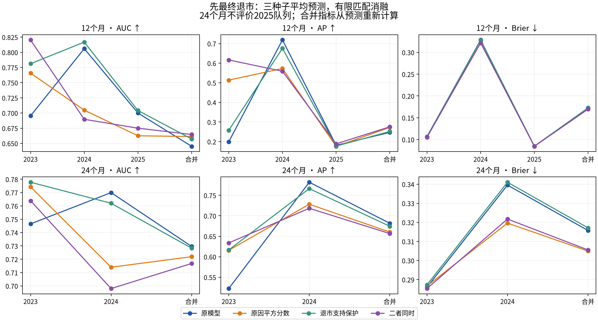

# 原因分裂准则与退市支持保护：真实匹配消融

结论：保持当前83变量、q2、深度4＋父节点AJ收缩模型。新分裂准则确实使森林更重视退市信号，且表示更小，但没有得到跨年度一致的预测收益；退市支持保护消除了单家公司支撑的退市叶，却没有证明稳定提高预测。两者同时加入也未形成可靠的协同收益。此次不自动升级参考模型。

## 执行与口径

完成36/36正式raw森林拟合（其中9次基线重现、27次新设计）、36个收缩派生版本，另2/2四树数值试运行。24个96树完整平均预测器由保存模型合并并验证，新增拟合数为0。三种子42/101/202先逐公司平均，再评分；单种子与raw结果全部保留。原参考9个模型的树结构与预测精确重现。正式作业2613，合并验证2614，两台机器均参与；无正式失败或拟合重试。

各年1月1日前训练，企业数309/345/390，已知退市14/26/49，恢复184/198/211；年度训练集相互嵌套，不能把这些事件相加当独立事件。三年评价36/45/53家公司。原始披露版本仍继承PROVISIONAL限制；旧元数据日期与字段级时钟的核对见DATA_ALIGNMENT_AUDIT_ZH.md。

四组仅改变冻结的分裂分数和退市支持开关。原因平方分数消除有符号抵消，同时改变逐原因方差标准化；本实验不能把其全部效果归因于“消除抵消”。支持保护允许0个退市，但不允许仅1家退市公司支撑的子节点，至少2家时才保留；不是要求两个子节点都有退市，也不是新增样本。

## 12个月：先最终退市

| 队列 | 模型 | AUC | AP | IPCW Brier | 前20%捕获 | 平均预测风险 | 观察发生率 |
| --- | --- | --- | --- | --- | --- | --- | --- |
| 2023 | 原模型 | 0.6953 | 0.1990 | 0.1065 | 1/4 | 0.0191 | 0.1111 |
| 2023 | 原因平方分数 | 0.7656 | 0.5135 | 0.1052 | 2/4 | 0.0175 | 0.1111 |
| 2023 | 退市支持保护 | 0.7812 | 0.2577 | 0.1062 | 1/4 | 0.0190 | 0.1111 |
| 2023 | 二者同时 | 0.8203 | 0.6165 | 0.1050 | 2/4 | 0.0189 | 0.1111 |
| 2024 | 原模型 | 0.8060 | 0.7184 | 0.3285 | 6/16 | 0.0324 | 0.3556 |
| 2024 | 原因平方分数 | 0.7047 | 0.5730 | 0.3218 | 6/16 | 0.0384 | 0.3556 |
| 2024 | 退市支持保护 | 0.8168 | 0.6759 | 0.3278 | 7/16 | 0.0329 | 0.3556 |
| 2024 | 二者同时 | 0.6897 | 0.5589 | 0.3218 | 5/16 | 0.0387 | 0.3556 |
| 2025 | 原模型 | 0.7000 | 0.1813 | 0.0847 | 2/5 | 0.0585 | 0.0943 |
| 2025 | 原因平方分数 | 0.6625 | 0.1759 | 0.0848 | 2/5 | 0.0581 | 0.0943 |
| 2025 | 退市支持保护 | 0.7042 | 0.1771 | 0.0847 | 2/5 | 0.0584 | 0.0943 |
| 2025 | 二者同时 | 0.6750 | 0.1887 | 0.0844 | 2/5 | 0.0583 | 0.0943 |
| pooled | 原模型 | 0.6451 | 0.2469 | 0.1724 | 9/25 | 0.0392 | 0.1866 |
| pooled | 原因平方分数 | 0.6613 | 0.2725 | 0.1699 | 10/25 | 0.0406 | 0.1866 |
| pooled | 退市支持保护 | 0.6572 | 0.2517 | 0.1721 | 10/25 | 0.0392 | 0.1866 |
| pooled | 二者同时 | 0.6646 | 0.2755 | 0.1697 | 9/25 | 0.0412 | 0.1866 |

## 24个月：先最终退市

| 队列 | 模型 | AUC | AP | IPCW Brier | 前20%捕获 | 平均预测风险 | 观察发生率 |
| --- | --- | --- | --- | --- | --- | --- | --- |
| 2023 | 原模型 | 0.7465 | 0.5223 | 0.2860 | 4/12 | 0.0647 | 0.3333 |
| 2023 | 原因平方分数 | 0.7743 | 0.6156 | 0.2866 | 4/12 | 0.0588 | 0.3333 |
| 2023 | 退市支持保护 | 0.7778 | 0.6165 | 0.2872 | 5/12 | 0.0614 | 0.3333 |
| 2023 | 二者同时 | 0.7639 | 0.6337 | 0.2853 | 4/12 | 0.0604 | 0.3333 |
| 2024 | 原模型 | 0.7700 | 0.7820 | 0.3396 | 8/20 | 0.1158 | 0.4444 |
| 2024 | 原因平方分数 | 0.7140 | 0.7283 | 0.3196 | 8/20 | 0.1291 | 0.4444 |
| 2024 | 退市支持保护 | 0.7620 | 0.7665 | 0.3411 | 7/20 | 0.1139 | 0.4444 |
| 2024 | 二者同时 | 0.6980 | 0.7184 | 0.3217 | 8/20 | 0.1287 | 0.4444 |
| 2025 | 原模型 | NA | NA | NA | NA | 0.1400 | NA |
| 2025 | 原因平方分数 | NA | NA | NA | NA | 0.1457 | NA |
| 2025 | 退市支持保护 | NA | NA | NA | NA | 0.1382 | NA |
| 2025 | 二者同时 | NA | NA | NA | NA | 0.1466 | NA |
| pooled | 原模型 | 0.7296 | 0.6817 | 0.3157 | 12/32 | 0.0931 | 0.3951 |
| pooled | 原因平方分数 | 0.7219 | 0.6602 | 0.3050 | 12/32 | 0.0979 | 0.3951 |
| pooled | 退市支持保护 | 0.7283 | 0.6744 | 0.3171 | 12/32 | 0.0906 | 0.3951 |
| pooled | 二者同时 | 0.7168 | 0.6565 | 0.3055 | 12/32 | 0.0984 | 0.3951 |

2025年24月的6例早期退市不能代替完整24月标签：尚25家未知、无人达到24月随访，因此所有该窗口性能NA。12月pooled为三年134家公司、25例退市；24月pooled仅2023/2024共81家公司、32例退市。合并AUC/AP/Brier从合并预测重算。Top20各年名额为8、9、11，pooled先按年确定名额再合计，不进行跨年统一截断。

## 12个月：先恢复

| 队列 | 模型 | AUC | AP | IPCW Brier | 前20%捕获 | 平均预测风险 | 观察发生率 |
| --- | --- | --- | --- | --- | --- | --- | --- |
| 2023 | 原模型 | NA | NA | 0.0592 | 0/0 | 0.2366 | 0.0000 |
| 2023 | 原因平方分数 | NA | NA | 0.0588 | 0/0 | 0.2363 | 0.0000 |
| 2023 | 退市支持保护 | NA | NA | 0.0653 | 0/0 | 0.2494 | 0.0000 |
| 2023 | 二者同时 | NA | NA | 0.0617 | 0/0 | 0.2424 | 0.0000 |
| 2024 | 原模型 | 0.5500 | 0.1452 | 0.1051 | 1/5 | 0.1787 | 0.1111 |
| 2024 | 原因平方分数 | 0.5500 | 0.1422 | 0.1054 | 1/5 | 0.1818 | 0.1111 |
| 2024 | 退市支持保护 | 0.5450 | 0.1402 | 0.1058 | 1/5 | 0.1825 | 0.1111 |
| 2024 | 二者同时 | 0.5200 | 0.1317 | 0.1062 | 1/5 | 0.1838 | 0.1111 |
| 2025 | 原模型 | 0.7733 | 0.2607 | 0.0678 | 1/3 | 0.1873 | 0.0566 |
| 2025 | 原因平方分数 | 0.7200 | 0.1599 | 0.0733 | 2/3 | 0.1978 | 0.0566 |
| 2025 | 退市支持保护 | 0.7400 | 0.4143 | 0.0686 | 1/3 | 0.1879 | 0.0566 |
| 2025 | 二者同时 | 0.7400 | 0.1970 | 0.0720 | 2/3 | 0.1962 | 0.0566 |
| pooled | 原模型 | 0.5407 | 0.0748 | 0.0780 | 2/8 | 0.1977 | 0.0597 |
| pooled | 原因平方分数 | 0.5179 | 0.0686 | 0.0801 | 3/8 | 0.2028 | 0.0597 |
| pooled | 退市支持保护 | 0.5139 | 0.0702 | 0.0802 | 2/8 | 0.2026 | 0.0597 |
| pooled | 二者同时 | 0.5030 | 0.0670 | 0.0807 | 3/8 | 0.2044 | 0.0597 |

## 24个月：先恢复

| 队列 | 模型 | AUC | AP | IPCW Brier | 前20%捕获 | 平均预测风险 | 观察发生率 |
| --- | --- | --- | --- | --- | --- | --- | --- |
| 2023 | 原模型 | 0.6952 | 0.7541 | 0.2529 | 7/15 | 0.5984 | 0.4167 |
| 2023 | 原因平方分数 | 0.7111 | 0.7451 | 0.2522 | 7/15 | 0.6032 | 0.4167 |
| 2023 | 退市支持保护 | 0.7016 | 0.7628 | 0.2608 | 7/15 | 0.6189 | 0.4167 |
| 2023 | 二者同时 | 0.7143 | 0.7551 | 0.2522 | 7/15 | 0.6087 | 0.4167 |
| 2024 | 原模型 | 0.7069 | 0.5657 | 0.2343 | 5/16 | 0.5164 | 0.3556 |
| 2024 | 原因平方分数 | 0.6530 | 0.5026 | 0.2373 | 4/16 | 0.5122 | 0.3556 |
| 2024 | 退市支持保护 | 0.6853 | 0.5499 | 0.2344 | 5/16 | 0.5177 | 0.3556 |
| 2024 | 二者同时 | 0.6552 | 0.5163 | 0.2390 | 5/16 | 0.5138 | 0.3556 |
| 2025 | 原模型 | NA | NA | NA | NA | 0.5629 | NA |
| 2025 | 原因平方分数 | NA | NA | NA | NA | 0.5687 | NA |
| 2025 | 退市支持保护 | NA | NA | NA | NA | 0.5624 | NA |
| 2025 | 二者同时 | NA | NA | NA | NA | 0.5672 | NA |
| pooled | 原模型 | 0.6735 | 0.6277 | 0.2426 | 12/31 | 0.5529 | 0.3827 |
| pooled | 原因平方分数 | 0.6690 | 0.6055 | 0.2439 | 11/31 | 0.5526 | 0.3827 |
| pooled | 退市支持保护 | 0.6710 | 0.6391 | 0.2461 | 12/31 | 0.5627 | 0.3827 |
| pooled | 二者同时 | 0.6697 | 0.6268 | 0.2449 | 12/31 | 0.5560 | 0.3827 |

2023年12月无恢复事件，AUC/AP不可估计；Brier、均值仍可评价。其他支持窗口结局均已知，竞争事件作为非该原因结局，IPCW权重实际均为1，Brier与普通二元平方误差一致。没有把未知结局当成正常。METRICS_ALL.csv保存512行年度/合并、种子/均值、raw/收缩、两原因双时点结果。

## 如何理解差异

1. 原因平方分数在2023年12月将退市AP从0.199提高到0.514，Top20从1/4到2/4；但仅4个事件，不能据此宣布成功。2024年12月AUC从0.806降到0.705、AP从0.718降到0.573；24月AUC0.770→0.714、AP0.782→0.728，Top20保持8/20。2025年12月也未改善AUC/AP。
2. 2024年24月Brier0.3396→0.3196，说明概率误差有所减小，与排序变差可以同时发生。平均退市风险仅11.58%→12.91%，仍远低于观察44.44%。新准则没有解决严重的整体风险低估。2023年24月均值还下降6.47%→5.88%。
3. 单独支持保护在2024年12月AUC0.806→0.817、Top20从6/16到7/16，但AP下降0.718→0.676；同年24月Top20从8/20降为7/20。2025年12月变化很小，不能称为稳健收益。
4. 恢复预测没有得到一致保护。原因平方分数令2024年24月恢复AUC0.707→0.653、AP0.566→0.503；两种改动的12月pooled恢复Brier均比原模型更差。退市和恢复的取舍必须一起报告。
5. 两开关的差分之差已经完整计算，没有稳定协同改善。raw版本和收缩版本另见PAIRED_DIFFERENCES.csv，不能只展示最有利种子或年度。

raw次分析同样不支持把问题完全归因于收缩：24月合并原模型raw AUC/AP为0.724/0.680，新分数为0.717/0.663；收缩后为0.730/0.682与0.722/0.660。新准则的24月合并排序损失在收缩前已经存在。收缩对各设计的AP、捕获和Brier作用也不同；没有因此追加新强度搜索。

## 不确定性与研究判断

固定模型、按年度分层、公司为单位的1000次共同重采样已完成。各臂减原模型的pooled退市AUC/AP/Brier/Top20差值95%区间均包含0。2024年原因平方分数的24月Brier差值约−0.0199，描述性区间[−0.0420,−0.0002]；同时两开关组合的12月AP差值约−0.1595，区间[−0.2775,−0.0209]。必须同时报告不利证据，不能在多指标、多对照中挑选某个区间作为确认性成功。完整结果及无事件重采样次数见PAIRED_BOOTSTRAP_95.csv。

这些区间不包含训练样本、筛选和历次调参的不确定性。2023—2025已被查看，本轮是探索性机制分析，不是独立盲测。没有未来标签参与本次配置选择。没有证据支持替换当前参考，也没有证据说明“类别不均衡已经解决”。

数值性质全部保留：q≤2，所有训练及评价样本、全部原生时间点、两个原因的完整展开最大显式重构误差2.887e-15，保存重载误差0，无裁剪、无代理解释。结构更小不自动等于预测更可靠；详见INTERPRETABILITY_COMPARISON_ZH.md。

