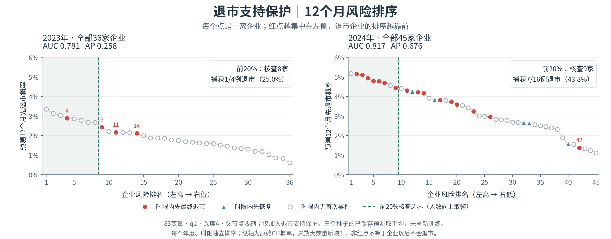
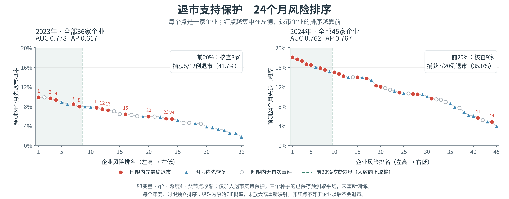

# 退市支持保护：2023/2024风险排序

本目录包含研究者于2026-11-02明确要求同步的逐企业排序与完整预测图。本模型是support单独开关：旧有符号分裂准则不变，仅增加独立退市公司支持保护，保留83变量、q2、深度4、共享切点、均衡覆盖25变量及直接父节点AJ收缩10。不是quadratic_support组合臂。

没有重新训练。三个种子42/101/202的保存CIF先取平均，再按各企业12/24个日历月提取退市概率；每年每个时限独立从高到低排序，相同预测以原sample_id字典序打破平局。保留原始概率，没有线性或非线性放大。

## 全部企业排序图





红点为时限内先最终退市，蓝三角为先恢复，空心点为时限内无首次事件；空心点不是“以后永不退市”。绿色区域为前20%核查范围，人数向上取整。每个点代表一家企业，图中不显示公司标识，CSV保留原始sample_id。

| 队列 | 时限 | 企业数 | AUC | AP | 前20%核查数 | 捕获/全部退市 | 覆盖率 |
| --- | --- | --- | --- | --- | --- | --- | --- |
| 2023 | 12月 | 36 | 0.7813 | 0.2577 | 8 | 1/4 | 25.0% |
| 2023 | 24月 | 36 | 0.7778 | 0.6165 | 8 | 5/12 | 41.7% |
| 2024 | 12月 | 45 | 0.8168 | 0.6759 | 9 | 7/16 | 43.8% |
| 2024 | 24月 | 45 | 0.7620 | 0.7665 | 9 | 7/20 | 35.0% |

2023年12月四例退市排名4、9、11、14，整体靠前但前8家只捕获1例。2024年12月前9家有7家退市，即核查命中率77.8%，与覆盖全部退市的43.8%不同。

## 文件与字段

- [ranked_companies.csv](ranked_companies.csv)：162条公司—时限记录，来自81家独立企业；同一公司分别有12月和24月两行，不能当作162家企业。
- [rank_summary.csv](rank_summary.csv)：上述4组的精确指标、预测均值、最大值和捕获情况。
- [完整双页PDF](support_risk_rankings_2023_2024.pdf)：适合组会和打印；每个时限也分别提供PNG/PDF。
- [event_ranks.json](event_ranks.json)：实际退市在各排序中的位置及汇总。
- [publication_receipt.json](publication_receipt.json)：本次公开授权、原始文件至发布文件的映射与SHA256。
- [original_plot_receipt.json](original_plot_receipt.json)：原制图回执。其private描述反映最初生成状态，由本次明确授权扩展公布范围；不是后来偷偷改变原记录。

| CSV字段 | 含义 |
| --- | --- |
| year / months | 外层评价入组年／预测时限（12或24个日历月） |
| rank | 对应年度、时限内的降序风险名次，从1开始 |
| sample_id | 冻结数据的原样本标识，包含企业代码、预测原点和preopen标记 |
| risk | 预测先最终退市CIF，原始0—1概率；不是标准化排名分数 |
| termination | 该时限内先最终退市是否已观察到 |
| recovery | 该时限内先恢复是否已观察到 |
| known | 该时限结局是否已知；本次四组均为True |
| top20 | 是否位于按年、时限独立确定的前20%核查范围 |

## 只读重画入口

在完整仓库根目录执行，output必须是全新目录。脚本校验输入哈希、样本对齐、AUC/AP/Brier及Top20与已发表汇总一致；不调用fit。

```bash
python -m experiments.post_st_cause_support_v1.rankings.plot_saved_rankings \
  --run /home/oliver/MainDiskData/xai_rsf_leaf_shallow_20261028_ep_9hazj/cause_support_20261102_run1 \
  --output /path/to/new_private_plot_directory
```

原始输入及模型工件仍依赖服务器权限。已公布的CSV、PNG和PDF可以直接阅读，不需要训练环境。既有PIT版本限制及探索性评价说明继续适用。
