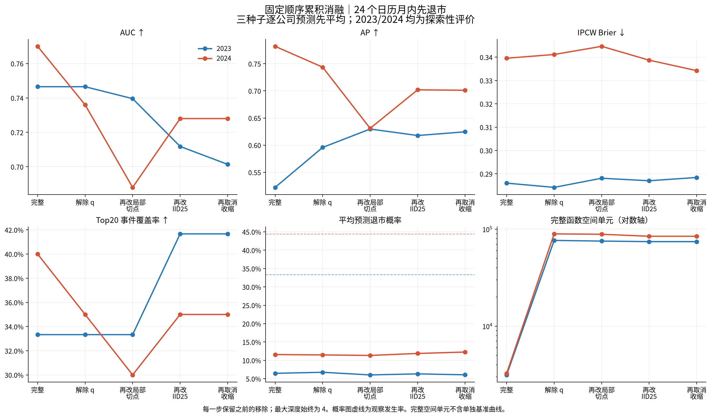

# 累积消融：完整模型保住紧凑表示，预测贡献并非步步同向

已按用户指定顺序完成：s0完整q2/共享/均衡/收缩 → s1解除q限制 → s2再改局部随机切点 → s3再改IID25 → s4再取消收缩。新增12次正式森林拟合、12个收缩派生版本；前两阶段复用12份历史模型；最后一步直接使用s3的raw森林，没有额外拟合。全部12次拟合和40项完整验证通过，失败0。当前研究参考和历史结果不变。

所有阶段均为深度4、每树25个候选变量、每种子32树、三个固定种子。下表先平均三个种子的逐公司预测，再计算24个日历月内先退市的指标。2023测试36家/12例，2024测试45家/20例；合并81家/32例。两年已被多次查看，本轮为**探索性机制分析**，继承原始财报版本/PIT的PROVISIONAL限制。

| scope | arm | auc | ap | brier | risk_mean | ipcw_observed_incidence | top20_captured | top20_coverage |
|---|---|---|---|---|---|---|---|---|
| 2023 | s0 完整模型 | 0.746528 | 0.522272 | 0.285989 | 0.064681 | 0.333333 | 4 | 0.333333 |
| 2023 | s1 再解除q限制 | 0.746528 | 0.595833 | 0.284164 | 0.067527 | 0.333333 | 4 | 0.333333 |
| 2023 | s2 再改局部随机切点 | 0.739583 | 0.629733 | 0.288086 | 0.060341 | 0.333333 | 4 | 0.333333 |
| 2023 | s3 再改IID25覆盖 | 0.711806 | 0.617786 | 0.287012 | 0.063196 | 0.333333 | 5 | 0.416667 |
| 2023 | s4 再取消收缩 | 0.701389 | 0.624602 | 0.288413 | 0.060679 | 0.333333 | 5 | 0.416667 |
| 2024 | s0 完整模型 | 0.770000 | 0.782032 | 0.339557 | 0.115813 | 0.444444 | 8 | 0.400000 |
| 2024 | s1 再解除q限制 | 0.736000 | 0.743676 | 0.341161 | 0.114811 | 0.444444 | 7 | 0.350000 |
| 2024 | s2 再改局部随机切点 | 0.688000 | 0.630994 | 0.344659 | 0.113412 | 0.444444 | 6 | 0.300000 |
| 2024 | s3 再改IID25覆盖 | 0.728000 | 0.701951 | 0.338725 | 0.118788 | 0.444444 | 7 | 0.350000 |
| 2024 | s4 再取消收缩 | 0.728000 | 0.701088 | 0.334237 | 0.122663 | 0.444444 | 7 | 0.350000 |
| pooled | s0 完整模型 | 0.729592 | 0.681719 | 0.315749 | 0.093088 | 0.395062 | 12 | 0.375000 |
| pooled | s1 再解除q限制 | 0.722577 | 0.662682 | 0.315829 | 0.093796 | 0.395062 | 11 | 0.343750 |
| pooled | s2 再改局部随机切点 | 0.704719 | 0.593102 | 0.319515 | 0.089825 | 0.395062 | 10 | 0.312500 |
| pooled | s3 再改IID25覆盖 | 0.704082 | 0.632320 | 0.315741 | 0.094080 | 0.395062 | 12 | 0.375000 |
| pooled | s4 再取消收缩 | 0.699617 | 0.629898 | 0.313871 | 0.095115 | 0.395062 | 12 | 0.375000 |

Top20每年向上取整，分别核查8家、9家；pooled合计17家，不重新按81家确定名额。合并AUC/AP/Brier按合并预测重算，未平均年度指标。

1. **解除q限制：表示代价清楚，预测效果分年度。** 2023 AUC不变、AP提高0.073562；2024 AUC/AP下降0.034000/0.038357，少捕获1例。合并AUC/AP下降0.007015/0.019037。函数空间从3,146/3,263升到76,668/89,517格。q2相对这一步减少95.90%/96.35%的逻辑空间单元，但不能据此宣称每年都没有预测代价。
2. **再改局部随机切点：本条链上24个月排序进一步变差。** 合并AP下降0.069580，Brier上升0.003686，Top20少1例；2023 AP却提高0.033899。总格数反而小降1.59%/0.90%，因为树结构及函数集合也随之改变。此前单项q2对照中共享方案减少格数，此处无q限制背景下没有同向总量证据。不能把共享切点的复杂度收益说成普遍定理；该对照也同时改变候选生成规则。
3. **再改IID25：出现对均衡覆盖有利性主张的反向证据。** 2024 AUC/AP从0.688/0.630994回升至0.728/0.701951；合并AP提高0.039218、Brier下降0.003774、Top20从10/32回到12/32。2023 AUC/AP下降，合并AUC几乎不变。均衡覆盖确实均衡了资格次数，但这里未表现为一致的预测收益。
4. **再取消收缩：排序变化小，概率质量和稳定性有权衡。** 2024 AUC不变、AP略降0.000863、Brier改善0.004488；2023 AUC下降0.010417、AP提高0.006817、Brier变差0.001401。合并Top20仍12/32，Brier改善0.001870。取消收缩不改变空间格数，但平均跨种子预测标准差从0.013675升到0.017115。收缩的稳定作用得到这个对照支持，不能同时宣称其Brier必然更优。

完整模型与全部移除版本相比：合并AUC为0.729592对0.699617、AP为0.681719对0.629898，Top20均12/32；Brier为0.315749对0.313871，后者略好。当前框架不是所有指标的全面胜者，保留它的证据主要是明显更小的完整函数表示，以及本轮24个月合并排序点估计的优势。

相邻步骤的合并配对差值及描述性95%区间：正差对AUC/AP/捕获数有利，对Brier不利。

| contrast | metric | estimate | lower95 | upper95 |
|---|---|---|---|---|
| s1_minus_s0 | auc | -0.007015 | -0.035990 | 0.020645 |
| s1_minus_s0 | ap | -0.019037 | -0.064612 | 0.019980 |
| s1_minus_s0 | brier | 0.000080 | -0.002265 | 0.002358 |
| s1_minus_s0 | top20_captured | -1.000000 | -3.000000 | 3.000000 |
| s2_minus_s1 | auc | -0.017857 | -0.053051 | 0.017677 |
| s2_minus_s1 | ap | -0.069580 | -0.126084 | -0.004177 |
| s2_minus_s1 | brier | 0.003686 | 0.000635 | 0.006699 |
| s2_minus_s1 | top20_captured | -1.000000 | -5.000000 | 1.000000 |
| s3_minus_s2 | auc | -0.000638 | -0.037892 | 0.033684 |
| s3_minus_s2 | ap | 0.039218 | -0.012328 | 0.095900 |
| s3_minus_s2 | brier | -0.003774 | -0.006620 | -0.001032 |
| s3_minus_s2 | top20_captured | 2.000000 | -1.000000 | 5.000000 |
| s4_minus_s3 | auc | -0.004464 | -0.024521 | 0.013291 |
| s4_minus_s3 | ap | -0.002423 | -0.024417 | 0.017835 |
| s4_minus_s3 | brier | -0.001870 | -0.003895 | 0.000031 |
| s4_minus_s3 | top20_captured | 0.000000 | -1.000000 | 2.000000 |

完整模型与全部移除版本的合并AUC/AP/Brier/Top20区间均包含0；部分中间步骤的AP或Brier区间不含0，也不能选择性升级为确认性结论。1000次公司配对、按年度分层重采样只反映固定预测条件下测试样本波动，不含重新训练、方法选择、多次研究接触的不确定性，未做多重比较校正。

**研究结论：q2的表示压缩价值有直接证据；四项设计各自普遍提升预测的主张不成立。** 新证据支持保留当前参考进行设计取舍说明，不足以宣称算法普遍优越，也不自动选择新参考。所有增量都是此固定删除顺序下的条件差异，不是顺序无关的独立贡献。

全部240行年度/种子/合并指标、384行配对差值、192行区间及完整数值诊断保存在results/；12个月和恢复原因的反向结果见PREDICTION_COMPARISON_ZH.md。
