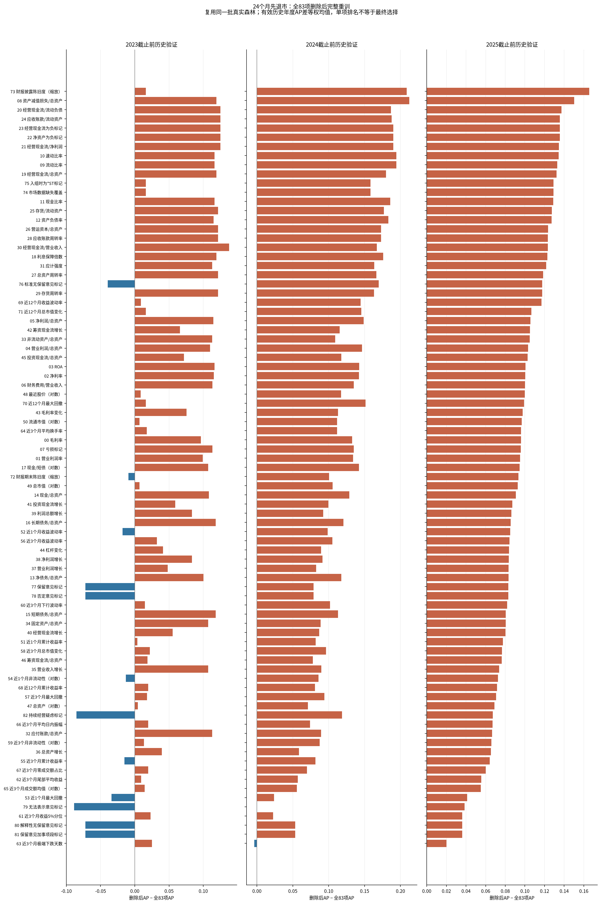
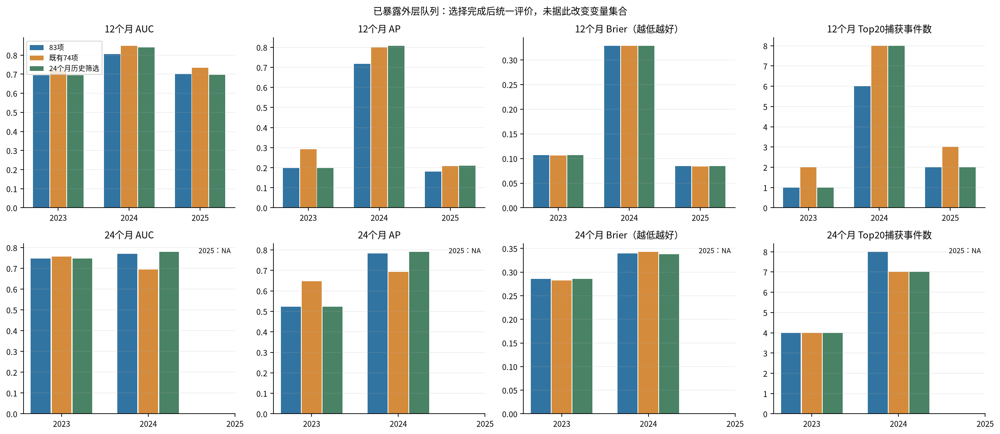
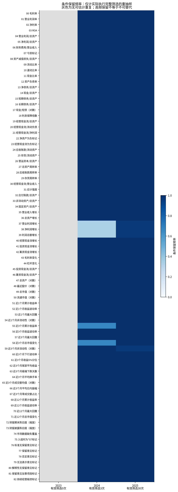
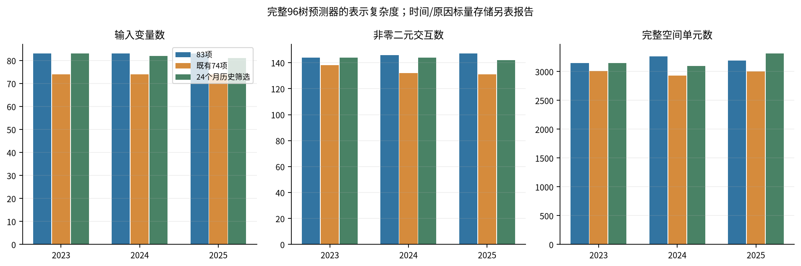

# 24个月主要目标：追加自动Drop-column实验

本轮由研究者在12个月支持门槛说明后明确追加。保留原协议、原83列模型和既有74列模型，单独冻结24个月主要选择目标。它不是把原先失败的12个月门槛事后改小，也没有改变森林的24个月训练随访上限。

本轮研究判断：24个月时限使2024/2025截止点可以开展历史筛选，但结果尚不支持稳定的自动删变量收益。2024部分年度指标改善，合并24个月AP几乎不变、Top20少捕获一例；2025输入减少而完整函数格数增加。主样本的删除决定在公司重抽样中很少重复。不替换当前83列参考模型。

## 实际完成

复用前轮全83项单删和相关组真实模型，追加36546次森林拟合，218个最终完成任务，拟合失败0。每个森林32树，42/101/202三种子平均形成完整96树预测器。新候选均完整重训；没有删除已经学好的非零函数充当重训。

另有9项首次文件回传失败，均为大量小文件经过NFS复制时超过工具固定600秒上限；已完成9项仅回传恢复，没有为此重新拟合任何森林。原Slurm失败报告保留。恢复在原lemon节点使用原publication.json，仍由原工具执行发布锁、源与目标SHA256核对、身份检查及不覆盖改名；仅把复制传输改成oliver直接拉取原计算文件，并允许3600秒。恢复记录见publication_recovery_summary.json，不能将最初发布失败改写成首次运行全成功。

其中2024最终3个森林额外复现了已保存的同配置候选；12/24个月预测最大差异0.000e+00。这部分已计入实际计算成本，未充当额外种子或独立证据。未达支持条件时直接引用上一轮相同公司抽样下的83列回退模型，未把复用记作新增拟合。

资源核验发现，本次oliver作业内管理进程的实际允许集合包含32个逻辑CPU，与此前“仅24个物理工作槽”的环境说明不同；没有据此宣称48个线程都在训练，也未修改Slurm或cgroup。部分任务完成后，仅在本作业内把已有任务动态迁到空闲物理P核，减少SMT争用与E核尾部等待，不增加任务、不重启拟合、不改数学计算。初始调度记录与后续核绑定分别保留在任务回执和affinity_adjustments.jsonl；耗时属于这些实际硬件调度条件，不能当成严格的算法速度对照。

lemon另按剩余初始候选数量进行了一次长短任务核位交换，让较长任务使用已有的独占核心；交换前后活跃CPU核位集合不变，没有新增SMT槽位。它是本次实测工作量下的调度调整，不宣称为通用最快方案。

| cutoff | selected_features | removed | historical24_events | support_passed |
| --- | --- | --- | --- | --- |
| 2023 | 83 | 未删除 | 6 | False |
| 2024 | 82 | 财报披露陈旧度（缩放） | 13 | True |
| 2025 | 81 | 营业利润增长、利润总额增长 | 22 | True |

2023的历史有效24个月验证只有2020一队列、6例退市，按冻结条件保留83列。2024、2025分别有13、22例，允许进入筛选，但这只是执行条件，不代表统计功效充分。所有选择使用各自年初前的历史前向预测。2023–2025已暴露的外层结果仅在选择决定固定后描述性评价。

还需区分历史验证事件与历史模型的训练事件：上述24个月比较使用的2020、2021、2022模型，在各自拟合时分别只有2、3、6例已知退市。延长验证时限可以观察到更多后续退市，却不能让历史模型在当时获得尚未发生的训练事件。因此，即便累计验证事件达到13或22，选择证据仍受稀少训练事件和较早历史环境限制。

## 内部选择证据

24个月主要目标为有效验证年度AP等权均值、各年度Top20捕获合计；置信下界、12个月表现、两原因Brier、种子方向、交互集合稳定性与空间格数共同保护。12个月守门指标仅使用可计算的历史队列，不要求其通过另一个事件数门槛；因此这些保护仍有小样本局限。

筛选中的Jaccard保护使用结构交互集合；非零贡献数量、具体原因/时点的函数幅度与形状稳定性另行报告。结构集合相同不等于作用幅度相同，也不自动证明解释可靠。

初始全83项和相关组候选均保留。最多12个删除单元进入递归池；每次删除后对剩余候选重新拟合。随后执行冻结的恢复/替换核查。完整接受、拒绝和停止记录见RECURSIVE_ELIMINATION_PATH.csv与SELECTION_CONTRASTS.csv。初始单项排名不直接作为连续删除顺序。

主样本在接受第一步后，两年各重新比较11个剩余删除候选，均未通过全部保护条件；恢复/替换候选也未通过。因此实际停在82/81列，并未继续追求65、55或更小规模。GUARD_REJECTION_SUMMARY.csv逐项列出停止原因；一个候选可以同时违反多条约束，不能把各行次数相加当成独立失败任务。

公开候选表分别列出指标约束通过与审计编码约束通过；两者均通过也不代表最终入选，还受有限候选池和递归顺序约束。审计7列在自动删除中作为完整块处理，单独删除其某一列只作诊断。最终变量集合以SELECTED_FEATURES.csv为准。

| outer | model | features | horizon | cohorts | auc | ap | brier | captured | spatial_cells |
| --- | --- | --- | --- | --- | --- | --- | --- | --- | --- |
| 2023 | full83 | 83 | 12 | 2020 | 0.647059 | 0.101852 | 0.054833 | 1.000000 | 3189.000000 |
| 2023 | full83 | 83 | 24 | 2020 | 0.819444 | 0.297711 | 0.105969 | 3.000000 | 3189.000000 |
| 2023 | selected_h24 | 83 | 12 | 2020 | 0.647059 | 0.101852 | 0.054833 | 1.000000 | 3189.000000 |
| 2023 | selected_h24 | 83 | 24 | 2020 | 0.819444 | 0.297711 | 0.105969 | 3.000000 | 3189.000000 |
| 2024 | full83 | 83 | 12 | 2020 | 0.647059 | 0.101852 | 0.054833 | 1.000000 | 3080.500000 |
| 2024 | full83 | 83 | 24 | 2020,2021 | 0.793181 | 0.300903 | 0.127029 | 6.000000 | 3080.500000 |
| 2024 | selected_h24 | 82 | 12 | 2020 | 0.771242 | 0.142949 | 0.054518 | 1.000000 | 3033.000000 |
| 2024 | selected_h24 | 82 | 24 | 2020,2021 | 0.861868 | 0.509706 | 0.126574 | 8.000000 | 3033.000000 |
| 2025 | full83 | 83 | 12 | 2020,2023 | 0.671186 | 0.150407 | 0.080682 | 2.000000 | 3040.000000 |
| 2025 | full83 | 83 | 24 | 2020,2021,2022 | 0.804150 | 0.439309 | 0.169680 | 10.000000 | 3040.000000 |
| 2025 | selected_h24 | 81 | 12 | 2020,2023 | 0.666156 | 0.163773 | 0.080729 | 2.000000 | 3008.666667 |
| 2025 | selected_h24 | 81 | 24 | 2020,2021,2022 | 0.849936 | 0.583358 | 0.169172 | 13.000000 | 3008.666667 |

这部分是模型选择用过的内部结果，不能当成独立性能提升。相同种子配对了公司bootstrap，但删列会改变均衡覆盖及分裂搜索；增量属于整个固定训练流程，不等于变量的因果贡献。

全83项单删的24个月年内AP均值方向如下。若多数甚至全部单删都上升，不能据此宣布多数甚至全部变量无用。

| outer_cutoff | variables | positive_mean_AP | negative_mean_AP |
| --- | --- | --- | --- |
| 2023 | 83 | 71 | 12 |
| 2024 | 83 | 81 | 2 |
| 2025 | 83 | 83 | 0 |

针对已有配置补做了不重训的候选调度核查：83种单删、3种子、32棵配对树中，每树25个可用变量平均只有16.174个与83列模型相同。删除1列会带来平均8.826个候选位置的变化。该诊断解释了比较中还包含候选调度变化，不能证明所有预测变化都由调度造成。详见FEATURE_SCHEDULE_DIAGNOSTIC.csv；它不参与筛选，也未改变冻结算法。

## 外层描述性比较

| year | label | features | horizon | auc | ap | brier | risk_mean | observed | checked | captured | target_events | supported |
| --- | --- | --- | --- | --- | --- | --- | --- | --- | --- | --- | --- | --- |
| 2023 | full83 | 83.000000 | 12 | 0.695312 | 0.198962 | 0.106531 | 0.019082 | 0.111111 | 8 | 1.000000 | 4 | True |
| 2023 | full83 | 83.000000 | 24 | 0.746528 | 0.522272 | 0.285989 | 0.064681 | 0.333333 | 8 | 4.000000 | 12 | True |
| 2023 | legacy74 | 74.000000 | 12 | 0.718750 | 0.290923 | 0.105864 | 0.021031 | 0.111111 | 8 | 2.000000 | 4 | True |
| 2023 | legacy74 | 74.000000 | 24 | 0.756944 | 0.647197 | 0.282277 | 0.070669 | 0.333333 | 8 | 4.000000 | 12 | True |
| 2024 | full83 | 83.000000 | 12 | 0.806034 | 0.718365 | 0.328452 | 0.032367 | 0.355556 | 9 | 6.000000 | 16 | True |
| 2024 | full83 | 83.000000 | 24 | 0.770000 | 0.782032 | 0.339557 | 0.115813 | 0.444444 | 9 | 8.000000 | 20 | True |
| 2024 | legacy74 | 74.000000 | 12 | 0.849138 | 0.799152 | 0.328816 | 0.032370 | 0.355556 | 9 | 8.000000 | 16 | True |
| 2024 | legacy74 | 74.000000 | 24 | 0.694000 | 0.693633 | 0.343057 | 0.118345 | 0.444444 | 9 | 7.000000 | 20 | True |
| 2025 | full83 | 83.000000 | 12 | 0.700000 | 0.181317 | 0.084689 | 0.058547 | 0.094340 | 11 | 2.000000 | 5 | True |
| 2025 | full83 | 83.000000 | 24 | NA | NA | NA | 0.140044 | NA | 11 | NA | 6 | False |
| 2025 | legacy74 | 74.000000 | 12 | 0.733333 | 0.207953 | 0.083828 | 0.061081 | 0.094340 | 11 | 3.000000 | 5 | True |
| 2025 | legacy74 | 74.000000 | 24 | NA | NA | NA | 0.146751 | NA | 11 | NA | 6 | False |
| pooled | legacy74 | 74.000000 | 12 | 0.641101 | 0.246299 | 0.172020 | 0.040680 | 0.186567 | 28 | 13.000000 | 25 | True |
| pooled | full83 | 83.000000 | 12 | 0.645138 | 0.246877 | 0.172418 | 0.039153 | 0.186567 | 28 | 9.000000 | 25 | True |
| pooled | legacy74 | 74.000000 | 24 | 0.697066 | 0.623033 | 0.316044 | 0.097156 | 0.395062 | 17 | 11.000000 | 32 | True |
| pooled | full83 | 83.000000 | 24 | 0.729592 | 0.681719 | 0.315749 | 0.093088 | 0.395062 | 17 | 12.000000 | 32 | True |
| 2023 | selected_h24 | 83.000000 | 12 | 0.695312 | 0.198962 | 0.106531 | 0.019082 | 0.111111 | 8 | 1.000000 | 4 | True |
| 2023 | selected_h24 | 83.000000 | 24 | 0.746528 | 0.522272 | 0.285989 | 0.064681 | 0.333333 | 8 | 4.000000 | 12 | True |
| 2024 | selected_h24 | 82.000000 | 12 | 0.840517 | 0.807859 | 0.328227 | 0.032869 | 0.355556 | 9 | 8.000000 | 16 | True |
| 2024 | selected_h24 | 82.000000 | 24 | 0.780000 | 0.790943 | 0.338223 | 0.119582 | 0.444444 | 9 | 7.000000 | 20 | True |
| 2025 | selected_h24 | 81.000000 | 12 | 0.695833 | 0.209018 | 0.084366 | 0.060289 | 0.094340 | 11 | 2.000000 | 5 | True |
| 2025 | selected_h24 | 81.000000 | 24 | NA | NA | NA | 0.144452 | NA | 11 | NA | 6 | False |
| pooled | selected_h24 | NA | 12 | 0.616514 | 0.236638 | 0.172214 | 0.040010 | 0.186567 | 28 | 11.000000 | 25 | True |
| pooled | selected_h24 | NA | 24 | 0.723214 | 0.681800 | 0.315008 | 0.095182 | 0.395062 | 17 | 11.000000 | 32 | True |

2025年观察截止2026-06-30，24个月随访不支持，结果仍为NA；合并24个月只包括2023/2024。各年度先平均三个种子的公司CIF；合并AUC/AP/Brier重新计算，Top20使用各年度向上取整的名额后合计。未知结局未当作正常。12个月与恢复原因、全部种子见MODEL_COMPARISON.csv。

以下为“24个月筛选模型减83列”的配对差值；AUC/AP正值为有利，Brier负值为有利。500次公司抽样按年度分层、两模型共用索引、预测与IPCW权重固定。这不是完整训练/筛选不确定性，多个区间不作选择性显著宣称。

区间跨零不能解释为性能等效；小样本下仍无法排除有实际意义的改善或损失。年度改善也不能替代合并排序改善，本轮12个月合并AUC/AP反而下降。

| year | cohorts | horizon | cause | metric | difference | lower95 | upper95 | undefined |
| --- | --- | --- | --- | --- | --- | --- | --- | --- |
| 2023 | 2023 | 12 | 1 | auc | 0.000000 | 0.000000 | 0.000000 | 5 |
| 2023 | 2023 | 12 | 1 | ap | 0.000000 | 0.000000 | 0.000000 | 5 |
| 2023 | 2023 | 12 | 1 | brier | 0.000000 | 0.000000 | 0.000000 | 0 |
| 2023 | 2023 | 24 | 1 | auc | 0.000000 | 0.000000 | 0.000000 | 0 |
| 2023 | 2023 | 24 | 1 | ap | 0.000000 | 0.000000 | 0.000000 | 0 |
| 2023 | 2023 | 24 | 1 | brier | 0.000000 | 0.000000 | 0.000000 | 0 |
| 2024 | 2024 | 12 | 1 | auc | 0.034483 | -0.039174 | 0.111750 | 0 |
| 2024 | 2024 | 12 | 1 | ap | 0.089495 | -0.033994 | 0.233300 | 0 |
| 2024 | 2024 | 12 | 1 | brier | -0.000226 | -0.001100 | 0.000768 | 0 |
| 2024 | 2024 | 24 | 1 | auc | 0.010000 | -0.039134 | 0.049510 | 0 |
| 2024 | 2024 | 24 | 1 | ap | 0.008911 | -0.055147 | 0.060382 | 0 |
| 2024 | 2024 | 24 | 1 | brier | -0.001334 | -0.004609 | 0.001344 | 0 |
| 2025 | 2025 | 12 | 1 | auc | -0.004167 | -0.161500 | 0.120000 | 3 |
| 2025 | 2025 | 12 | 1 | ap | 0.027701 | -0.036840 | 0.136496 | 3 |
| 2025 | 2025 | 12 | 1 | brier | -0.000323 | -0.001299 | 0.000462 | 0 |
| pooled | 2023,2024,2025 | 12 | 1 | auc | -0.028624 | -0.066805 | 0.001269 | 0 |
| pooled | 2023,2024,2025 | 12 | 1 | ap | -0.010239 | -0.036173 | 0.018954 | 0 |
| pooled | 2023,2024,2025 | 12 | 1 | brier | -0.000204 | -0.000674 | 0.000254 | 0 |
| pooled | 2023,2024 | 24 | 1 | auc | -0.006378 | -0.033039 | 0.014274 | 0 |
| pooled | 2023,2024 | 24 | 1 | ap | 0.000081 | -0.040590 | 0.033207 | 0 |
| pooled | 2023,2024 | 24 | 1 | brier | -0.000741 | -0.002561 | 0.000747 | 0 |

## 真正重训的选择稳定性

| year | replicates | support_passes | actual_selection_scans | reduced_replicates | min_features | mean_features | new_forests |
| --- | --- | --- | --- | --- | --- | --- | --- |
| 2023 | 50 | 0 | 0 | 0 | 83 | 83.000000 | 0 |
| 2024 | 50 | 10 | 3 | 3 | 80 | 82.840000 | 2115 |
| 2025 | 50 | 46 | 30 | 2 | 80 | 82.920000 | 34227 |

与前轮50次回退模型的稳定性不同，本轮在支持和保护指标可计算时，重新执行了全量初始候选及相同递归算法；每个候选均重新拟合三种子森林。重抽样按历史入组年分层、公司为单位，重复公司的权重保留，门槛按独立公司计数，不把重复抽到的事件当作新增支持。相关组字典与三个森林种子固定，未覆盖重新估计组定义和种子分布的不确定性。

未达24个月支持、或必要12个月保护指标不可计算的重复按规则回退83列。无条件保留率包含这些回退，不能直接解释为变量不可替代；另外报告实际完成筛选条件下的保留频率。主样本删除项的重复表现如下。

| outer | feature_name | actual_selection_scans | unconditional_inclusion | conditional_inclusion_given_scan | conditional_deletion_frequency |
| --- | --- | --- | --- | --- | --- |
| 2024 | fin_publication_age_scaled | 3 | 1.000000 | 1.000000 | 0.000000 |
| 2025 | operating_profit_growth | 30 | 0.980000 | 0.966667 | 0.033333 |
| 2025 | profit_total_growth | 30 | 0.980000 | 0.966667 | 0.033333 |

所有83项频率、主效应/交互幅度与形状稳定性均保留。这里做的是选择稳定性评价，没有再根据外层结果或事后选定的频率阈值修改最终变量集合。固定50次，不额外扩展至100次。

此外，把自动筛选流程和原83列流程在同样50次公司抽样上配对比较。下表`component_spread_l2`为函数间方差之和在共同历史样本上取平均后开平方，缺失函数按零对齐，不除以会变化的函数数量。它衡量函数表示的整体重抽样波动，越低越稳定；`mean_anchor_distance_l2`则与各流程自己的主样本模型比较，两者含义不同。分位数只是50个扰动结果的经验范围，不是均值的95%置信区间。

| year | horizon | cause | order | model | replicates | reference_companies | component_spread_l2 | mean_anchor_distance_l2 | anchor_distance_p025 | anchor_distance_p975 | mean_nonzero_jaccard_to_anchor |
| --- | --- | --- | --- | --- | --- | --- | --- | --- | --- | --- | --- |
| 2023 | 24 | 1 | 1 | full83 | 50 | 309 | 0.008896 | 0.010539 | 0.007650 | 0.014509 | 0.666776 |
| 2023 | 24 | 1 | 1 | selected_h24 | 50 | 309 | 0.008896 | 0.010539 | 0.007650 | 0.014509 | 0.666776 |
| 2023 | 24 | 1 | 2 | full83 | 50 | 309 | 0.004183 | 0.006045 | 0.005141 | 0.007149 | 0.117408 |
| 2023 | 24 | 1 | 2 | selected_h24 | 50 | 309 | 0.004183 | 0.006045 | 0.005141 | 0.007149 | 0.117408 |
| 2024 | 24 | 1 | 1 | full83 | 50 | 345 | 0.011681 | 0.014310 | 0.010887 | 0.019201 | 0.695770 |
| 2024 | 24 | 1 | 1 | selected_h24 | 50 | 345 | 0.011807 | 0.014023 | 0.011077 | 0.018163 | 0.679497 |
| 2024 | 24 | 1 | 2 | full83 | 50 | 345 | 0.005415 | 0.006939 | 0.006065 | 0.008170 | 0.107881 |
| 2024 | 24 | 1 | 2 | selected_h24 | 50 | 345 | 0.005429 | 0.006842 | 0.005952 | 0.008302 | 0.086771 |
| 2025 | 24 | 1 | 1 | full83 | 50 | 390 | 0.014635 | 0.020039 | 0.012846 | 0.027744 | 0.702122 |
| 2025 | 24 | 1 | 1 | selected_h24 | 50 | 390 | 0.014663 | 0.018242 | 0.012683 | 0.025190 | 0.721484 |
| 2025 | 24 | 1 | 2 | full83 | 50 | 390 | 0.006898 | 0.008757 | 0.007932 | 0.010256 | 0.105218 |
| 2025 | 24 | 1 | 2 | selected_h24 | 50 | 390 | 0.006904 | 0.008898 | 0.008034 | 0.010498 | 0.097380 |

| year | horizon | cause | model | replicates | reference_companies | root_mean_prediction_variance | mean_company_prediction_sd | anchor_mean_risk | bootstrap_mean_risk |
| --- | --- | --- | --- | --- | --- | --- | --- | --- | --- |
| 2023 | 24 | 1 | full83 | 50 | 309 | 0.015979 | 0.014560 | 0.054783 | 0.051203 |
| 2023 | 24 | 1 | selected_h24 | 50 | 309 | 0.015979 | 0.014560 | 0.054783 | 0.051203 |
| 2024 | 24 | 1 | full83 | 50 | 345 | 0.019330 | 0.018091 | 0.084883 | 0.086402 |
| 2024 | 24 | 1 | selected_h24 | 50 | 345 | 0.019436 | 0.018189 | 0.085216 | 0.086434 |
| 2025 | 24 | 1 | full83 | 50 | 390 | 0.024014 | 0.022976 | 0.137723 | 0.141837 |
| 2025 | 24 | 1 | selected_h24 | 50 | 390 | 0.024065 | 0.023034 | 0.137019 | 0.141825 |

预测波动同时报告平均风险水平，避免把接近常数、幅度很小造成的低波动称为解释优势。完整逐重复配对值见PAIRED_FUNCTION_STABILITY.csv；2023两流程均回退83，应当一致。函数形状与幅度在相同历史参考记录上比较，不能据此宣称所有未观察到的变量组合都稳定。

这50次配对函数比较评价的是包含保守回退的完整流程。许多重复返回83列时，两流程自然接近；这不等于已证明“真正删列后的函数更稳定”。实际执行筛选、最终确实删列的重复数量须与函数波动一起阅读，不能用大量回退掩盖筛选本身的不确定性。

## 内生解释及数值性质

| year | model | features | main_functions | interaction_functions | spatial_table_cells | scalar_table_cells | distinct_thresholds |
| --- | --- | --- | --- | --- | --- | --- | --- |
| 2023 | full83 | 83 | 62 | 144 | 3146 | 773916 | 266 |
| 2023 | legacy74 | 74 | 60 | 138 | 3010 | 740460 | 246 |
| 2024 | full83 | 83 | 65 | 146 | 3263 | 913640 | 274 |
| 2024 | legacy74 | 74 | 58 | 132 | 2933 | 821240 | 242 |
| 2025 | full83 | 83 | 64 | 147 | 3194 | 1034856 | 261 |
| 2025 | legacy74 | 74 | 54 | 131 | 3001 | 972324 | 232 |
| 2023 | selected_h24 | 83 | 62 | 144 | 3146 | 773916 | 266 |
| 2024 | selected_h24 | 82 | 64 | 144 | 3101 | 868280 | 256 |
| 2025 | selected_h24 | 81 | 64 | 142 | 3312 | 1073088 | 278 |

每个新raw/收缩森林及完整合并预测器都通过q≤2、两原因CIF合法性、保存/重载与完整函数重构核验。全训练/评价样本、所有原生时间点、两原因的最大重构误差为3.997e-15，门槛1e-10。没有clipping或事后代理模型。原模型和输入哈希未变。

完整测试205项通过（含独立R核查）。LOCAL_EXPLANATION_CHANGES.csv比较原83列和最终候选在同样8条历史训练记录上的完整贡献变化与CIF变化；完整个体向量保留私有目录。贡献变化可能相互抵消，所以预测变化小不等于解释变化小。

函数对比使用同一年度原训练集的经验边际乘积参考；删列后仍按原变量ID对齐，缺失项贡献作为零比较。函数出现率指该参考样本上的非零幅度，不等于所有空间格上的结构存在。主效应和二阶贡献是CIF贡献，不能解读成因果影响。精确重构证明表示忠实，不能证明模型学到真实作用或变量不可替代。

复杂度表的非零函数在两原因、全部原生时点检出；幅度与稳定性表按具体原因和时限计算，两种计数口径不混用。即使删除了披露陈旧度这一预测字段，原始可得日仍作为PIT审计元数据保留，不能因此忽略信息时间核验。

被删变量在原83列模型中的24个月贡献如下，数值单位为CIF概率（乘100才是百分点）。某个原因/时点上贡献为零，不意味着该变量在另一个原因、时点或另一个重训模型中也无用；完整两原因/两时点见REMOVED_FEATURE_CONTEXT.csv。

| year | feature_id | feature_name | feature_label | horizon | cause | full83_main_present | full83_pair_count | mean_absolute_main | mean_sum_absolute_pairs | reference_companies |
| --- | --- | --- | --- | --- | --- | --- | --- | --- | --- | --- |
| 2024 | 73 | fin_publication_age_scaled | 财报披露陈旧度（缩放） | 24 | 1 | True | 8 | 0.000364 | 0.002125 | 345 |
| 2025 | 37 | operating_profit_growth | 营业利润增长 | 24 | 1 | True | 1 | 0.000000 | 0.000000 | 390 |
| 2025 | 39 | profit_total_growth | 利润总额增长 | 24 | 1 | True | 3 | 0.000515 | 0.000685 | 390 |

企业、预测、完整模型/函数、原始阈值及个体解释全部保留在私有目录`/home/oliver/MainDiskData/xai_rsf_dropcolumn_h24_20261101_GdmMpMdx`。森林使用无损gzip保存；完整函数文件仍可独立求值。哈希与逐模型数值核验表压缩为CSV.gz公开，未上传模型参数。沿用旧conservative C与原始披露版本PIT的PROVISIONAL限制。

## 研究判断

- 2024、12个月：83项→自动选择，AUC 0.806→0.841，AP 0.718→0.808，Brier 0.328452→0.328227，Top20 6/16→8/16。既有74项的AP为0.799、Brier为0.328816、捕获8/16。
- 2024、24个月：83项→自动选择，AUC 0.770→0.780，AP 0.782→0.791，Brier 0.339557→0.338223，Top20 8/20→7/20。既有74项的AP为0.694、Brier为0.343057、捕获7/20。
- 2025、12个月：83项→自动选择，AUC 0.700→0.696，AP 0.181→0.209，Brier 0.084689→0.084366，Top20 2/5→2/5。既有74项的AP为0.208、Brier为0.083828、捕获3/5。
- pooled、12个月：83项→自动选择，AUC 0.645→0.617，AP 0.247→0.237，Brier 0.172418→0.172214，Top20 9/25→11/25。既有74项的AP为0.246、Brier为0.172020、捕获13/25。
- pooled、24个月：83项→自动选择，AUC 0.730→0.723，AP 0.682→0.682，Brier 0.315749→0.315008，Top20 12/32→11/32。既有74项的AP为0.623、Brier为0.316044、捕获11/32。

以上并非同一个指标上的统一胜出。年度和合并指标必须分别判断；选择用过的历史AP增益不能替代这些外层描述性结果。

2024完整预测器：主效应65→64，二元交互146→144，空间单元3263→3101（-4.96%）。这是重训后完整函数的实际变化，不能由删掉几列直接推算。
同一50次公司抽样下，24个月退市主效应的整体函数波动为0.011681→0.011807（CIF概率单位）。
同一50次公司抽样下，24个月退市二元交互的整体函数波动为0.005415→0.005429（CIF概率单位）。

2025完整预测器：主效应64→64，二元交互147→142，空间单元3194→3312（+3.69%）。这是重训后完整函数的实际变化，不能由删掉几列直接推算。
同一50次公司抽样下，24个月退市主效应的整体函数波动为0.014635→0.014663（CIF概率单位）。
同一50次公司抽样下，24个月退市二元交互的整体函数波动为0.006898→0.006904（CIF概率单位）。

2024主样本删除的fin_publication_age_scaled，在实际执行筛选的3次重复中，删除频率为0.0%。

2025主样本删除的operating_profit_growth，在实际执行筛选的30次重复中，删除频率为3.3%。

2025主样本删除的profit_total_growth，在实际执行筛选的30次重复中，删除频率为3.3%。
2023的50次重复中，仅0次执行完整筛选，0次最终少于83列；支持或必要保护指标不够的回退，不能算作稳定保留证据。
2024的50次重复中，仅3次执行完整筛选，3次最终少于83列；支持或必要保护指标不够的回退，不能算作稳定保留证据。
2025的50次重复中，仅30次执行完整筛选，2次最终少于83列；支持或必要保护指标不够的回退，不能算作稳定保留证据。

2023候选的24个月平均预测退市概率为6.47%，对应观察发生率为33.33%，差-26.87个百分点。变量选择没有消除这两个队列的总体风险低估，排序改善不能等同于概率校准成功。

2024候选的24个月平均预测退市概率为11.96%，对应观察发生率为44.44%，差-32.49个百分点。变量选择没有消除这两个队列的总体风险低估，排序改善不能等同于概率校准成功。

1. 找到了符合预设历史规则的82/81列候选，未找到在12/24个月、年内/合并排序、概率误差及捕获上共同稳健优于83或74列的集合。2025的24个月外层表现仍不可评价。
2. 本轮不能确认某一变量具有稳定、不可替代的增量。单项与相关组重训提供当前训练算法条件下的证据；小样本、相关替代和候选调度变化限制了更强判断。单删AP上升不等于变量没有信息。
3. 三项主样本删除均未获得稳定重复支持：披露陈旧度在3次有效筛选中未再删除；两个增长字段分别只在30次有效筛选中的1次被删除，且该次还删除了净利润增长。不能把这些字段列为已证明安全删除。
4. 完整精确解释保留，但未证明解释更简单、更稳定。2024空间单元减少约5%，2025增加约3.7%；两年的主效应和交互整体重抽样波动均略升。大量回退也使两流程接近，不能以此宣称筛选后的解释可靠性提高。
5. 现有证据不足以推荐默认启用本轮自动Drop-column；可保留为研究诊断工具。它属于训练前特征选择，不是q2森林内部结构约束或精确解释的新数学贡献。
6. 不替换当前模型。升级仍需要独立、未参与选择且随访充分的时间外证据及研究者批准。

