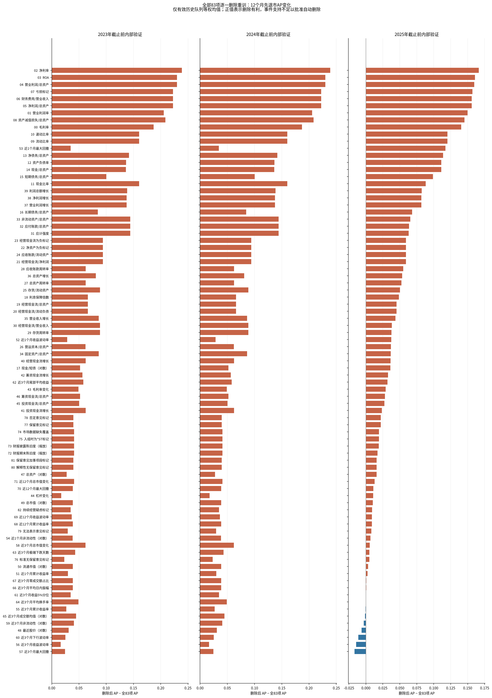
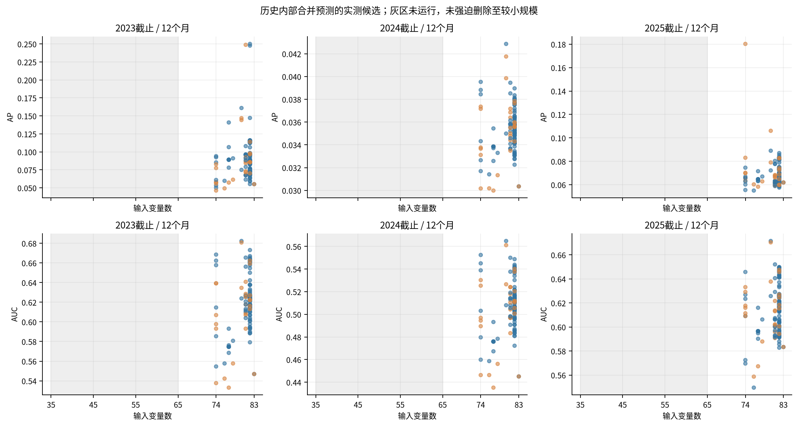
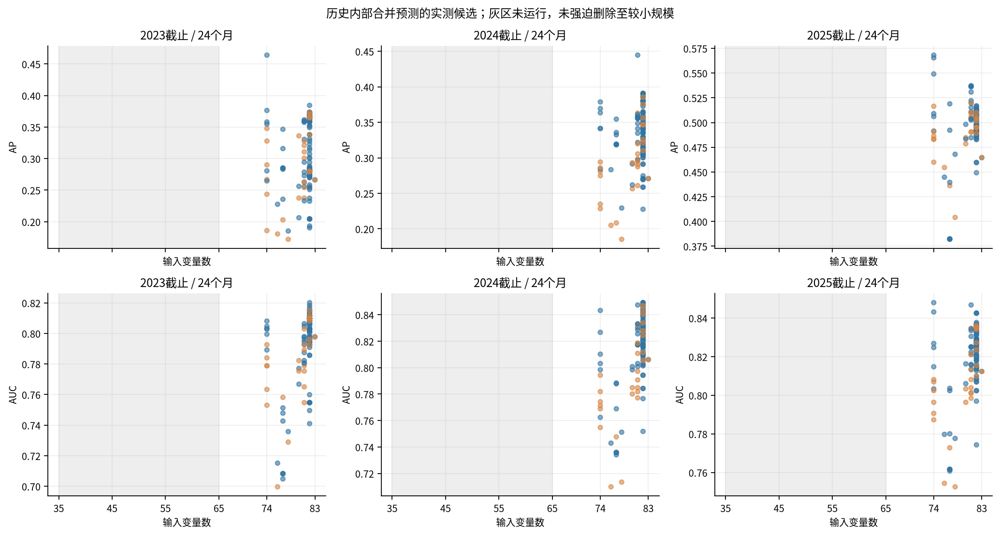
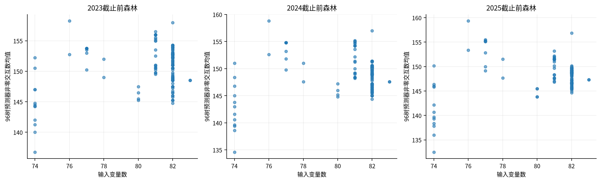
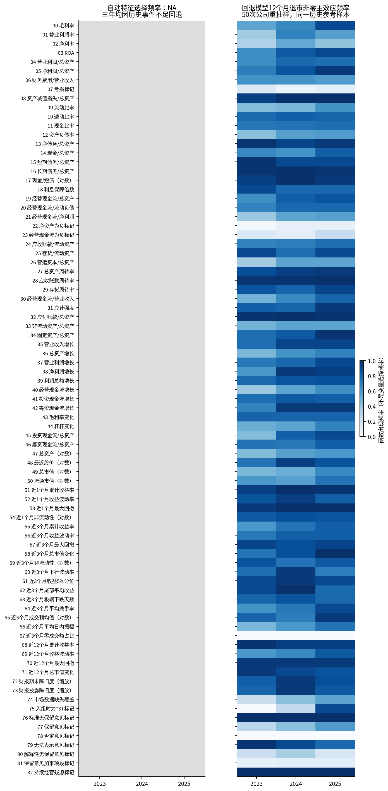
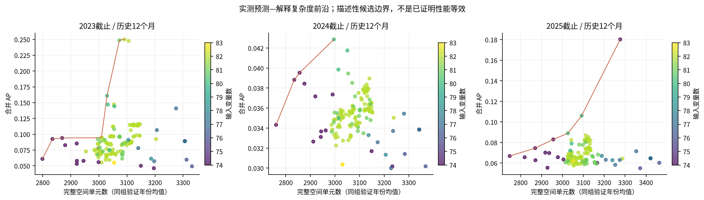
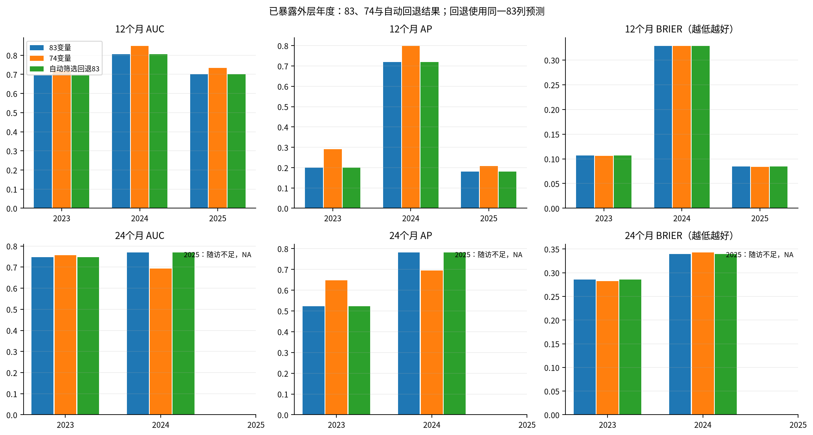

# 全变量Drop-column重训与自动特征选择结果

## 结论

**全83项删除、相关组、随机删9项及候选比例对照均已真实运行；本轮没有批准新的自动删除集合。** 三个截止点的12个月历史有效事件均不足，递归程序按冻结门槛在第0轮停止，保留83列。不能把这一回退称为找到了最优83列，也不能据此证明不存在更好的子集。

新增森林拟合3090次：试运行3、内部2538、公司重抽样450、外层固定对照99；全部成功。复用18个外层83/74参考森林，另编译1035个三种子完整预测器。保留全部预设正面、负面及NA结果，没有额外调参或替换当前模型。

## 预测表现

主目标24个月先最终退市、次目标12个月；自动选择按预设12个月AP与Top20优先，24个月及恢复/Brier作保护。各年先平均3个种子的逐公司CIF后评分。Top20每年向上取整；pooled重新计算AUC/AP/Brier，Top20名额按年度分别确定再合计。

| year | label | horizon | companies | target_events | auc | ap | brier | risk_mean | observed | checked | captured | coverage | supported |
| --- | --- | --- | --- | --- | --- | --- | --- | --- | --- | --- | --- | --- | --- |
| 2023 | full83 | 12 | 36 | 4 | 0.695312 | 0.198962 | 0.106531 | 0.019082 | 0.111111 | 8 | 1.000000 | 0.250000 | True |
| 2023 | full83 | 24 | 36 | 12 | 0.746528 | 0.522272 | 0.285989 | 0.064681 | 0.333333 | 8 | 4.000000 | 0.333333 | True |
| 2023 | legacy74 | 12 | 36 | 4 | 0.718750 | 0.290923 | 0.105864 | 0.021031 | 0.111111 | 8 | 2.000000 | 0.500000 | True |
| 2023 | legacy74 | 24 | 36 | 12 | 0.756944 | 0.647197 | 0.282277 | 0.070669 | 0.333333 | 8 | 4.000000 | 0.333333 | True |
| 2024 | full83 | 12 | 45 | 16 | 0.806034 | 0.718365 | 0.328452 | 0.032367 | 0.355556 | 9 | 6.000000 | 0.375000 | True |
| 2024 | full83 | 24 | 45 | 20 | 0.770000 | 0.782032 | 0.339557 | 0.115813 | 0.444444 | 9 | 8.000000 | 0.400000 | True |
| 2024 | legacy74 | 12 | 45 | 16 | 0.849138 | 0.799152 | 0.328816 | 0.032370 | 0.355556 | 9 | 8.000000 | 0.500000 | True |
| 2024 | legacy74 | 24 | 45 | 20 | 0.694000 | 0.693633 | 0.343057 | 0.118345 | 0.444444 | 9 | 7.000000 | 0.350000 | True |
| 2025 | full83 | 12 | 53 | 5 | 0.700000 | 0.181317 | 0.084689 | 0.058547 | 0.094340 | 11 | 2.000000 | 0.400000 | True |
| 2025 | full83 | 24 | 53 | 6 | NA | NA | NA | 0.140044 | NA | 11 | NA | NA | False |
| 2025 | legacy74 | 12 | 53 | 5 | 0.733333 | 0.207953 | 0.083828 | 0.061081 | 0.094340 | 11 | 3.000000 | 0.600000 | True |
| 2025 | legacy74 | 24 | 53 | 6 | NA | NA | NA | 0.146751 | NA | 11 | NA | NA | False |
| pooled | legacy74 | 12 | 134 | 25 | 0.641101 | 0.246299 | 0.172020 | 0.040680 | 0.186567 | 28 | 13.000000 | 0.520000 | True |
| pooled | full83 | 12 | 134 | 25 | 0.645138 | 0.246877 | 0.172418 | 0.039153 | 0.186567 | 28 | 9.000000 | 0.360000 | True |
| pooled | legacy74 | 24 | 81 | 32 | 0.697066 | 0.623033 | 0.316044 | 0.097156 | 0.395062 | 17 | 11.000000 | 0.343750 | True |
| pooled | full83 | 24 | 81 | 32 | 0.729592 | 0.681719 | 0.315749 | 0.093088 | 0.395062 | 17 | 12.000000 | 0.375000 | True |
| 2023 | automatic_fallback83 | 12 | 36 | 4 | 0.695312 | 0.198962 | 0.106531 | 0.019082 | 0.111111 | 8 | 1.000000 | 0.250000 | True |
| 2023 | automatic_fallback83 | 24 | 36 | 12 | 0.746528 | 0.522272 | 0.285989 | 0.064681 | 0.333333 | 8 | 4.000000 | 0.333333 | True |
| 2024 | automatic_fallback83 | 12 | 45 | 16 | 0.806034 | 0.718365 | 0.328452 | 0.032367 | 0.355556 | 9 | 6.000000 | 0.375000 | True |
| 2024 | automatic_fallback83 | 24 | 45 | 20 | 0.770000 | 0.782032 | 0.339557 | 0.115813 | 0.444444 | 9 | 8.000000 | 0.400000 | True |
| 2025 | automatic_fallback83 | 12 | 53 | 5 | 0.700000 | 0.181317 | 0.084689 | 0.058547 | 0.094340 | 11 | 2.000000 | 0.400000 | True |
| 2025 | automatic_fallback83 | 24 | 53 | 6 | NA | NA | NA | 0.140044 | NA | 11 | NA | NA | False |
| pooled | automatic_fallback83 | 12 | 134 | 25 | 0.645138 | 0.246877 | 0.172418 | 0.039153 | 0.186567 | 28 | 9.000000 | 0.360000 | True |
| pooled | automatic_fallback83 | 24 | 81 | 32 | 0.729592 | 0.681719 | 0.315749 | 0.093088 | 0.395062 | 17 | 12.000000 | 0.375000 | True |

自动回退与原83列使用同一预测，未冒充新增拟合。legacy74是历史固定删9项对照；近3个月总市值变化的冗余诊断直到2024截止才成立，因此该名单不能作为2023严格前向自动筛选的先验。本轮自动筛选没有使用它。

2025观察截止2026-06-30，12个月全部可评价，24个月未获得时点支持。其24个月指标留NA，pooled24仅含2023/2024。未知结局不当作正常或误报。2023–2025均已暴露，只能描述性比较。概率低估没有通过调整测试概率掩盖。

## 全83项逐一删除

DROP_COLUMN_ALL_83.csv包含4980行：三个外层信息截止下的15个内部年度组合×83变量×两个时点×两个原因。全部83项覆盖，保留每行基准/删除后指标、事件支持、复杂度变化、种子波动和500次配对公司bootstrap区间。各内部模型只使用其入组年前的信息拟合，验证标签截到对应外层截止。没有用外层排名来决定删除。

以下为2025截止前有效历史队列的**年内AP差均值**，正值为删除有利；它不是合并AP，也不是安全删除名单。该比较仅有2020、2023两个小事件队列，不能凭点估计决定保留/删除。

| feature_id | feature_name | feature_label | delta_ap | delta_auc | delta_brier | delta_capture20 | cell_change | interactions_change | positive_cohort_fraction |
| --- | --- | --- | --- | --- | --- | --- | --- | --- | --- |
| 2 | net_margin | 净利率 | 0.166554 | 0.150888 | -0.000498 | 2.000000 | 4.000000 | -2.000000 | 1.000000 |
| 3 | roa | ROA | 0.160818 | 0.143714 | -0.000500 | 2.000000 | 4.000000 | -2.000000 | 1.000000 |
| 4 | operating_profit_to_assets | 营业利润/总资产 | 0.159736 | 0.139808 | -0.000487 | 2.000000 | -9.000000 | -2.500000 | 1.000000 |
| 7 | loss_flag | 亏损标记 | 0.157115 | 0.140446 | -0.000481 | 2.000000 | -1.000000 | -2.000000 | 1.000000 |
| 5 | net_profit_to_assets | 净利润/总资产 | 0.156032 | 0.136540 | -0.000484 | 2.000000 | 12.000000 | -1.000000 | 1.000000 |
| 6 | financial_expense_to_revenue | 财务费用/营业收入 | 0.156032 | 0.136540 | -0.000502 | 2.000000 | -9.500000 | -2.500000 | 1.000000 |
| 1 | operating_margin | 营业利润率 | 0.149888 | 0.134549 | -0.000485 | 1.000000 | 3.000000 | -1.500000 | 1.000000 |
| 8 | asset_impairment_loss_to_assets | 资产减值损失/总资产 | 0.145210 | 0.122192 | -0.000393 | 1.000000 | 15.500000 | -1.500000 | 1.000000 |
| 0 | gross_margin | 毛利率 | 0.140628 | 0.124745 | -0.000481 | 0.000000 | 33.000000 | -1.500000 | 1.000000 |
| 9 | current_ratio | 流动比率 | 0.120230 | 0.118285 | -0.000388 | 1.000000 | 7.000000 | 0.000000 | 1.000000 |

删除后AP下降最多的候选如下；这些结果提示信息损失的可能性，尚不足以认定全局不可替代。

| feature_id | feature_name | feature_label | delta_ap | delta_auc | delta_brier | delta_capture20 | cell_change | interactions_change | positive_cohort_fraction |
| --- | --- | --- | --- | --- | --- | --- | --- | --- | --- |
| 57 | max_drawdown_3m | 近3个月最大回撤 | -0.016661 | -0.032373 | 0.000219 | 0.000000 | -60.500000 | -5.500000 | 0.500000 |
| 56 | ret_vol_3m | 近3个月收益波动率 | -0.014516 | -0.014834 | 0.000170 | -1.000000 | -60.500000 | -5.500000 | 0.500000 |
| 60 | downside_vol_3m | 近3个月下行波动率 | -0.011059 | -0.020655 | 0.000074 | 0.000000 | -64.000000 | -4.000000 | 0.500000 |
| 48 | log_price_last | 最近股价（对数） | -0.006357 | -0.026552 | 0.000143 | 0.000000 | -57.000000 | -5.000000 | 0.500000 |
| 59 | log_amihud_illiq_3m | 近3个月非流动性（对数） | -0.003283 | -0.004315 | 0.000094 | 0.000000 | -74.000000 | -5.000000 | 0.500000 |
| 65 | log_amount_mean_3m | 近3个月成交额均值（对数） | -0.001411 | -0.004315 | 0.000076 | 0.000000 | -9.000000 | 0.000000 | 0.500000 |
| 55 | ret_cum_3m | 近3个月累计收益率 | -0.000593 | 0.018408 | 0.000050 | 0.000000 | -64.500000 | -5.500000 | 0.500000 |
| 64 | turnover_mean_3m | 近3个月平均换手率 | -0.000043 | -0.001047 | 0.000054 | 0.000000 | 4.500000 | 0.500000 | 0.500000 |
| 61 | var_5pct_3m | 近3个月收益5%分位 | 0.000098 | 0.004774 | 0.000030 | 0.000000 | -28.500000 | -2.500000 | 0.500000 |
| 67 | zero_amount_ratio_3m | 近3个月零成交额占比 | 0.000511 | 0.008042 | -0.000011 | 0.000000 | 1.500000 | 1.000000 | 0.500000 |

同一变量删除后，全森林的候选覆盖和分裂会一起变化，因此Drop-column衡量的是当前训练算法在该信息集合下的表现变化，不是变量的因果作用。不能用“差异不显著”推断性能等效。

值得注意：2023/2024截止时唯一符合主要排名条件的2020验证队列只有3例退市，83种单项删除的AP点估计全部提高；2025截止加入2023队列后，75项均值提高、8项下降。这不是83项都冗余的证据。基础模型已与历史模型逐种子精确复现，删列仍会重新安排候选覆盖及后续搜索，因此本结果同时包含输入信息变化和训练算法变化，少事件排名尤其不能直接转成删除名单。

## 分组、随机删除和候选比例

主阈值0.95得到26个截止点—组定义（含审计块）。A/B/C/D及E候选均用真实森林；相同有效输入与预算允许复用。具体组、经济名称与0.90/0.99组结构敏感性见REDUNDANCY_GROUPS_ZH.md。

随机删9项使用5个预先固定的变量抽样种子，每组均用3个森林种子。下表为已暴露外层12个月先退市AP；完整四个时点/原因和全部指标见RANDOM_DELETION_CONTROLS.csv。

| year | horizon | cause | mode | metric | legacy74 | random_sets | random_mean | random_min | random_max | random_better_than_legacy | interpretation |
| --- | --- | --- | --- | --- | --- | --- | --- | --- | --- | --- | --- |
| 2023 | 12 | 1 | count | ap | 0.290923 | 5 | 0.190295 | 0.143934 | 0.288889 | 0 | five fixed random deletion sets, descriptive exposed-cohort comparison |
| 2024 | 12 | 1 | count | ap | 0.799152 | 5 | 0.695434 | 0.650196 | 0.752752 | 0 | five fixed random deletion sets, descriptive exposed-cohort comparison |
| 2025 | 12 | 1 | count | ap | 0.207953 | 5 | 0.211597 | 0.158606 | 0.265175 | 3 | five fixed random deletion sets, descriptive exposed-cohort comparison |
| pooled | 12 | 1 | count | ap | 0.246299 | 5 | 0.243743 | 0.213601 | 0.268525 | 2 | five fixed random deletion sets, descriptive exposed-cohort comparison |

固定候选数量为25；固定比例按round(p×25/83)取整，74列对应22。两种模式的差值见CANDIDATE_COUNT_ABLATION.csv。它可以显示覆盖预算的影响，不能把所有删变量收益都归为消除噪声。

实际结果没有给出统一胜出的删列方案：既有74列的12个月AP在2023/2024超过五个随机删除对照，但在2025有三个随机对照超过它。2024年把74列的每树候选从25改为22后，AP从0.799152降至0.686158，低于83列的0.718365，说明候选预算会明显改变结论。随机对照只限本轮五组，不能视为删列空间的完整分布。

虽然74列的12个月年内AUC/AP在三年均高于83列，重新合并三年后AUC却从0.645138变为0.641101，AP从0.246877变为0.246299，不能宣称跨年度排序改善。24个月合并AP从0.681719下降到0.623033，Top20捕获从12/32下降到11/32；这也是保留当前参考的重要描述性依据，未用其反向调整历史选择规则。

**执行偏差：**清单按“子集+模式”去重，未完全按取整后的有效配置去重。141个模式子集中实际为132个不同有效配置，9对等效模式多拟合162次。全部保留、计入成本，逐对预测差异已核验；未当作额外种子或独立证据。冻结协议原定的等效构型去重没有完整实现，见scheduling_deviation.json。

## 内生解释与稳定性

| year | label | features | main_functions | interaction_functions | spatial_table_cells | scalar_table_cells | distinct_thresholds |
| --- | --- | --- | --- | --- | --- | --- | --- |
| 2023 | full83 | 83 | 62 | 144 | 3146 | 773916 | 266 |
| 2023 | legacy74 | 74 | 60 | 138 | 3010 | 740460 | 246 |
| 2024 | full83 | 83 | 65 | 146 | 3263 | 913640 | 274 |
| 2024 | legacy74 | 74 | 58 | 132 | 2933 | 821240 | 242 |
| 2025 | full83 | 83 | 64 | 147 | 3194 | 1034856 | 261 |
| 2025 | legacy74 | 74 | 54 | 131 | 3001 | 972324 | 232 |

所有新raw、收缩森林及完整三种子预测器均验证q≤2、CIF非负/随时间不减/原因和≤1、保存重载与全函数重构；覆盖全部训练及评价行、所有原生时点与两原因，最大误差4.441e-15，小于1e-10。没有删除已训练非零函数、裁剪概率或使用事后代理模型。

单种子与合并预测器复杂度分别保留；空间格数含缺失状态，不乘时间/原因维，标量格数另计这些维度。INTERACTION_STABILITY.csv报告50次真实重训中的函数出现频率、幅度、相对原模型形状相关与差异，均使用相同年度原训练集的经验边际乘积参考。相关特征下，该参考会包含现实中稀少的组合；精确重构不等于真实效应恢复或统计可辨识。

每年度50次公司重抽样、每次3个种子，重新拟合的是因支持不足而回退的83列模型。所有150次重抽样的支持门槛仍未通过。FEATURE_SELECTION_STABILITY.csv中的选择频率明确为NA；回退保留率100%不能证明变量不可删除。未执行100次扩展，也未强迫运行65/55/45/35列。单变量、分组、递归与稳定性筛选四种自动流程均在同一前置支持条件回退，不能声称复杂流程优于简单删除。

LOCAL_EXPLANATION_CHANGES.csv在各模型相同的8条历史输入上比较全贡献向量与CIF变化；逐公司值仅保留私有目录。它用于判断作用是否重新分配到其他变量，不把风险百分点贡献称为因果影响。

## 计算与可复现性

训练冻结提交`969c6c2f6bd5594ef6055a926300929a96d28248`。198项完整测试（含R）通过。逐任务哈希、配置、子集哈希、种子、训练截止、作业、内存与耗时保留。首次准备因一行非入模chain_gap诊断差异停止，定位后沿用最早历史诊断，实际入模字段、结局与资格检查未放宽。未发生训练失败。

| stage | job | tasks | seconds | hosts |
| --- | --- | --- | --- | --- |
| pilot | 2588 | 3 | 6.402092 | {"oliverdesktop": 3} |
| inner | 2589 | 2538 | 394.824025 | {"lemon": 520, "oliverdesktop": 2018} |
| bootstrap | 2590 | 450 | 91.789200 | {"lemon": 95, "oliverdesktop": 355} |
| outer | 2593 | 99 | 27.450992 | {"lemon": 19, "oliverdesktop": 80} |
| aggregate_inner | 2591 | 846 | 449.515248 | {"lemon": 242, "oliverdesktop": 604} |
| aggregate_bootstrap | 2592 | 150 | 115.836721 | {"lemon": 47, "oliverdesktop": 103} |
| aggregate_outer | 2594 | 39 | 44.421319 | {"lemon": 16, "oliverdesktop": 23} |

用户授权两节点，任务单线程，由现有Slurm负责P/E核和SMT亲和性，不硬编码CPU。资源实测来自执行日志；不将不同节点时间当作严格算法速度比较。当前指针及所有历史源哈希不变。私有运行目录：`/home/oliver/MainDiskData/xai_rsf_dropcolumn_selection_20261101_EzUsFtiO`。

## 图表

