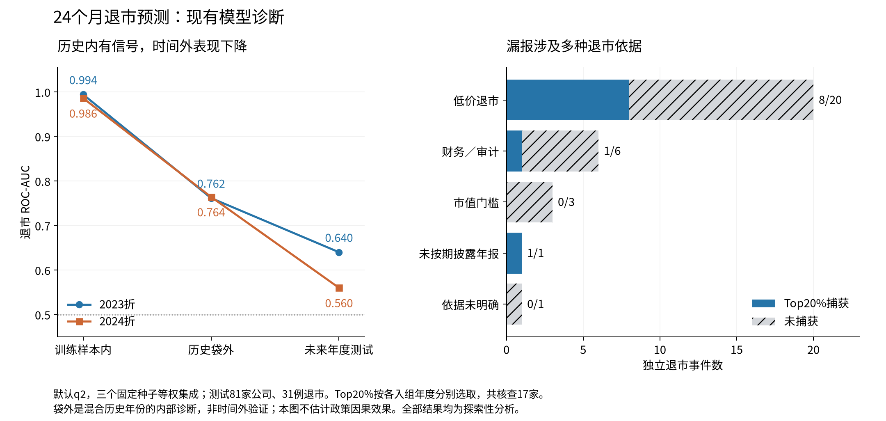

# 24个月预测失效诊断：历史信号、时间迁移和政策依据

本轮没有重新训练。对30个冻结森林的预测重新对齐，检查18个q2模型的576棵树及完整函数重构，并对24个Python森林的768棵树计算袋外预测。全部81家测试企业、31个先退市事件保留；原模型、权重、种子和年度Top20%／Top25%核查预算不变。

**模型并非完全没有学到历史信号，也没有在解释转换时丢弃预测。默认q2的历史袋外AUC为0.762／0.764，时间外AUC为0.640／0.560。现有结果支持历史规律迁移不足，同时存在信息集不充分和稀少退市支持；不能把损失全部归因于政策变化。** 2023／2024均为已暴露的探索性测试；历史袋外诊断不是独立时间验证。

默认Top20%合并捕获10/31、漏掉21例：低价12例、财务／审计5例、市值3例、未明确1例。31例终局中20例引用已有1元股价条件；仅2例明确引用5亿元市值条件，但这也不是“新政策净增加2例退市”的反事实估计。

- [完整结果与证据边界](RESULTS_ZH.md)
- [公告日期与政策适用核对](POLICY_ALIGNMENT_ZH.md)
- [输入信息及叶节点支持核查](INFORMATION_AND_LEARNING_ZH.md)
- [执行回执](execution_receipt.json)
- [固定诊断协议](frozen_protocol.json)、[追加袋外诊断登记](results/oob_supplement.json)、[政策原始来源](policy_sources.json)

数据与失效归因保持 **PROVISIONAL／INCONCLUSIVE**。本轮没有形成更优的新预测模型，不改写此前这套冻结ST后配置的PREDICTIVE_NO_GO记录。未对2025年入组企业重新评价；2023／2024入组企业的24个月随访中发生于2025年的事件属于本来既定终点。

运行方式：先创建新的权限700私有目录及空的`audit`、`private`、`results`子目录，将冻结协议复制为`audit/protocol.json`；顺序运行本目录的`analyze.py`、`oob.py`、`validate.py`、`plot.py`模块，均传入`--run`私有目录。`validate.py`要求在计算前将两份分析脚本分别复制为`audit/analyze_frozen.py`、`audit/oob_frozen.py`。程序拒绝覆盖既有计算输出。`deliver.py`在验证通过后发布脱敏汇总到本目录，不导出企业数据。

当前私有运行目录：`/home/oliver/MainDiskData/xai_rsf_error_attribution_20261028__8s4oxrp/`。单企业预测、公告文本及来源ID、精确日期、叶支持、袋外预测和完整函数继续留在服务器。公开数值分组少于3家公司／病例时隐藏风险、损失和排序细节，仍保留数量和捕获统计；全部未隐藏的原始诊断可在私有目录复核。
