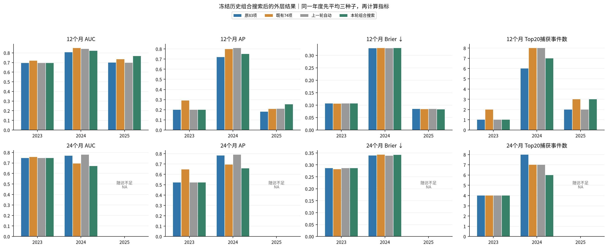
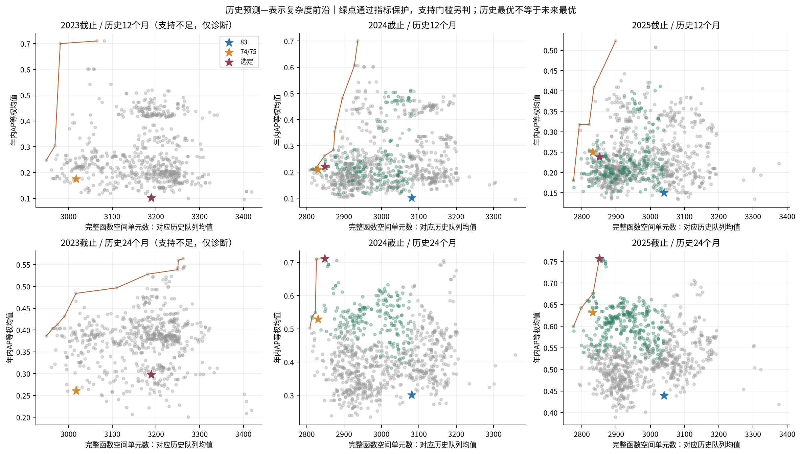
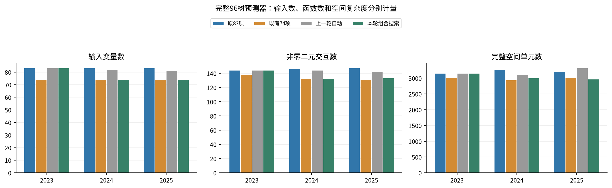
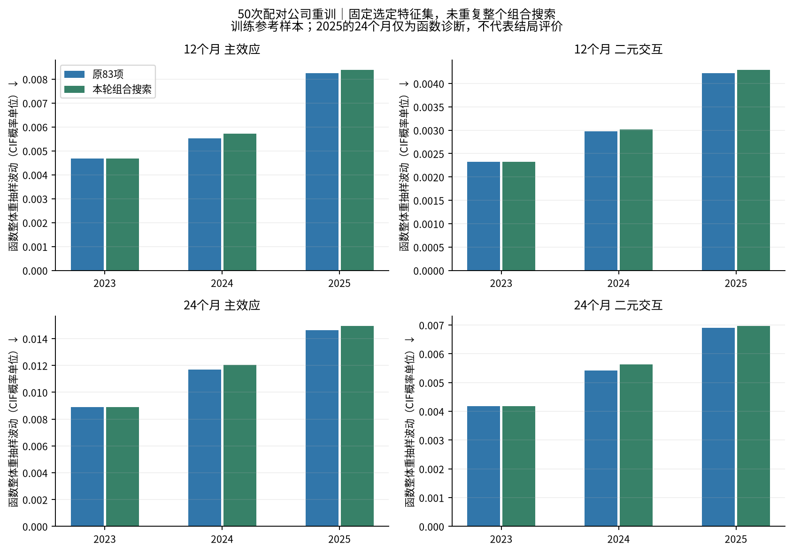

# 显式83/74候选与多起点特征组合搜索

本轮完成真实重训与统一评价；当前83项研究参考保持。完整研究判断见[METHOD_INNOVATION_DECISION_ZH.md](METHOD_INNOVATION_DECISION_ZH.md)，论文结果段落见[PAPER_RESULTS_ZH.md](PAPER_RESULTS_ZH.md)。研究性质为已暴露2023–2025队列上的探索性机制比较，继承旧conservative C原始财务版本PIT的PROVISIONAL限制。

## 实际搜索与候选时间

83项与历史可用74/75项每轮都作为起点。2023的近3个月总市值变化诊断尚未成立，因此只用当时8项形成256种组合；2024/2025分别9项512种组合。完整74在2023没有被注入初始先验；对所有原变量对称枚举的通用邻域可以独立生成同一集合，其来源在候选表中保留。

随后两轮、每轮四个起点，枚举所有变量增删、审计整块和历史相关组代表替换。允许不合格中间结构继续探索，最终接受仍比较原83、使用同一保护条件。只在8/9字段子空间完整枚举，不能称作全83变量全局最优。没有依据外层结果改变搜索轮数、候选范围或最终集合。

| year | evaluated_candidates | minimum_features | maximum_features | guard_passes | initial | round1 | round2 |
| --- | --- | --- | --- | --- | --- | --- | --- |
| 2023 | 662 | 68 | 83 | 0 | 337 | 239 | 86 |
| 2024 | 915 | 67 | 83 | 209 | 593 | 237 | 85 |
| 2025 | 999 | 67 | 83 | 344 | 593 | 237 | 169 |

| year | candidates | features | historical_events | support_passed | removed | status |
| --- | --- | --- | --- | --- | --- | --- |
| 2023 | 662 | 83 | 6 | False | 无 | FALLBACK_INSUFFICIENT_SUPPORT |
| 2024 | 915 | 74 | 13 | True | 净利率、营业利润/总资产、净利润/总资产、流动比率、经营现金流/流动负债、利润总额增长、近3个月总市值变化、近3个月尾部平均收益、近12个月总市值变化 | SELECTED_HISTORICAL_FEASIBLE |
| 2025 | 999 | 74 | 22 | True | 净利率、营业利润/总资产、净利润/总资产、流动比率、经营现金流/流动负债、利润总额增长、近3个月累计收益率、近3个月下行波动率、近12个月总市值变化 | SELECTED_HISTORICAL_FEASIBLE |

2023支持不足时即使历史诊断找到高AP组合，正式选择仍回退83。2024/2025历史有效退市13/22例，达到操作门槛不代表充分功效；这些历史模型在拟合时只有2/3/6例退市（2025的12个月保护另含2023模型）。候选评分复用这批小样本，扩展搜索增加选择过拟合风险。

## 83与74确实参与了什么比较

| year | candidate | features | mean_AP12 | mean_AP24 | delta_AP24 | lower90 | delta_capture24 | delta_cells | approved | failed_guards | provenance |
| --- | --- | --- | --- | --- | --- | --- | --- | --- | --- | --- | --- |
| 2023 | full83 | 83 | 0.101852 | 0.297711 | 0.000000 | 0.000000 | 0.000000 | 0.000000 | False | ["delta_ap24", "seed_gain_fraction"] | initial_lattice |
| 2023 | legacy74 | 74 | 0.209524 | 0.314352 | 0.016641 | -0.166411 | 1.000000 | -228.000000 | False | ["ap24_lower90"] | general_neighbourhood_round_1 |
| 2023 | historical_anchor | 75 | 0.175000 | 0.260798 | -0.036913 | -0.225207 | -1.000000 | -172.000000 | False | ["delta_ap24", "delta_capture24", "ap24_lower90", "seed_gain_fraction"] | initial_lattice |
| 2023 | selected_search | 83 | 0.101852 | 0.297711 | 0.000000 | 0.000000 | 0.000000 | 0.000000 | False | ["delta_ap24", "seed_gain_fraction"] | initial_lattice |
| 2024 | full83 | 83 | 0.101852 | 0.300903 | 0.000000 | 0.000000 | 0.000000 | 0.000000 | False | ["delta_ap24", "seed_gain_fraction"] | initial_lattice |
| 2024 | legacy74 | 74 | 0.209524 | 0.529580 | 0.228677 | 0.085422 | 2.000000 | -250.500000 | True | [] | initial_lattice |
| 2024 | historical_anchor | 74 | 0.209524 | 0.529580 | 0.228677 | 0.085422 | 2.000000 | -250.500000 | True | [] | initial_lattice |
| 2024 | selected_search | 74 | 0.221256 | 0.711185 | 0.410282 | 0.189592 | 3.000000 | -232.000000 | True | [] | general_neighbourhood_round_2 |
| 2025 | full83 | 83 | 0.150407 | 0.439309 | 0.000000 | 0.000000 | 0.000000 | 0.000000 | False | ["delta_ap24", "seed_gain_fraction"] | initial_lattice |
| 2025 | legacy74 | 74 | 0.250223 | 0.632335 | 0.193026 | 0.074855 | 3.000000 | -208.666667 | True | [] | initial_lattice |
| 2025 | historical_anchor | 74 | 0.250223 | 0.632335 | 0.193026 | 0.074855 | 3.000000 | -208.666667 | True | [] | initial_lattice |
| 2025 | selected_search | 74 | 0.237866 | 0.756475 | 0.317166 | 0.143640 | 4.000000 | -189.000000 | True | [] | general_neighbourhood_round_2 |

83的增量保护未通过仅因为自身增量为0，它始终是合法的保守回退。74必须接受同样保护，并非凭外层表现强制获胜。历史AP用于选择，不当作独立验证增益；“已搜索可行候选中最高”也不表示外层最优。两种模型都可能包含相关可替代信息，删列同时改变均衡覆盖与每树候选比例，不能解释为变量的因果增量。

## 12/24个月统一结果

每年度先平均42/101/202三个种子的逐公司CIF，再算AUC/AP/IPCW Brier。合并指标重新计算；Top20按各年ceil(0.2N)名额后合计。12个月合并含2023–2025，24个月仅含2023/2024。观察截止2026-06-30，2025完整24个月不支持，未知结局没有当正常。

| year | model | features | horizon | auc | ap | brier | risk_mean | observed | captured | target_events | supported |
| --- | --- | --- | --- | --- | --- | --- | --- | --- | --- | --- | --- |
| 2023 | 原83项 | 83.000000 | 12 | 0.695312 | 0.198962 | 0.106531 | 0.019082 | 0.111111 | 1.000000 | 4 | True |
| 2023 | 原83项 | 83.000000 | 24 | 0.746528 | 0.522272 | 0.285989 | 0.064681 | 0.333333 | 4.000000 | 12 | True |
| 2023 | 既有74项 | 74.000000 | 12 | 0.718750 | 0.290923 | 0.105864 | 0.021031 | 0.111111 | 2.000000 | 4 | True |
| 2023 | 既有74项 | 74.000000 | 24 | 0.756944 | 0.647197 | 0.282277 | 0.070669 | 0.333333 | 4.000000 | 12 | True |
| 2023 | 上一轮自动 | 83.000000 | 12 | 0.695312 | 0.198962 | 0.106531 | 0.019082 | 0.111111 | 1.000000 | 4 | True |
| 2023 | 上一轮自动 | 83.000000 | 24 | 0.746528 | 0.522272 | 0.285989 | 0.064681 | 0.333333 | 4.000000 | 12 | True |
| 2023 | 本轮组合搜索 | 83.000000 | 12 | 0.695312 | 0.198962 | 0.106531 | 0.019082 | 0.111111 | 1.000000 | 4 | True |
| 2023 | 本轮组合搜索 | 83.000000 | 24 | 0.746528 | 0.522272 | 0.285989 | 0.064681 | 0.333333 | 4.000000 | 12 | True |
| 2024 | 原83项 | 83.000000 | 12 | 0.806034 | 0.718365 | 0.328452 | 0.032367 | 0.355556 | 6.000000 | 16 | True |
| 2024 | 原83项 | 83.000000 | 24 | 0.770000 | 0.782032 | 0.339557 | 0.115813 | 0.444444 | 8.000000 | 20 | True |
| 2024 | 既有74项 | 74.000000 | 12 | 0.849138 | 0.799152 | 0.328816 | 0.032370 | 0.355556 | 8.000000 | 16 | True |
| 2024 | 既有74项 | 74.000000 | 24 | 0.694000 | 0.693633 | 0.343057 | 0.118345 | 0.444444 | 7.000000 | 20 | True |
| 2024 | 上一轮自动 | 82.000000 | 12 | 0.840517 | 0.807859 | 0.328227 | 0.032869 | 0.355556 | 8.000000 | 16 | True |
| 2024 | 上一轮自动 | 82.000000 | 24 | 0.780000 | 0.790943 | 0.338223 | 0.119582 | 0.444444 | 7.000000 | 20 | True |
| 2024 | 本轮组合搜索 | 74.000000 | 12 | 0.821121 | 0.750432 | 0.328939 | 0.032697 | 0.355556 | 7.000000 | 16 | True |
| 2024 | 本轮组合搜索 | 74.000000 | 24 | 0.670000 | 0.658728 | 0.342160 | 0.121326 | 0.444444 | 6.000000 | 20 | True |
| 2025 | 原83项 | 83.000000 | 12 | 0.700000 | 0.181317 | 0.084689 | 0.058547 | 0.094340 | 2.000000 | 5 | True |
| 2025 | 原83项 | 83.000000 | 24 | NA | NA | NA | 0.140044 | NA | NA | 6 | False |
| 2025 | 既有74项 | 74.000000 | 12 | 0.733333 | 0.207953 | 0.083828 | 0.061081 | 0.094340 | 3.000000 | 5 | True |
| 2025 | 既有74项 | 74.000000 | 24 | NA | NA | NA | 0.146751 | NA | NA | 6 | False |
| 2025 | 上一轮自动 | 81.000000 | 12 | 0.695833 | 0.209018 | 0.084366 | 0.060289 | 0.094340 | 2.000000 | 5 | True |
| 2025 | 上一轮自动 | 81.000000 | 24 | NA | NA | NA | 0.144452 | NA | NA | 6 | False |
| 2025 | 本轮组合搜索 | 74.000000 | 12 | 0.766667 | 0.254444 | 0.083287 | 0.061074 | 0.094340 | 3.000000 | 5 | True |
| 2025 | 本轮组合搜索 | 74.000000 | 24 | NA | NA | NA | 0.146933 | NA | NA | 6 | False |
| 2023 | 历史75项 | 75.000000 | 12 | 0.687500 | 0.197885 | 0.106462 | 0.019461 | 0.111111 | 1.000000 | 4 | True |
| 2023 | 历史75项 | 75.000000 | 24 | 0.774306 | 0.688189 | 0.281169 | 0.070228 | 0.333333 | 5.000000 | 12 | True |
| pooled | 原83项 | NA | 12 | 0.645138 | 0.246877 | 0.172418 | 0.039153 | 0.186567 | 9.000000 | 25 | True |
| pooled | 原83项 | NA | 24 | 0.729592 | 0.681719 | 0.315749 | 0.093088 | 0.395062 | 12.000000 | 32 | True |
| pooled | 既有74项 | NA | 12 | 0.641101 | 0.246299 | 0.172020 | 0.040680 | 0.186567 | 13.000000 | 25 | True |
| pooled | 既有74项 | NA | 24 | 0.697066 | 0.623033 | 0.316044 | 0.097156 | 0.395062 | 11.000000 | 32 | True |
| pooled | 上一轮自动 | NA | 12 | 0.616514 | 0.236638 | 0.172214 | 0.040010 | 0.186567 | 11.000000 | 25 | True |
| pooled | 上一轮自动 | NA | 24 | 0.723214 | 0.681800 | 0.315008 | 0.095182 | 0.395062 | 11.000000 | 32 | True |
| pooled | 本轮组合搜索 | NA | 12 | 0.627890 | 0.248102 | 0.172027 | 0.040263 | 0.186567 | 11.000000 | 25 | True |
| pooled | 本轮组合搜索 | NA | 24 | 0.684949 | 0.596497 | 0.317195 | 0.096151 | 0.395062 | 10.000000 | 32 | True |

- 2023、12个月：83→本轮，AUC 0.6953→0.6953，AP 0.1990→0.1990，Brier 0.106531→0.106531，Top20 1/4→1/4。既有74为AUC 0.7188、AP 0.2909、Brier 0.105864、捕获2/4。
- 2023、24个月：83→本轮，AUC 0.7465→0.7465，AP 0.5223→0.5223，Brier 0.285989→0.285989，Top20 4/12→4/12。既有74为AUC 0.7569、AP 0.6472、Brier 0.282277、捕获4/12。
- 2024、12个月：83→本轮，AUC 0.8060→0.8211，AP 0.7184→0.7504，Brier 0.328452→0.328939，Top20 6/16→7/16。既有74为AUC 0.8491、AP 0.7992、Brier 0.328816、捕获8/16。
- 2024、24个月：83→本轮，AUC 0.7700→0.6700，AP 0.7820→0.6587，Brier 0.339557→0.342160，Top20 8/20→6/20。既有74为AUC 0.6940、AP 0.6936、Brier 0.343057、捕获7/20。
- 2025、12个月：83→本轮，AUC 0.7000→0.7667，AP 0.1813→0.2544，Brier 0.084689→0.083287，Top20 2/5→3/5。既有74为AUC 0.7333、AP 0.2080、Brier 0.083828、捕获3/5。
- 2025、24个月：随访支持不足，AUC/AP/Brier/完整窗口捕获保留NA。
- pooled、12个月：83→本轮，AUC 0.6451→0.6279，AP 0.2469→0.2481，Brier 0.172418→0.172027，Top20 9/25→11/25。既有74为AUC 0.6411、AP 0.2463、Brier 0.172020、捕获13/25。
- pooled、24个月：83→本轮，AUC 0.7296→0.6849，AP 0.6817→0.5965，Brier 0.315749→0.317195，Top20 12/32→10/32。既有74为AUC 0.6971、AP 0.6230、Brier 0.316044、捕获11/32。

## 配对不确定性

| year | cohorts | horizon | metric | difference | lower95 | upper95 | undefined |
| --- | --- | --- | --- | --- | --- | --- | --- |
| 2023 | 2023 | 12 | auc | 0.000000 | 0.000000 | 0.000000 | 6 |
| 2023 | 2023 | 12 | ap | 0.000000 | 0.000000 | 0.000000 | 6 |
| 2023 | 2023 | 12 | brier | 0.000000 | 0.000000 | 0.000000 | 0 |
| 2023 | 2023 | 12 | captured | 0.000000 | 0.000000 | 0.000000 | 0 |
| 2023 | 2023 | 12 | coverage | 0.000000 | 0.000000 | 0.000000 | 6 |
| 2023 | 2023 | 24 | auc | 0.000000 | 0.000000 | 0.000000 | 0 |
| 2023 | 2023 | 24 | ap | 0.000000 | 0.000000 | 0.000000 | 0 |
| 2023 | 2023 | 24 | brier | 0.000000 | 0.000000 | 0.000000 | 0 |
| 2023 | 2023 | 24 | captured | 0.000000 | 0.000000 | 0.000000 | 0 |
| 2023 | 2023 | 24 | coverage | 0.000000 | 0.000000 | 0.000000 | 0 |
| 2024 | 2024 | 12 | auc | 0.015086 | -0.097257 | 0.133641 | 0 |
| 2024 | 2024 | 12 | ap | 0.032067 | -0.136554 | 0.221588 | 0 |
| 2024 | 2024 | 12 | brier | 0.000486 | -0.001324 | 0.002407 | 0 |
| 2024 | 2024 | 12 | captured | 1.000000 | -2.000000 | 4.000000 | 0 |
| 2024 | 2024 | 12 | coverage | 0.062500 | -0.153947 | 0.272727 | 0 |
| 2024 | 2024 | 24 | auc | -0.100000 | -0.168018 | -0.033727 | 0 |
| 2024 | 2024 | 24 | ap | -0.123304 | -0.227313 | -0.018228 | 0 |
| 2024 | 2024 | 24 | brier | 0.002603 | -0.000997 | 0.006175 | 0 |
| 2024 | 2024 | 24 | captured | -2.000000 | -4.000000 | 1.000000 | 0 |
| 2024 | 2024 | 24 | coverage | -0.100000 | -0.235294 | 0.055556 | 0 |
| 2025 | 2025 | 12 | auc | 0.066667 | -0.025000 | 0.173361 | 7 |
| 2025 | 2025 | 12 | ap | 0.073128 | -0.007915 | 0.262718 | 7 |
| 2025 | 2025 | 12 | brier | -0.001402 | -0.003155 | -0.000009 | 0 |
| 2025 | 2025 | 12 | captured | 1.000000 | 0.000000 | 3.000000 | 0 |
| 2025 | 2025 | 12 | coverage | 0.200000 | 0.000000 | 1.000000 | 7 |
| pooled | 2023,2024,2025 | 12 | auc | -0.017248 | -0.060189 | 0.024159 | 0 |
| pooled | 2023,2024,2025 | 12 | ap | 0.001226 | -0.027042 | 0.049044 | 0 |
| pooled | 2023,2024,2025 | 12 | brier | -0.000391 | -0.001369 | 0.000421 | 0 |
| pooled | 2023,2024,2025 | 12 | captured | 2.000000 | -2.000000 | 5.025000 | 0 |
| pooled | 2023,2024,2025 | 12 | coverage | 0.080000 | -0.083333 | 0.230833 | 0 |
| pooled | 2023,2024 | 24 | auc | -0.044643 | -0.073225 | -0.018860 | 0 |
| pooled | 2023,2024 | 24 | ap | -0.085222 | -0.142069 | -0.017883 | 0 |
| pooled | 2023,2024 | 24 | brier | 0.001446 | -0.000554 | 0.003431 | 0 |
| pooled | 2023,2024 | 24 | captured | -2.000000 | -4.000000 | 1.000000 | 0 |
| pooled | 2023,2024 | 24 | coverage | -0.062500 | -0.138988 | 0.033362 | 0 |

1000次按评价年分层、公司为单位的共同重抽样，模型预测及IPCW固定；与74及上一轮自动的差值也完整保存。区间仅反映条件评价波动，不包含完整训练/组合搜索/模型开发不确定性，也没有多重比较确认性保证。跨零不等于性能等效。

## 内生解释与稳定性

| year | model | features | main_functions | interaction_functions | spatial_table_cells | scalar_table_cells | distinct_thresholds | function_bytes | max_path_variables | low_support_cell_fraction | zero_support_cell_fraction |
| --- | --- | --- | --- | --- | --- | --- | --- | --- | --- | --- | --- |
| 2023 | full83 | 83 | 62 | 144 | 3146 | 773916 | 266 | 232681 | 2 | 0.435791 | 0.221233 |
| 2023 | legacy74 | 74 | 60 | 138 | 3010 | 740460 | 246 | 230517 | 2 | 0.453821 | 0.240864 |
| 2023 | previous_auto | 83 | 62 | 144 | 3146 | 773916 | 266 | 232681 | 2 | 0.435791 | 0.221233 |
| 2023 | selected_search | 83 | 62 | 144 | 3146 | 773916 | 266 | 232681 | 2 | 0.435791 | 0.221233 |
| 2024 | full83 | 83 | 65 | 146 | 3263 | 913640 | 274 | 260008 | 2 | 0.413117 | 0.251302 |
| 2024 | legacy74 | 74 | 58 | 132 | 2933 | 821240 | 242 | 260393 | 2 | 0.415274 | 0.236618 |
| 2024 | previous_auto | 82 | 64 | 144 | 3101 | 868280 | 256 | 261828 | 2 | 0.407933 | 0.224121 |
| 2024 | selected_search | 74 | 60 | 132 | 2992 | 837760 | 259 | 262796 | 2 | 0.410762 | 0.229947 |
| 2025 | full83 | 83 | 64 | 147 | 3194 | 1034856 | 261 | 298085 | 2 | 0.386349 | 0.236381 |
| 2025 | legacy74 | 74 | 54 | 131 | 3001 | 972324 | 232 | 300999 | 2 | 0.406531 | 0.225258 |
| 2025 | previous_auto | 81 | 64 | 142 | 3312 | 1073088 | 278 | 299925 | 2 | 0.399457 | 0.229469 |
| 2025 | selected_search | 74 | 56 | 133 | 2964 | 960336 | 233 | 300759 | 2 | 0.396761 | 0.223684 |
| 2023 | historical75 | 75 | 59 | 136 | 2885 | 709710 | 246 | 234816 | 2 | 0.424263 | 0.242981 |

- 2023：主效应62→62，二元交互144→144，完整空间单元3146→3146（+0.00%）。
- 2024：主效应65→60，二元交互146→132，完整空间单元3263→2992（-8.31%）。
- 2025：主效应64→56，二元交互147→133，完整空间单元3194→2964（-7.20%）。

| year | model | order | component_spread_l2 | mean_anchor_distance_l2 | mean_nonzero_jaccard_to_anchor |
| --- | --- | --- | --- | --- | --- |
| 2023 | full83 | 1 | 0.008896 | 0.010539 | 0.666776 |
| 2023 | selected_search | 1 | 0.008896 | 0.010539 | 0.666776 |
| 2023 | full83 | 2 | 0.004183 | 0.006045 | 0.117408 |
| 2023 | selected_search | 2 | 0.004183 | 0.006045 | 0.117408 |
| 2024 | full83 | 1 | 0.011681 | 0.014310 | 0.695770 |
| 2024 | selected_search | 1 | 0.012035 | 0.014154 | 0.732888 |
| 2024 | full83 | 2 | 0.005415 | 0.006939 | 0.107881 |
| 2024 | selected_search | 2 | 0.005632 | 0.007202 | 0.107152 |
| 2025 | full83 | 1 | 0.014635 | 0.020039 | 0.702122 |
| 2025 | selected_search | 1 | 0.014937 | 0.018174 | 0.673000 |
| 2025 | full83 | 2 | 0.006898 | 0.008757 | 0.105218 |
| 2025 | selected_search | 2 | 0.006963 | 0.008995 | 0.120321 |

这50次公司重抽样是在固定最终特征集合下重新训练，使用与原83相同抽样、同一原训练集的经验边际乘积参考，缺失函数以0对齐。它没有重新执行扩大后的特征搜索，不能作为变量选择频率或无条件算法稳定性证据。主效应/二阶函数的形状、幅度、预测波动与风险均值分别报告，低幅度不自动视为可靠解释。

相关变量的边际乘积参考会包含现实中稀少或未出现的组合；这是统一函数归一化的约定，不证明统计可辨识性或经济因果关系。历史复杂度保护也不保证随后重训的外层模型复杂度必然下降。

完整96树预测器与每个raw/收缩模型均验证q≤2、CIF合法、保存重载和全部训练/评价行、原生时间点、两个原因的显式完整函数重构；最大误差3.886e-15，门槛1e-10。没有裁剪预测、代理模型或删掉已训练函数。CIF贡献不是因果影响。空间单元含缺失状态；乘时间和原因维度后的标量储量另列。

## 计算及可复现性

新增12606个32树森林、4202个三种子完整预测器、1079个任务；拟合失败0，回传失败0。Slurm作业2599,2600,2601,2602,2603,2604。另外复用530组三种子历史工件、对应1590个种子森林，按工件目录去重，模型/函数/预测文件均按原清单核对哈希，见REUSED_MODELS。复用数量不计入新增拟合，也不等于独立数据证据。原公司bootstrap哈希配对通过，特征覆盖随删列变化如实保留。

四个试运行包含12次真实拟合，正式搜索继续复用；每项最多4个完整预测器，避免上一轮巨大单任务回传。两节点单线程任务通过现有Slurm允许集合管理P/E核与SMT，没有修改cgroup或声称固定48训练线程。时间与内存见EXECUTION_TASKS/FIT_BUNDLES。

准备时修正了旧诊断CSV的字段名读取；最初独立R测试因R库路径设置错误失败，恢复既有正确路径后完整测试通过。原失败日志保留，未放宽测试或改森林公式。这些环境/准备失败不计为真实拟合失败。

最终计数复核修正了只汇总最后搜索阶段、漏计早期缓存复用的问题；重验时防覆盖写入器曾拒绝已有回执，已先归档旧回执和日志再重新核验。最终完整复用计数以本报告及validation.json为准；没有重训、改变选择或修改预测，详情见audit/analysis_incidents.json。

私有模型、阈值、预测与个体解释保留在`/home/oliver/MainDiskData/xai_rsf_feature_combinations_20261101_uido4igz`。公开内容仅代码、协议、字段名单、汇总指标、哈希及诊断。

## 研究解释边界

扩大搜索解决了上一轮遗漏完整74组合及单步停止过早的限制；预测收益仍必须看实际年度、合并、校准、捕获与函数稳定性共同判断。训练前特征组合选择不是森林q2精确分解的新数学机制。当前参考模型不自动替换；新的未参与选择且随访充分的时间外证据仍是升级依据。

