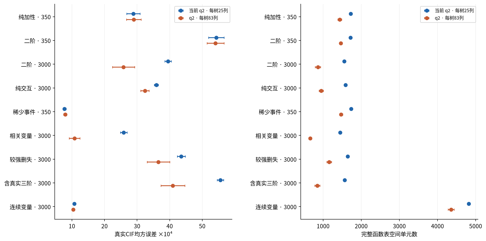

# 保留q2扩大每树候选资格

唯一训练配置变化为tree_feature_count25→83，保留depth4、path_budget2、mtry75、32树/种子、共享分位数5切点、原因权重(1,1)、最小叶10/公司5/事件3、直接父节点收缩10。节点尚未达到q上限时实际候选由25增加到75。不是相同计算预算；每树83列意味着均衡资格全部相同，但不变为新的随机覆盖算法或两层前瞻搜索。

| 场景 · 训练N | 25列幅度恢复 | 83列幅度恢复 | 真实交互检出 | 真实CIF MSE↓ |
|---|---|---|---|---|
| 纯加性 · 350 | 不适用 | 不适用 | 不适用 | 0.002885 → 0.002898 |
| 二阶 · 350 | 0.224% | 0.574% | 0/50 → 1/50 | 0.005430 → 0.005405 |
| 二阶 · 3000 | 4.883% | 22.188% | 1/50 → 34/50 | 0.003949 → 0.002583 |
| 纯交互 · 3000 | 0.244% | 0.084% | 0/50 → 0/50 | 0.003590 → 0.003240 |
| 稀少事件 · 350 | 0.044% | 0.046% | 0/50 → 0/50 | 0.000772 → 0.000795 |
| 相关变量 · 3000 | 4.489% | 28.067% | 1/50 → 39/50 | 0.002591 → 0.001081 |
| 较强删失 · 3000 | 2.314% | 10.407% | 0/50 → 14/50 | 0.004356 → 0.003653 |
| 含真实三阶 · 3000 | 4.707% | 24.209% | 1/50 → 36/50 | 0.005557 → 0.004097 |
| 连续变量 · 3000 | 0.284% | 0.558% | 0/50 → 0/50 | 0.001073 → 0.001039 |

大样本、存在可供首层使用的主效应时改善明显；纯交互无相应边际主效应，增加资格依然不能有效触发逐节点贪心搜索。该解释是与结果相符的机制判断，本轮没有新增前瞻搜索对照来独立证明全部原因。相关变量场景的28.07%恢复也仍远小于100%；在乘积边际参考下比较函数，并不代表相关特征实际联合分布中的独立因果作用。

无关函数检出增加、稀少事件MSE变差。两个小样本有真实交互的场景幅度差区间包含0；连续场景虽然均值略升，幅度仍接近0。真实三阶结构在q2下仍不可表示；该场景表格报告的是其中的二阶项，不是三阶恢复。

## 企业解释复杂度与支持

| 年度 | 模型 | 非零主效应 | 非零交互 | 空间单元 | 函数标量数 | 导出KiB |
|---|---|---|---|---|---|---|
| 2023 | 当前25列 | 62 | 144 | 3146 | 773916 | 227.2 |
| 2023 | 每树83列 | 46 | 58 | 1422 | 349812 | 237.5 |
| 2024 | 当前25列 | 65 | 146 | 3263 | 913640 | 253.9 |
| 2024 | 每树83列 | 41 | 47 | 1135 | 317800 | 272.4 |

全部企业模型实际最大路径变量数为2、最大深度4。主效应/交互数为全部空间格和原生时间上数值非零的函数数，而非仅“路径出现过”。本轮结构数与非零数恰相同，均在[导出表](results/enterprise_export_geometry.csv)单独保存。低支持和零支持比例仍未消失：2024 wide83零训练支持空间格比例约30.31%，当前版25.13%；有NaN专门格与未观察组合，不能把这些格全解释成现实公司关系。

2024零退市叶比例由当前约42.49%升至wide83约54.85%，不是降低了零事件叶。收缩会借入父节点正风险，但不创造新的观察事件或公司。2024借入正退市风险的零事件叶由186个降为45个；解释空间更集中并不自动增加事件支持。逐种子数值见[叶支持](results/enterprise_leaf_support.csv)。

2023/2024交互集合重合度从0.072/0.055升至0.284/0.396，共同函数相关性的中位数均值从0.663/0.643升至0.747/0.772；2023主效应重合度反而下降。训练联合样本用于比较函数形状，中心化仍用同年度训练乘积边际；固定730天的稳定性展示不应误称每家不同日历终点。三种子属于算法随机性。完整数据见[函数稳定性](results/enterprise_function_stability.csv)、[预测波动](results/enterprise_prediction_variation.csv)。

## 计算代价

wide83两个年度候选路由尝试合计分别157291和157756；原25列为53613和53541，约2.93—2.95倍。真正通过叶支持筛选并打分的候选数分别148480和149607，原25列为49367和49699；有限切点数、缺失路由与小于5个有效切点的情况分别保存在[搜索成本](results/enterprise_search_cost.csv)。候选尝试不等于实际打分次数。

6个新企业森林单次拟合约6.41—12.81秒，实际峰值RSS约274—284MiB，收缩约0.20—0.65秒。不同机器P/E核、并发与历史负载不同，不用历史墙钟时间做公平算法速度结论；没有为了计时重训当前模型。模拟逐种子耗时、候选和模型存储见simulation_models.csv.gz及simulation_model_summary.csv。

结论是“覆盖瓶颈得到部分验证，放宽覆盖不是已验证的企业预测改进”。本轮不做结果驱动的新范围/深度/切点搜索。
