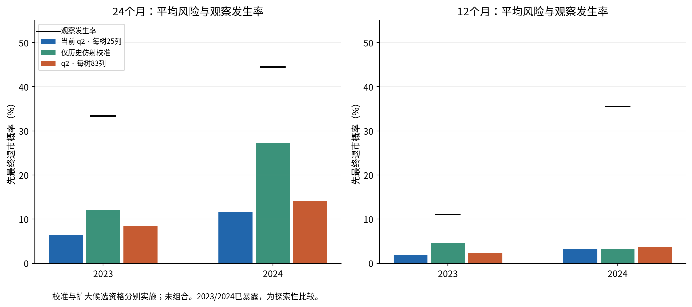
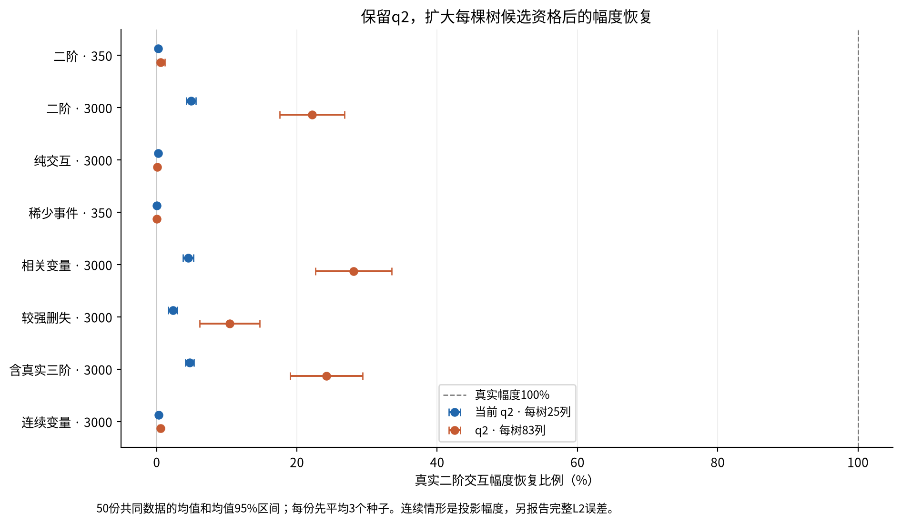

# 概率水平与候选覆盖：两组分开的实验

**24个月历史仿射校准缓解了风险低估，且保留逐年度排序与精确解释，但没有消除低估。扩大候选资格能改善部分大样本交互恢复，却损害了企业2024年的排序。两组不组合，当前参考模型继续保留。**

本轮是已暴露2023/2024及既有模拟数据上的有限机制分析，不是独立确认性验证。企业输入仍有继承的PROVISIONAL/PIT限制。没有新增2025访问。

## 1. 实际执行

两台机器完成460/460正式任务：1350次模拟森林拟合、6次企业森林拟合、4次仿射校准优化；另外2次数值小试森林拟合。正式任务oliver343项、lemon117项，队列含等待约317.81秒。10项并行分析另用约27.89秒，均成功。没有重训历史对照，也没有更换当前模型、追加配置或挑选成功种子。

完整测试180项通过，包含独立R检查。企业最大重构误差2.665e-15，模拟最大误差1.887e-15，均远低于1e-10。全部保存/重载、概率和配对检查通过。详细范围、存储计数和两类已修复的汇总脚本问题见[数值报告](NUMERICAL_VALIDATION_ZH.md)。

## 2. 主要企业结果：24个日历月先最终退市

| 年度 | 模型 | AUC | AP | Brier↓ | 平均风险 | 观察发生率 | Top20捕获 | 核查数 |
|---|---|---|---|---|---|---|---|---|
| 2023 | 当前25列 | 0.7465 | 0.5223 | 0.2860 | 6.47% | 33.33% | 4/12 | 8 |
| 2023 | 仅仿射校准 | 0.7465 | 0.5223 | 0.2593 | 12.01% | 33.33% | 4/12 | 8 |
| 2023 | 每树83列 | 0.7257 | 0.5629 | 0.2733 | 8.47% | 33.33% | 5/12 | 8 |
| 2024 | 当前25列 | 0.7700 | 0.7820 | 0.3396 | 11.58% | 44.44% | 8/20 | 9 |
| 2024 | 仅仿射校准 | 0.7700 | 0.7820 | 0.2521 | 27.25% | 44.44% | 8/20 | 9 |
| 2024 | 每树83列 | 0.6760 | 0.6541 | 0.3305 | 14.13% | 44.44% | 7/20 | 9 |
| pooled | 当前25列 | 0.7296 | 0.6817 | 0.3157 | 9.31% | 39.51% | 12/32 | 17 |
| pooled | 仅仿射校准 | 0.6920 | 0.6626 | 0.2553 | 20.48% | 39.51% | 12/32 | 17 |
| pooled | 每树83列 | 0.6639 | 0.5856 | 0.3051 | 11.62% | 39.51% | 12/32 | 17 |

逐公司先平均三个种子再计算指标。2023为36家、12例退市；2024为45家、20例。Top20名额按年向上取整，为8家和9家；合并捕获按年度名额合计。pooled AUC、AP、Brier均重新计算。全部终点已知，本次IPCW权重实际均为1；这不表示训练样本没有删失。

校准把2023平均概率6.47%提高到12.01%，2024从11.58%提高到27.25%；对应观察发生率33.33%和44.44%，分别仍低估21.32和17.19个百分点。合并Brier从0.31575降到0.25531，配对差值−0.06044，描述性95%区间[−0.08753,−0.03290]。

各年校准斜率为正，所以年内AUC、AP和Top20不变。**不同年份使用不同映射，pooled排序可改变**：24个月合并AUC从0.72959降至0.69196，AP从0.68172降至0.66263。不能将“逐年排序不变”扩大为“跨年排序不变”。

扩大候选资格使2023 AP略升、Top20多捕获1例，但2024 AUC下降0.094，AP下降0.128，Top20少捕获1例。2024 AUC配对差值区间[−0.17990,−0.01213]；AP区间[−0.26343,0.00780]。合并AUC下降0.06569、AP下降0.09615，Brier改善0.01066。**概率水平、排序和事件捕获不是同一指标。**

这些区间来自固定预测下1000次按年度分层公司配对bootstrap；主要24个月退市指标均1000次可算。它们不包含重新训练、模型选择及此前多轮探索的不确定性，不作为选择性的确认性显著结论。

## 3. 12个月与恢复结果也全部保留

| 年度 | 模型 | AUC | AP | Brier↓ | 平均风险 | 观察发生率 | Top20捕获 | 核查数 |
|---|---|---|---|---|---|---|---|---|
| 2023 | 当前25列 | 0.6953 | 0.1990 | 0.1065 | 1.91% | 11.11% | 1/4 | 8 |
| 2023 | 仅仿射校准 | 0.6953 | 0.1990 | 0.1024 | 4.56% | 11.11% | 1/4 | 8 |
| 2023 | 每树83列 | 0.5938 | 0.1696 | 0.1057 | 2.38% | 11.11% | 1/4 | 8 |
| 2024 | 当前25列 | 0.8060 | 0.7184 | 0.3285 | 3.24% | 35.56% | 6/16 | 9 |
| 2024 | 仅仿射校准 | 0.8060 | 0.7184 | 0.3285 | 3.24% | 35.56% | 6/16 | 9 |
| 2024 | 每树83列 | 0.6724 | 0.4836 | 0.3279 | 3.61% | 35.56% | 4/16 | 9 |
| pooled | 当前25列 | 0.7992 | 0.6341 | 0.2298 | 2.65% | 24.69% | 7/20 | 17 |
| pooled | 仅仿射校准 | 0.6352 | 0.3222 | 0.2280 | 3.82% | 24.69% | 7/20 | 17 |
| pooled | 每树83列 | 0.7131 | 0.4276 | 0.2292 | 3.07% | 24.69% | 5/20 | 17 |

2024/12个月校准窗口只有1例退市、9例恢复，两个斜率均固定1；历史目标风险本就不低于该窗口发生率，非负截距约束下得到恒等映射，未缓解2024测试队列的低估。2023/12个月提高了平均退市概率，但pooled AUC从0.79918降到0.63525，AP从0.63407降到0.32224。这是年际映射错位的实际不利结果，必须保留。

恢复原因24个月结果：

| 年度 | 模型 | AUC | AP | Brier↓ | 平均风险 | 观察发生率 |
|---|---|---|---|---|---|---|
| 2023 | 当前25列 | 0.6952 | 0.7541 | 0.2529 | 59.84% | 41.67% |
| 2023 | 仅仿射校准 | 0.6952 | 0.7541 | 0.2244 | 44.56% | 41.67% |
| 2023 | 每树83列 | 0.6635 | 0.6921 | 0.2112 | 51.23% | 41.67% |
| 2024 | 当前25列 | 0.7069 | 0.5657 | 0.2343 | 51.64% | 35.56% |
| 2024 | 仅仿射校准 | 0.7069 | 0.5657 | 0.2211 | 46.30% | 35.56% |
| 2024 | 每树83列 | 0.6164 | 0.4985 | 0.2349 | 44.76% | 35.56% |
| pooled | 当前25列 | 0.6735 | 0.6277 | 0.2426 | 55.29% | 38.27% |
| pooled | 仅仿射校准 | 0.6903 | 0.5970 | 0.2226 | 45.53% | 38.27% |
| pooled | 每树83列 | 0.6303 | 0.5664 | 0.2243 | 47.63% | 38.27% |

2023/12个月没有观察到先恢复事件，AUC和AP不定义，CSV保留NaN而非填0。恢复的12个月、各个种子、raw版本、Top25及分箱结果均在[完整指标](results/enterprise_metrics.csv)、[核查结果](results/enterprise_warnings.csv)、[分组校准](results/enterprise_calibration_bins.csv)。

## 4. 扩大候选范围是否恢复重要交互

| 场景 · 训练N | 25列幅度恢复 | 83列幅度恢复 | 真实交互检出 | 真实CIF MSE↓ |
|---|---|---|---|---|
| 纯加性 · 350 | 不适用 | 不适用 | 不适用 | 0.002885 → 0.002898 |
| 二阶 · 350 | 0.224% | 0.574% | 0/50 → 1/50 | 0.005430 → 0.005405 |
| 二阶 · 3000 | 4.883% | 22.188% | 1/50 → 34/50 | 0.003949 → 0.002583 |
| 纯交互 · 3000 | 0.244% | 0.084% | 0/50 → 0/50 | 0.003590 → 0.003240 |
| 稀少事件 · 350 | 0.044% | 0.046% | 0/50 → 0/50 | 0.000772 → 0.000795 |
| 相关变量 · 3000 | 4.489% | 28.067% | 1/50 → 39/50 | 0.002591 → 0.001081 |
| 较强删失 · 3000 | 2.314% | 10.407% | 0/50 → 14/50 | 0.004356 → 0.003653 |
| 含真实三阶 · 3000 | 4.707% | 24.209% | 1/50 → 36/50 | 0.005557 → 0.004097 |
| 连续变量 · 3000 | 0.284% | 0.558% | 0/50 → 0/50 | 0.001073 → 0.001039 |

幅度100%表示沿已知真实交互函数方向完全恢复，不是AUC、概率或事件捕获率。检出门槛为函数RMS≥0.005；50份数据重复均先合并3个种子，原始AJ及其他期限/原因完整保存。纯加性场景没有真实交互，召回和幅度不定义。

大样本普通二阶场景的幅度恢复从4.883%升至22.188%，配对增幅17.305个恢复比例百分点，95%均值区间[12.875,21.734]；仍距100%很远。该场景真实作用为±5个百分点，平均学到约±1.109个百分点，原来约±0.244个百分点。函数L2误差从0.047558降至0.038906。

真实变量对同时有资格的树由平均8.76/96变为96/96，形成非零交互的树由5.68/96增至26.10/96。按树加权的分解是9.125%×64.840%×82.532%=4.883%，以及100%×27.188%×81.610%=22.188%。扩大资格缓解了覆盖瓶颈，但多数树仍未形成该交互；不能解释成已经解决搜索和有限样本问题。

纯交互场景反而由0.244%降至0.084%；稀少事件仍约0.05%，连续场景仅0.558%。全部场景无关函数检出数的均值均上升；纯加性场景由0.54升至1.38。稀少事件场景真实CIF MSE反而增加约0.000023。更多候选同时增加竞争和噪声选择，不能把扩大范围称为普遍改进。

## 5. 完整解释是否保住

| 年度 | 模型 | 非零主效应 | 非零交互 | 空间单元 | 函数标量数 | 导出KiB |
|---|---|---|---|---|---|---|
| 2023 | 当前25列 | 62 | 144 | 3146 | 773916 | 227.2 |
| 2023 | 每树83列 | 46 | 58 | 1422 | 349812 | 237.5 |
| 2024 | 当前25列 | 65 | 146 | 3263 | 913640 | 253.9 |
| 2024 | 每树83列 | 41 | 47 | 1135 | 317800 | 272.4 |

以上为96树完整预测器，缺失状态单独计格，空间单元不含时间/原因乘数；标量数包含全部原生时间和两个原因，但不含基线。校准保持变量、交互、阈值和空间单元不变，只变基线与原因内统一幅度。实际导出增加原点时间，校准标量数见[导出几何](results/enterprise_export_geometry.csv)，不能照搬原生时间数。

扩大资格后两年空间单元分别减少54.80%、65.22%，交互函数144→58和146→47。但因子化文件反而略增，说明“空间表更小”不等于“压缩文件更小”。2023/2024交互集合Jaccard均值由0.072/0.055升至0.284/0.396；2023主效应集合重合度下降，预测随机波动也未两年一致改善。集合更稳定不证明函数更真实，更不能抵消2024预测退化。

## 6. 本轮研究判断

1. 受约束仿射更新与完整q2函数表示可兼容，且本轮24个月数据中改善了概率水平与Brier；这是明确的工程/数值证据。尚未证明个体概率已经准确、跨期映射稳定或未来制度下仍有效。
2. 每树25列造成的交互资格不足是幅度衰减的一个实际来源。保留q2扩大资格可部分恢复含主效应的大样本交互，并不需要先放开交互阶数。
3. 资格扩大不是充分解决方案：纯交互、连续和稀少事件恢复仍很差，企业2024排序变差。它没有证明整体优于当前森林。
4. 校准改的是风险水平及统一幅度；覆盖实验改的是森林学到的结构。前者不能修复遗漏交互，后者不能自动解决概率漂移。两组未组合，不能声称联合方案成功。

**保留当前参考版本。本轮不自动推广wide83，也不把校准版替换为新的默认模型。** 证据用于说明设计取舍与方法边界；没有启动下一轮搜索。完整方法可见[论文文本](PAPER_TEXT_ZH.md)，执行与工件见[运行说明](RUN_ZH.md)。
