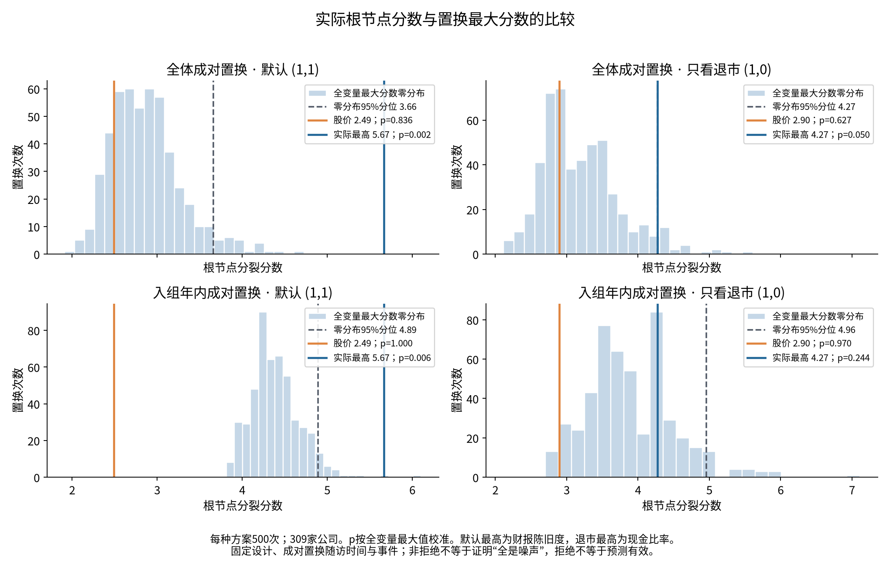

# 根节点置换核查：股价证据较弱，但不能判定森林选择基本都是噪声

已完成两种预先冻结的置换方案，每种500次，共1,000次；未拟合新研究模型、未生成企业预测。**股价的退市分裂分数2.8976未越过全变量搜索的零分布参照；默认第一名财报报告期陈旧度5.6654则在两种方案中都越过。** 因而实际结果不符合“股价和真实赢家都在噪声95%分位以内”的前提，也不能得出“森林选择基本由噪声决定”。

本轮是冻结数据上的探索性根节点诊断，状态为 **PROVISIONAL**。原预测实验的 `PREDICTIVE_NO_GO` 判断不因本检验改变；新证据没有评估改用原因权重后的预测性能。

## 数据与置换单位

仅使用2012—2022年入组、信息截止2023-01-01之前的原训练矩阵：309家独立公司、14个先退市、184个先恢复、111条事件标记0。事件0混合完整时限无事件和提前删失，未改成正常标签。没有读取2023／2024评价数组或2025入组结局，也未宣称2025已独立封存。

采用**完整观察对 `(随访时间, 事件类型)` 的公司间置换**，保留两类竞争结局的互斥关系、时间与状态的配对及其边际分布。不单独把退市二元标记打乱后与不变的恢复标记拼接，这样可能制造冲突的事件状态。成对置换不等于保持每家公司原来的日历删失日期，下面的可交换性限制仍然存在。

两种方案均在计算零分布前冻结，不根据p值追加置换或选择方案：

| 方案 | 随机化方式 | 零假设所需条件 |
| --- | --- | --- |
| `global_pair` | 全309家公司之间移动观察对 | 固定特征与观察时间／事件整体独立，且公司观察对可交换 |
| `within_entry_year_pair` | 仅在相同入组年份内部移动观察对 | 给定入组年份后具有上述独立性和年内可交换性 |

按年置换保留年份间特征、结局和删失构成差异；它没有证明年内可交换性，也没有完全控制月份、信息可得日、个体行政删失差异等。若删失本身与变量关联，检验可能反映观察过程，而非纯粹的退市风险。两种方案检验不同的零假设，不把差异量化为“多少信号由年份造成”。分块置换的适用性依赖相应可交换性：[Winkler等，2015](https://pubmed.ncbi.nlm.nih.gov/26074200/)。

## 固定搜索语义与统计量

冻结原75列输入、5个共享经验分位数切点及缺失路由；每子节点至少10条记录、5家公司、3条全部原因事件。309家公司一行一组。共有592个满足记录／公司约束的候选，观察数据中也全部满足事件支持；74个变量有可用候选。`negative_equity_flag` 无可用候选，CSV中的p值与排名留空，不把统计占位0解释为一个可检验变量。

每次置换都**重新检查事件支持约束**，不能冻结真实标签下的合格候选。固定比较 `(退市,恢复)` 权重 `(1,1)`、`(1,0)`、`(0,1)`。没有改变风险集定义、分裂公式、森林配置或候选搜索策略。这里比较的是完整训练队列根节点的全变量搜索，不是已有96棵树各自bootstrap根节点的显著性，也不是整个森林选择稳定性的直接检验。

令每个变量自身最佳分数为 $T_{j,w}=\max_{c\in C_j}S_w(c)$。置换 $b$ 后，全变量最大值为 $M_w^{(b)}=\max_jT_{j,w}^{(b)}$，另保存三种权重的联合最大值 $M_*^{(b)}=\max_wM_w^{(b)}$。报告三种参照：

1. **自身切点参照**：比较 $T_{j,w}$ 与同变量的 $T_{j,w}^{(b)}$，已处理自身挑切点，但未处理挑变量。
2. **全变量搜索参照（主要）**：比较 $T_{j,w}$ 与 $M_w^{(b)}$。
3. **变量及三种权重联合参照（补充）**：比较 $T_{j,w}$ 与 $M_*^{(b)}$。

每项使用 $p=(1+\#\{T_b\ge T_{obs}-10^{-12}\})/501$；95%分位采用 NumPy `method='higher'`。最小可报告p值为1/501≈0.001996，不报告p=0。[Phipson与Smyth，2010](https://pubmed.ncbi.nlm.nih.gov/21044043/)。CSV同时给出超越次数及二项Monte Carlo尾概率95%区间，后者仅衡量500次随机置换的有限抽样误差，不是模型性能置信区间。

这些p值基于整体独立零假设下的最大值参照；没有证明存在其他非零关联时，对每一个变量条件效应的强家族错误率控制。股价和默认赢家已在先前诊断中被看过，自身p值尤其不能当作事前单一假说的确认性证据。

## 主要实际结果

下表p值均使用**同一权重下全变量最大值**参照。实际分数因固定数据和候选而不随置换方案改变。

| 对象／权重 | 实际分数 | 全体置换95%分位 | 全体置换p | 年内置换95%分位 | 年内置换p |
| --- | ---: | ---: | ---: | ---: | ---: |
| 股价／只看退市 | 2.8976 | 4.2703 | 0.6267 | 4.9561 | 0.9701 |
| 股价／默认组合 | 2.4891 | 3.6619 | 0.8363 | 4.8896 | 1.0000 |
| 股价／只看恢复 | 3.2190 | 4.0714 | 0.3772 | 5.4560 | 1.0000 |
| 现金比率／只看退市第一名 | 4.2725 | 4.2703 | 0.0499 | 4.9561 | 0.2435 |
| 财报报告期陈旧度／默认第一名 | 5.6654 | 3.6619 | 0.0020 | 4.8896 | 0.0060 |
| 财报报告期陈旧度／恢复第一名 | 6.6505 | 4.0714 | 0.0020 | 5.4560 | 0.0040 |



**股价2.90并没有在全搜索背景下显得异常高。** 在全体置换中，313／500次全变量最大值不低于它；年内置换为485／500次。它约处于这两个最大值分布的第37.4和第3.0百分位。若只与股价自身切点比较，全体置换p=0.0180（8次超越），年内置换p=0.1617（80次超越）。因此存在未控制年份时的边际关联线索，但其年内证据和相对全部候选的优势不足；不能把0.018与最大值校准后的0.627当成相互矛盾。

**退市第一名现金比率的结果不稳健。** 全体置换p=0.0499只是边界结果，尾概率Monte Carlo区间约[0.0310,0.0706]；按年置换p=0.2435；进一步把三种权重也纳入搜索参照，分别为0.0739、0.9062。不能写成“成功发现稳定退市分裂”。本轮不因边界结果再加置换次数。

**默认第一名仍然比相应整体零假设下的搜索最大值高。** 财报报告期陈旧度在全体／年内置换中的超越次数为0／500、2／500。若同时纳入三种权重搜索，p分别为0.0020、0.0379；后一个更接近边界，仍有有限Monte Carlo不确定性。它的恢复单原因分数6.6505也明显高，说明当前证据更强地体现在恢复／观察过程相关的分裂上，不能直接外推为退市预测成功。

## 默认前五名，并非都能稳健排除整体零假设

| 默认排序 | 变量 | 分数 | 全体置换p | 年内置换p |
| --- | --- | ---: | ---: | ---: |
| 1 | 财报报告期陈旧度 `fin_period_age_scaled` | 5.6654 | 0.0020 | 0.0060 |
| 2 | 财报披露陈旧度 `fin_publication_age_scaled` | 4.9017 | 0.0020 | 0.0499 |
| 3 | 近1月最大回撤 `max_drawdown_1m` | 4.5089 | 0.0040 | 0.3074 |
| 4 | 应付账款／总资产 `ap_to_assets` | 4.5059 | 0.0040 | 0.3094 |
| 5 | 近12月累计收益 `ret_cum_12m` | 4.4993 | 0.0040 | 0.3154 |

这里仍是每种权重的全变量最大值参照。第二名年内p=0.0499同样属于Monte Carlo边界，不作稳健发现。三种权重联合参照的全部结果见CSV；不能只挑最有利的一列。

## 年份结构为什么必须保留在解释中

[训练年份汇总](results/training_cohort_counts.csv)显示：14个训练退市分布于2018年1个、2019年1个、2020年6个、2021年6个；其余训练年份均为0。2022年32家公司在冻结训练观察中全部标记事件0，受训练信息截止约束，不能解释为32家最终没有退市或恢复。

年内置换保留这些构成差异后，默认最大值零分布95%分位从3.6619升至4.8896，退市单原因从4.2703升至4.9561。结果提示，结局与年份、随访及特征结构的耦合对本次诊断很重要。它没有证明具体变量属于泄漏，也没有证明财报陈旧度存在可跨时期迁移的因果或预测价值。此前同日年报未纳入、原始披露版本尚待恢复等数据问题未在本轮解决。

## 对原假说的更新

- **原因间反号及分数受到影响**：上一轮同切点分解已经支持，本轮没有推翻。
- **股价未被选主要由反号抵消造成**：仍缺乏支持；改用退市权重后，股价相对全变量搜索的证据仍弱。
- **只有14个退市使所有选择基本由噪声决定**：不成立为当前可下的结论。默认第一名并未落入最大值零分布95%以内；即使某个分数落入，也只是不拒绝相应零假设，低功效、候选切点不匹配、混杂和删失过程都可能影响结果。
- **改为退市权重就能解决预测问题**：本轮不支持也不直接检验。根节点统计关联、变量选择稳定性与时间外AUC／AP是不同问题。

可用于汇报的表述：“在冻结训练队列中，股价的退市分裂分数未超过全变量搜索的置换参照，且自身关联对入组年份控制敏感；默认组合准则仍选择具有较强观察结局关联的财报陈旧度。这提示目标稀少与时间／观察结构共同限制了退市变量筛选，不能将现有结果简单归为纯噪声，也不能据此认定改权重足以改善预测。”

## 执行、复现及失败保留

冻结计算代码提交：`397da15fc5ffa6322abf9e0b49004f0ac1338772`。原模型拟合代码、训练数据与配置均未改动。批量评分对真实数据和两种验证置换逐项完成5,328次原核心函数核对，绝对容差1e-12；另有事件支持重新判定、重复置换ID拒绝、最大值一致性及p值边界测试。完整测试78项通过，含独立R核验；唯一警告是既有EBM缺失值可视化提示。

预检实测5次约0.019秒，因此在oliver上运行两个独立单线程任务；未提交Slurm或占用lemon，避免调度成本超过这轮计算。每种500次分别耗时2.010秒和1.980秒、峰值内存约55MB；这是两个任务各自耗时，不把相加时间称为并行墙钟时间。进程可见CPU亲和性数量不代表实际用了这么多核。

首次启动的两个任务均在计算前因父输出目录未创建而失败。保留原日志，补建父目录后使用完全相同的代码、输入、协议和随机种子，各完成一次500次计算；没有更换种子、遗漏失败或重训。最终两个结果文件均通过SHA256、协议一致性、0—499完整ID及有限数值核验。

复现步骤（服务器私有路径需有权限，`RUN`须为新目录）：

```bash
export PYTHONPATH="$PWD"
export OPENBLAS_NUM_THREADS=1 OMP_NUM_THREADS=1 MKL_NUM_THREADS=1
python -m experiments.post_st_permutation_v1.permutation prepare --base "$BASE" --out "$RUN"
mkdir -p "$RUN/input/code" "$RUN/results/local"
cp experiments/post_st_permutation_v1/permutation.py "$RUN/input/code/permutation.py"
for scheme in global_pair within_entry_year_pair; do
  DATA_DIR="$RUN/input" OUTPUT_DIR="$RUN/results/local/$scheme" \
    python "$RUN/input/code/permutation.py" worker --scheme "$scheme" --start 0 --stop 500
done
python -m experiments.post_st_permutation_v1.aggregate --run "$RUN" --out "$RUN/aggregate"
```

冻结协议包含脚本和输入哈希；聚合还要求协议与仓库 `frozen_protocol.json` 一致。因此复现应使用此冻结版本及原输入；改变数据或计算脚本必须作为新协议另存，不能冒充本次复现。聚合只重算统计表和图，不重新计算置换、不训练。

公开文件包括完整变量汇总、每次全局最大值与股价最大值、图、环境及执行回执。变量名和统计量可以审查；企业记录、候选掩码、精确切点、逐变量逐次私人数组和旧模型文件均留在服务器。历史实验报告和哈希覆盖文件保持原样。

- [完整变量检验表](results/feature_tests.csv)：450行；无合格候选变量的检验项为空。
- [重点比较](results/selected_comparisons.csv)、[全局最高分数检验](results/global_tests.csv)。
- [1,000次汇总最大值](results/null_maxima.csv)、[执行回执](execution_receipt.json)。
- [上一轮同切点与已有bootstrap根节点核查](../post_st_rule_features_v1/root_weight_audit/README.md)。
