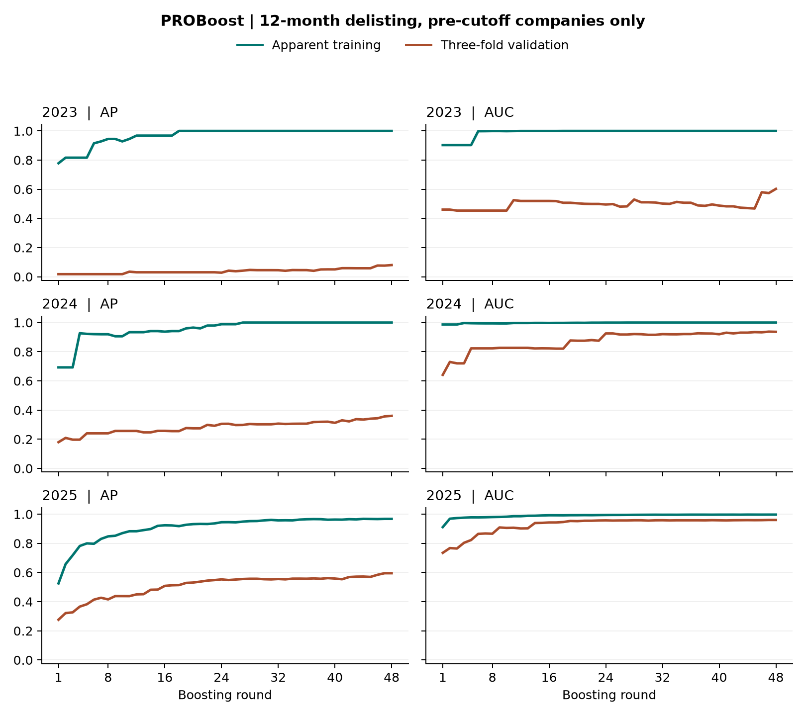
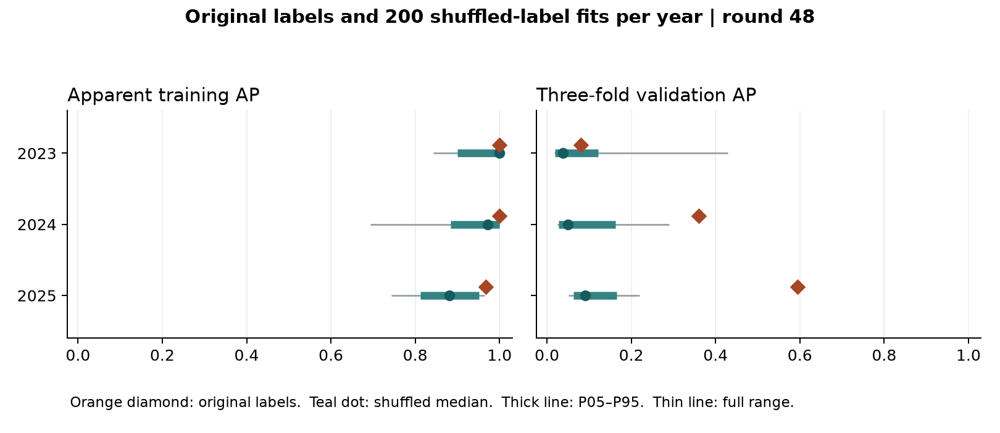

# PROBoost 在 2023 年历史训练公司上的过拟合诊断

**原模型的训练 AP = 1.000 准确。训练样本上存在明显的过拟合迹象，证据集中在“能把极少数正例排在最前，却难以在内部留出公司上重现”。** 2023 年历史训练队列有 309 家公司，277 家的 12 个月退市结局已知，其中 5 家退市。直接加载已部署模型，这 5 家全部排在 272 家已知非事件公司之前，1,360 个事件–对照配对无错序、无并列。三个内部验证折的平均 AP 仅 0.0800，AUC 为 0.6024。更换为随机标签后，200 次中仍有 165 次训练 AP 达到 1。训练满分单独不能证明有可泛化的退市信号。

## 训练满分是怎样出现的

固定 74 个输入，beta 由 2 线性降至 1，c=0.75，深度 2，48 轮，学习率 0.075。每一行都是同一个 48 轮训练过程的前缀；没有对每个轮数重新压缩 beta 日程。下表是 2023 年摘录，[完整曲线](ROUND_CURVES.csv)含三个年度各 48 行，以及各折指标和折外合并指标。

|轮数|训练 AP|训练 AUC|三折验证 AP|三折验证 AUC|
|---:|---:|---:|---:|---:|
|1|0.7783|0.9028|0.0175|0.4604|
|18|1.0000|1.0000|0.0304|0.5072|
|24|1.0000|1.0000|0.0277|0.4953|
|40|1.0000|1.0000|0.0503|0.4878|
|48|1.0000|1.0000|0.0800|0.6024|

第 18 轮首次达到完美训练排序，其后保持到第 48 轮。验证 AP 有波动，但 AP 和 AUC 的最高点都在第 48 轮，观察范围内没有峰后下降段。曲线不给出提前停止能提高验证表现的证据，第 48 轮以后的走势也未知。由于每折只留出了 1、2、2 个退市事件，最后三个折的 AP 分别为 0.0198、0.0212、0.1989。将三折的样本外分数放在一起直接算 AP 为 0.0305；各折等权的 0.0800 与原调参代码同口径。

## 固定配置的年度对照

各年仅使用该年 1 月 1 日之前的独立训练快照。已知公司数不含 12 个月结局未知的早期删失；先恢复的公司在“12 个月先退市”任务中是已知非事件。IPCW 和特征预处理均从各自拟合部分估计。

|截止年|已知公司／退市|第 48 轮训练 AP／AUC|第 48 轮验证 AP／AUC|验证 AP 最佳轮及后续|验证 AUC 最佳轮及后续|
|---|---:|---|---|---|---|
|2023|277／5|1.0000／1.0000|0.0800／0.6024|48，无后续轮|48，无后续轮|
|2024|313／9|1.0000／1.0000|0.3601／0.9364|48，无后续轮|47，0.9377，至 48 下降 0.0013|
|2025|359／23|0.9679／0.9971|0.5951／0.9603|47 与 48 并列|47 与 48 并列|

**正式模型单列。** 2023、2024、2025 年实际归档模型的训练 AP 都是 1.000，逐年配置及错序配对数见 [ORIGINAL_TRAINING.csv](ORIGINAL_TRAINING.csv)。2024 年原部署深度为 3；2025 年原部署深度为 3、c=0.25。两者均不同于本次年度对照的固定配置。2025 年的 0.9679 专指用 2023 年配置重放的训练 AP。2023 年的重放与已部署模型在所有已知训练企业上的得分逐值相同，三年固定候选的原归档三折验证 AP 也逐折核对通过。

## 随机标签能做到什么程度

每年打乱已知公司之间的退市标签 200 次，保留该年真实正例数、删失与随访记录。每次重新分层分折、拟合并验证。下表的分位数为第 48 轮 AP；各格依次为中位数和 [P5, P95]。完整极值、每次结果和折分数另存 CSV。

|截止年|随机标签训练 AP|随机标签验证 AP|随机标签训练满分次数|随机标签验证 AP 达到或超过真实值|
|---|---|---|---:|---:|
|2023|1.0000 [0.8996, 1.0000]|0.0375 [0.0183, 0.1209]|165/200|33/200|
|2024|0.9722 [0.8839, 1.0000]|0.0498 [0.0281, 0.1620]|61/200|0/200|
|2025|0.8809 [0.8116, 0.9508]|0.0904 [0.0627, 0.1654]|0/200|0/200|

2023 年的真实验证 AP 高于置换中位数，但在置换样本中并不罕见。按包含同分的上尾计数并做加一修正，为 34/201 = 0.169。若先在全部 48 轮内找验证 AP 最高点，再与每个置换自身的最高点比较，57/200 次达到或超过真实最高点，加一修正为 58/201 = 0.289。2024、2025 年的真实验证 AP 则都超过本年 200 次置换的最高值，加一修正各为 1/201。两个对照年显示出比 2023 更清楚的内部排序信号。正例数、公司构成、年份、历史信息均同时变化，本实验不能分离各项原因。

## 解释范围与执行记录

- “过拟合”在此特指样本内满分与内部验证的落差，以及对随机标签的拟合能力。结论不足以证明真实信号为零、存在数据泄漏，或解释任何外层测试年的具体 AUC。只分析截止日前公司，整个诊断没有加载评价集标签或预测。
- 分层三折沿用原机制，没有按时间再分验证期。配置继承自此前看过历史内部指标的基准，置换也固定原删失时钟和 IPCW 口径。上尾数值用于诊断该条件下的拟合能力，不构成对未来队列的确认性检验。
- 三年各 1 组真实标签、200 组置换。每组拟合 1 个完整历史模型和 3 个折内模型，共 2,412 次诊断拟合，全部成功。研究未改动正式 PROBoost、Chen Stacking 或 XAI-RSF，也没有用峰值轮数选择新模型。
