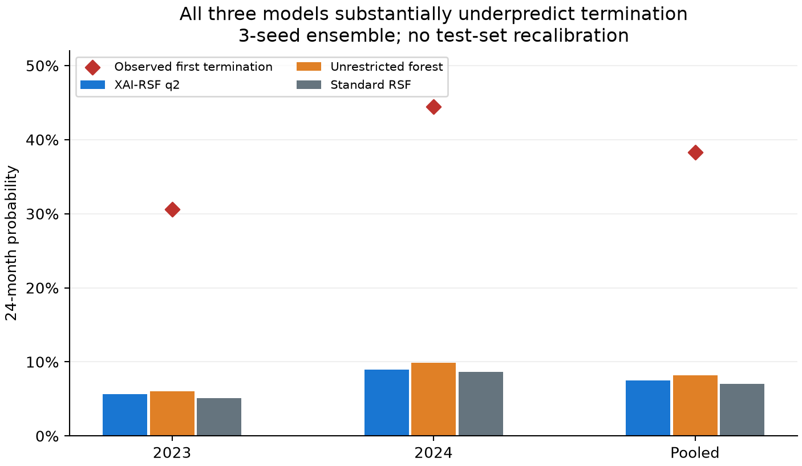

# 集成预测、校准与核查覆盖

本页先将同配置三个种子的概率等权平均，再评价这个集成；主比较仍见 `RESULTS_ZH.md` 的种子均值。没有从三个种子中选优。原始预测不重新映射、缩放或按测试结局校准。

## 24个月先退市集成

| 模型 | 入组期 | auc | ap | brier | 平均预测概率 | 观察事件比例 |
| --- | --- | --- | --- | --- | --- | --- |
| XAI-RSF q2 | 2023 | 0.6400 | 0.5463 | 0.2705 | 0.0566 | 0.3056 |
| XAI-RSF q2 | 2024 | 0.5340 | 0.4903 | 0.3718 | 0.0898 | 0.4444 |
| XAI-RSF q2 | pooled | 0.6226 | 0.4802 | 0.3268 | 0.0751 | 0.3827 |
| 同后端无限阶森林 | 2023 | 0.6327 | 0.4081 | 0.2686 | 0.0602 | 0.3056 |
| 同后端无限阶森林 | 2024 | 0.5320 | 0.5579 | 0.3649 | 0.0984 | 0.4444 |
| 同后端无限阶森林 | pooled | 0.5994 | 0.5072 | 0.3221 | 0.0814 | 0.3827 |
| 标准RSF（randomForestSRC） | 2023 | 0.5055 | 0.3574 | 0.2777 | 0.0507 | 0.3056 |
| 标准RSF（randomForestSRC） | 2024 | 0.5300 | 0.5696 | 0.3729 | 0.0861 | 0.4444 |
| 标准RSF（randomForestSRC） | pooled | 0.5652 | 0.5043 | 0.3306 | 0.0704 | 0.3827 |
| 训练AJ无变量基线 | 2023 | 0.5000 | 0.3056 | 0.2767 | 0.0516 | 0.3056 |
| 训练AJ无变量基线 | 2024 | 0.5000 | 0.4444 | 0.4013 | 0.0516 | 0.4444 |
| 训练AJ无变量基线 | pooled | 0.5000 | 0.3827 | 0.3459 | 0.0516 | 0.3827 |

q2合并平均退市概率0.0751，实际31/81=0.3827；标准RSF约0.0704，无限阶约0.0814，同样明显低估。训练AJ基线约0.0516，反映训练端可见发生率较低。相对这个弱基线的Brier改善不等于已能正确估计新年代绝对概率。不能使用测试事件率重新标定后再把结果冒充原固定模型。

## 24个月先恢复集成

| 模型 | 入组期 | auc | ap | brier | 平均预测概率 | 观察事件比例 |
| --- | --- | --- | --- | --- | --- | --- |
| XAI-RSF q2 | 2023 | 0.5079 | 0.4913 | 0.3106 | 0.6691 | 0.4167 |
| XAI-RSF q2 | 2024 | 0.4289 | 0.3295 | 0.2807 | 0.5447 | 0.3556 |
| XAI-RSF q2 | pooled | 0.4865 | 0.4196 | 0.2940 | 0.6000 | 0.3827 |
| 同后端无限阶森林 | 2023 | 0.6413 | 0.5679 | 0.2985 | 0.6667 | 0.4167 |
| 同后端无限阶森林 | 2024 | 0.5453 | 0.3923 | 0.2721 | 0.5636 | 0.3556 |
| 同后端无限阶森林 | pooled | 0.5839 | 0.4852 | 0.2838 | 0.6094 | 0.3827 |
| 标准RSF（randomForestSRC） | 2023 | 0.5746 | 0.5406 | 0.3299 | 0.7028 | 0.4167 |
| 标准RSF（randomForestSRC） | 2024 | 0.6530 | 0.5542 | 0.2502 | 0.5504 | 0.3556 |
| 标准RSF（randomForestSRC） | pooled | 0.6065 | 0.4991 | 0.2856 | 0.6182 | 0.3827 |
| 训练AJ无变量基线 | 2023 | 0.5000 | 0.4167 | 0.3098 | 0.6750 | 0.4167 |
| 训练AJ无变量基线 | 2024 | 0.5000 | 0.3556 | 0.3267 | 0.6679 | 0.3556 |
| 训练AJ无变量基线 | pooled | 0.5319 | 0.3991 | 0.3192 | 0.6710 | 0.3827 |

q2合并平均恢复概率约0.6000，观察发生率0.3827，存在过估。两种转归应同时检查；单独强调退市排序会遗漏这一问题。五组校准表在 `results/calibration.csv`，每组约7—17家公司，只作描述，未声称曲线稳定。

## Top20%及Top25%

| 模型 | 入组期 | 比例 | 核查数 | 捕获数 | 总退市数 | 已知非目标 | 未知 | 提前≥3月 | 提前≥6月 |
| --- | --- | --- | --- | --- | --- | --- | --- | --- | --- |
| XAI-RSF q2 | 2023 | 0.2000 | 8 | 5 | 11 | 3 | 0 | 4 | 2 |
| XAI-RSF q2 | 2023 | 0.2500 | 9 | 5 | 11 | 4 | 0 | 4 | 2 |
| XAI-RSF q2 | 2024 | 0.2000 | 9 | 3 | 20 | 6 | 0 | 3 | 1 |
| XAI-RSF q2 | 2024 | 0.2500 | 12 | 5 | 20 | 7 | 0 | 5 | 2 |
| XAI-RSF q2 | pooled | 0.2000 | 17 | 8 | 31 | 9 | 0 | 7 | 3 |
| XAI-RSF q2 | pooled | 0.2500 | 21 | 10 | 31 | 11 | 0 | 9 | 4 |
| 同后端无限阶森林 | 2023 | 0.2000 | 8 | 3 | 11 | 5 | 0 | 3 | 1 |
| 同后端无限阶森林 | 2023 | 0.2500 | 9 | 4 | 11 | 5 | 0 | 4 | 2 |
| 同后端无限阶森林 | 2024 | 0.2000 | 9 | 6 | 20 | 3 | 0 | 6 | 1 |
| 同后端无限阶森林 | 2024 | 0.2500 | 12 | 7 | 20 | 5 | 0 | 7 | 2 |
| 同后端无限阶森林 | pooled | 0.2000 | 17 | 9 | 31 | 8 | 0 | 9 | 2 |
| 同后端无限阶森林 | pooled | 0.2500 | 21 | 11 | 31 | 10 | 0 | 11 | 4 |
| 标准RSF（randomForestSRC） | 2023 | 0.2000 | 8 | 3 | 11 | 5 | 0 | 3 | 1 |
| 标准RSF（randomForestSRC） | 2023 | 0.2500 | 9 | 3 | 11 | 6 | 0 | 3 | 1 |
| 标准RSF（randomForestSRC） | 2024 | 0.2000 | 9 | 5 | 20 | 4 | 0 | 5 | 1 |
| 标准RSF（randomForestSRC） | 2024 | 0.2500 | 12 | 6 | 20 | 6 | 0 | 6 | 1 |
| 标准RSF（randomForestSRC） | pooled | 0.2000 | 17 | 8 | 31 | 9 | 0 | 8 | 2 |
| 标准RSF（randomForestSRC） | pooled | 0.2500 | 21 | 9 | 31 | 12 | 0 | 9 | 2 |

合并Top20为各年分别排名后合并：17/81家被核查，q2捕获8/31（25.8%），无限阶9/31，标准RSF8/31。Top25时21家被核查，q2捕获10/31、无限阶11/31、标准RSF9/31。小样本向上取整使实际核查比例略大于名义比例。此处“已知非目标”含先恢复及到时限仍未出现首次转归，不能全称为误报或正常；本批未知为0。

每企业只在首次ST公告时预测一次，所以无重复预警、无季度核查机制。提前识别以公告日计算，不是退市执行日前的时间。年度排序使用事后完整入组名单，不能当成当时已部署的在线决策系统。逐种子和12个月结果均保存在 `warning_metrics.csv`。
