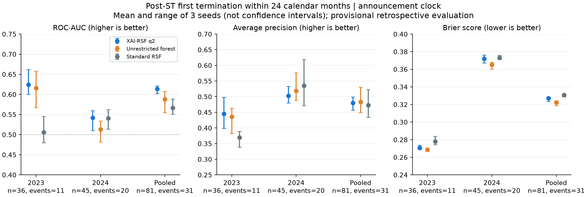

# 预测结果：三种子均值

以下主表为三个固定种子42/101/202的指标均值，不是挑选最好种子，也不是集成预测指标。完整种子值、最小／最大及标准差在CSV中；三个种子不构成置信区间。记录与公司等权完全一致。

## 24个月先退市（主终点之一）

| 模型 | 入组期 | AUC均值 | AP均值 | Brier均值 |
| --- | --- | --- | --- | --- |
| 标准RSF（randomForestSRC） | 2023 | 0.5055 | 0.3694 | 0.2779 |
| 标准RSF（randomForestSRC） | 2024 | 0.5407 | 0.5354 | 0.3731 |
| 标准RSF（randomForestSRC） | pooled | 0.5665 | 0.4728 | 0.3308 |
| 同后端无限阶森林 | 2023 | 0.6158 | 0.4356 | 0.2688 |
| 同后端无限阶森林 | 2024 | 0.5133 | 0.5186 | 0.3652 |
| 同后端无限阶森林 | pooled | 0.5880 | 0.4830 | 0.3223 |
| XAI-RSF q2 | 2023 | 0.6242 | 0.4450 | 0.2707 |
| XAI-RSF q2 | 2024 | 0.5420 | 0.5026 | 0.3720 |
| XAI-RSF q2 | pooled | 0.6138 | 0.4802 | 0.3270 |

2023有11/36个事件，2024有20/45个事件，合并31/81。q2在2023尚有一定排序能力，2024平均AUC仅0.542；合并AUC不能掩盖分年失效。AP的参照水平随事件发生率变化，2024 AP约0.503并不代表概率校准良好。

## 24个月先恢复（另一竞争转归）

| 模型 | 入组期 | AUC均值 | AP均值 | Brier均值 |
| --- | --- | --- | --- | --- |
| 标准RSF（randomForestSRC） | 2023 | 0.5693 | 0.5369 | 0.3318 |
| 标准RSF（randomForestSRC） | 2024 | 0.6552 | 0.5319 | 0.2529 |
| 标准RSF（randomForestSRC） | pooled | 0.6026 | 0.4964 | 0.2880 |
| 同后端无限阶森林 | 2023 | 0.6222 | 0.5619 | 0.3005 |
| 同后端无限阶森林 | 2024 | 0.5366 | 0.4244 | 0.2756 |
| 同后端无限阶森林 | pooled | 0.5772 | 0.4808 | 0.2867 |
| XAI-RSF q2 | 2023 | 0.5217 | 0.4751 | 0.3115 |
| XAI-RSF q2 | 2024 | 0.4404 | 0.3502 | 0.2817 |
| XAI-RSF q2 | pooled | 0.4933 | 0.4137 | 0.2950 |

q2恢复AUC在2024为0.440，合并0.493，弱于本轮标准RSF；不能只展示退市的相对AUC而省略恢复的负面结果。

## 12个月先退市

| 模型 | 入组期 | AUC均值 | AP均值 | Brier均值 |
| --- | --- | --- | --- | --- |
| 标准RSF（randomForestSRC） | 2023 | 0.5898 | 0.1755 | 0.1073 |
| 标准RSF（randomForestSRC） | 2024 | 0.5867 | 0.4789 | 0.3145 |
| 标准RSF（randomForestSRC） | pooled | 0.6462 | 0.3816 | 0.2224 |
| 同后端无限阶森林 | 2023 | 0.5729 | 0.1582 | 0.1075 |
| 同后端无限阶森林 | 2024 | 0.5837 | 0.4296 | 0.3113 |
| 同后端无限阶森林 | pooled | 0.6607 | 0.3735 | 0.2208 |
| XAI-RSF q2 | 2023 | 0.6224 | 0.2215 | 0.1075 |
| XAI-RSF q2 | 2024 | 0.5052 | 0.3985 | 0.3129 |
| XAI-RSF q2 | pooled | 0.6338 | 0.3565 | 0.2216 |

## 12个月先恢复

| 模型 | 入组期 | AUC均值 | AP均值 | Brier均值 |
| --- | --- | --- | --- | --- |
| 标准RSF（randomForestSRC） | 2023 | NA | NA | 0.1251 |
| 标准RSF（randomForestSRC） | 2024 | 0.4756 | 0.1227 | 0.0964 |
| 标准RSF（randomForestSRC） | pooled | 0.3474 | 0.0464 | 0.1091 |
| 同后端无限阶森林 | 2023 | NA | NA | 0.0789 |
| 同后端无限阶森林 | 2024 | 0.3740 | 0.0877 | 0.0968 |
| 同后端无限阶森林 | pooled | 0.2868 | 0.0414 | 0.0888 |
| XAI-RSF q2 | 2023 | NA | NA | 0.0679 |
| XAI-RSF q2 | 2024 | 0.4573 | 0.1215 | 0.0936 |
| XAI-RSF q2 | pooled | 0.2955 | 0.0429 | 0.0822 |

2023年12个月内没有观察到首次恢复，AUC与AP无定义，表中NA不是0，也不是计算任务失败。2024也仅4个恢复事件，不支持强结论。合并指标来自合并预测重新计算。

## 表观训练表现与评价边界

| model | auc_mean | ap_mean | brier_mean |
| --- | --- | --- | --- |
| standard_rsf | 0.9681 | 0.7828 | 0.0403 |
| unrestricted | 0.9817 | 0.8715 | 0.0391 |
| xai_q2 | 0.9866 | 0.8648 | 0.0410 |

以上为同样本表观指标，不是OOB或交叉验证。高训练AUC与弱时间外表现提示拟合适应性及年代迁移问题；不能据此区分过拟合、事件谱变化、数据版本误差各自占比。训练只有14个先退市事件，测试31个；不使用测试事件率反向调参或重新校准。

