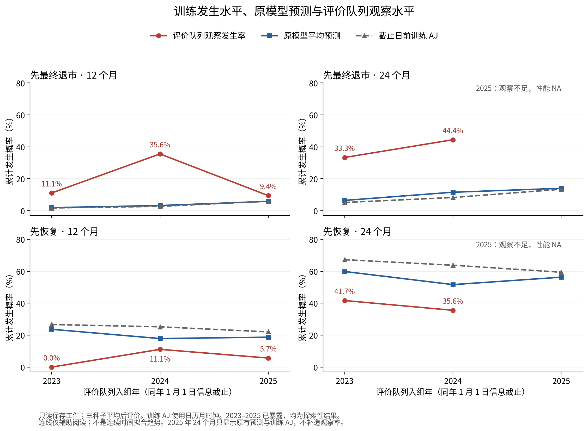

# 退市预测报告口径与水平漂移：只读分析

**结论：原来的 pooled AUC 数值计算没有错误，但不能把它的上升表述为“年内筛查排序改善”。** 原因平方分数的12个月 pooled AUC由0.6451升到0.6613，年内AUC却由0.7584降到0.7019；两者同时加入也反向。单独支持保护的年内AUC在12/24个月均略升，但95%差值区间均跨0，尚不足以宣布稳定收益或替换参考模型。

**低估更符合“2023—2024发生水平集中上升、历史训练水平反应较慢”的描述。** 2025年12个月观察率回落，而训练AJ和模型均值继续上升，低估明显减轻。日历年风险在2024年集中升高，入组队列风险也变化；市场输入分布有明显漂移，但这些描述不足以在队列、日历环境和协变量之间作独立因果归因。

本轮森林拟合0、校准器拟合0、其他新研究模型0、倍率/参数搜索0。只读取现有保存工件；训练AJ是用户要求的无变量发生率统计。原模型、CURRENT指针、冻结协议和所有旧预测/报告未修改。2023—2025全部为**探索性**，继承财报原始披露版本PROVISIONAL限制。2025年24个月性能保持NA。

## 年内排序与跨年排序

年内AUC = 各年“胜出配对数＋0.5×并列配对数”之和 / 各年“事件数×非事件数”之和。只比较同一年度的公司。年度等权均值仅平均有事件且有非事件的年份；无事件年记0对，AUC保留NA，不按0加入均值。

12个月退市配对数为128、464、240，共832；24个月为288、500，共788。pooled AUC还包括跨年配对，因此不是这两个指标的另一种写法。12个月所有正负配对2725对，其中1893对跨年，占69.47%；24个月跨年占49.74%。不同年份风险水平和事件构成会明显影响pooled排序。

配对分解进一步确认：12个月退市跨年配对AUC，原模型为0.5954，新分裂准则为0.6434；跨年配对改善掩盖了同年配对下降。见PAIR_DECOMPOSITION.csv。这是对pooled数值的精确算术分解，不是政策或模型机制的因果解释。

下表为三种子平均后的收缩版本；within_minus_pooled为年内减pooled。年度、raw、两原因、AP/Brier对照全部见CSV。

| months | arm | within_year_auc | equal_year_auc | pooled_auc | within_minus_pooled |
| --- | --- | --- | --- | --- | --- |
| 12 | baseline | 0.7584 | 0.7338 | 0.6451 | 0.1133 |
| 12 | quadratic | 0.7019 | 0.7110 | 0.6613 | 0.0406 |
| 12 | support | 0.7788 | 0.7674 | 0.6572 | 0.1216 |
| 12 | quadratic_support | 0.7055 | 0.7283 | 0.6646 | 0.0409 |
| 24 | baseline | 0.7614 | 0.7583 | 0.7296 | 0.0318 |
| 24 | quadratic | 0.7360 | 0.7442 | 0.7219 | 0.0141 |
| 24 | support | 0.7678 | 0.7699 | 0.7283 | 0.0395 |
| 24 | quadratic_support | 0.7221 | 0.7309 | 0.7168 | 0.0052 |

单独支持保护在24个月的方向也随口径改变：年内0.7614→0.7678，pooled0.7296→0.7283。原因平方分数及组合臂24个月在两种口径下都下降。恢复年内AUC在新增三臂下均未提高：12个月原模型0.6457，三臂0.6229/0.6286/0.6143；24个月原模型0.7022，三臂0.6765/0.6919/0.6791。不能只报告退市一侧。

| months | contrast | estimate | lower95 | upper95 | undefined_repeats |
| --- | --- | --- | --- | --- | --- |
| 12 | quadratic_minus_baseline | -0.0565 | -0.1492 | 0.0252 | 0 |
| 12 | support_minus_baseline | 0.0204 | -0.0120 | 0.0592 | 0 |
| 12 | quadratic_support_minus_baseline | -0.0529 | -0.1499 | 0.0272 | 0 |
| 12 | score_support_interaction | -0.0168 | -0.0569 | 0.0215 | 0 |
| 24 | quadratic_minus_baseline | -0.0254 | -0.0942 | 0.0388 | 0 |
| 24 | support_minus_baseline | 0.0063 | -0.0288 | 0.0403 | 0 |
| 24 | quadratic_support_minus_baseline | -0.0393 | -0.1084 | 0.0267 | 0 |
| 24 | score_support_interaction | -0.0203 | -0.0608 | 0.0158 | 0 |

1000次、种子2026110201，按测试年分层并以公司为单位，**逐元素复用原cause-support抽样索引**。所有臂、raw/收缩版本使用相同抽样；差值为消融臂减基线。区间只反映固定模型下评价公司的波动，不含训练、选择或历次开发不确定性，多重探索不可当确认性显著检验。各scope未定义次数如下（所列是AUC家族的最大值）：

| scope | months | cause | undefined_repeats |
| --- | --- | --- | --- |
| 2023 | 12 | 1 | 15 |
| 2023 | 12 | 2 | 1000 |
| 2023 | 24 | 1 | 0 |
| 2023 | 24 | 2 | 0 |
| 2024 | 12 | 1 | 0 |
| 2024 | 12 | 2 | 2 |
| 2024 | 24 | 1 | 0 |
| 2024 | 24 | 2 | 0 |
| 2025 | 12 | 1 | 5 |
| 2025 | 12 | 2 | 36 |
| pooled | 12 | 1 | 0 |
| pooled | 12 | 2 | 0 |
| pooled | 24 | 1 | 0 |
| pooled | 24 | 2 | 0 |

2023年12个月恢复没有事件，1000次AUC均未定义；在跨年度年内指标中该年贡献0对。其O/E为0、bootstrap区间也退化为0，**不表示真实恢复风险确定为0**。完整逐scope/指标计数保留。

## 预警报告：风险水平与Top20

O/E是观察发生率除以平均预测概率，大于1表示总体低估，不能直接当作可部署的放大倍率。以下为原模型退市：

| scope | months | observed | mean_predicted | observed_expected | lower95 | upper95 |
| --- | --- | --- | --- | --- | --- | --- |
| 2023 | 12 | 0.1111 | 0.0191 | 5.8229 | 1.4185 | 11.8065 |
| 2024 | 12 | 0.3556 | 0.0324 | 10.9851 | 6.9636 | 14.7915 |
| 2025 | 12 | 0.0943 | 0.0585 | 1.6114 | 0.3462 | 3.0563 |
| 2023 | 24 | 0.3333 | 0.0647 | 5.1535 | 2.9909 | 7.4090 |
| 2024 | 24 | 0.4444 | 0.1158 | 3.8376 | 2.7283 | 5.0159 |
| 2025 | 24 | NA | NA | NA | NA | NA |

Top20名额按年ceil(0.2n)为8、9、11；合并先按年度选定后相加。命中率=捕获/被检查数，覆盖率=捕获/该年事件总数，提升倍数=命中率/该年观察发生率。二者不能混称。例如2024年12个月支持保护捕获7/16，覆盖率43.75%，检查9家中7家发生退市，命中率77.78%，提升2.1875倍。

| scope | months | arm | checked | captured | precision | coverage | lift |
| --- | --- | --- | --- | --- | --- | --- | --- |
| 2023 | 12 | baseline | 8.0000 | 1.0000 | 0.1250 | 0.2500 | 1.1250 |
| 2023 | 12 | quadratic | 8.0000 | 2.0000 | 0.2500 | 0.5000 | 2.2500 |
| 2023 | 12 | support | 8.0000 | 1.0000 | 0.1250 | 0.2500 | 1.1250 |
| 2023 | 12 | quadratic_support | 8.0000 | 2.0000 | 0.2500 | 0.5000 | 2.2500 |
| 2024 | 12 | baseline | 9.0000 | 6.0000 | 0.6667 | 0.3750 | 1.8750 |
| 2024 | 12 | quadratic | 9.0000 | 6.0000 | 0.6667 | 0.3750 | 1.8750 |
| 2024 | 12 | support | 9.0000 | 7.0000 | 0.7778 | 0.4375 | 2.1875 |
| 2024 | 12 | quadratic_support | 9.0000 | 5.0000 | 0.5556 | 0.3125 | 1.5625 |
| 2025 | 12 | baseline | 11.0000 | 2.0000 | 0.1818 | 0.4000 | 1.9273 |
| 2025 | 12 | quadratic | 11.0000 | 2.0000 | 0.1818 | 0.4000 | 1.9273 |
| 2025 | 12 | support | 11.0000 | 2.0000 | 0.1818 | 0.4000 | 1.9273 |
| 2025 | 12 | quadratic_support | 11.0000 | 2.0000 | 0.1818 | 0.4000 | 1.9273 |
| 2023 | 24 | baseline | 8.0000 | 4.0000 | 0.5000 | 0.3333 | 1.5000 |
| 2023 | 24 | quadratic | 8.0000 | 4.0000 | 0.5000 | 0.3333 | 1.5000 |
| 2023 | 24 | support | 8.0000 | 5.0000 | 0.6250 | 0.4167 | 1.8750 |
| 2023 | 24 | quadratic_support | 8.0000 | 4.0000 | 0.5000 | 0.3333 | 1.5000 |
| 2024 | 24 | baseline | 9.0000 | 8.0000 | 0.8889 | 0.4000 | 2.0000 |
| 2024 | 24 | quadratic | 9.0000 | 8.0000 | 0.8889 | 0.4000 | 2.0000 |
| 2024 | 24 | support | 9.0000 | 7.0000 | 0.7778 | 0.3500 | 1.7500 |
| 2024 | 24 | quadratic_support | 9.0000 | 8.0000 | 0.8889 | 0.4000 | 2.0000 |
| 2025 | 24 | baseline | NA | NA | NA | NA | NA |
| 2025 | 24 | quadratic | NA | NA | NA | NA | NA |
| 2025 | 24 | support | NA | NA | NA | NA | NA |
| 2025 | 24 | quadratic_support | NA | NA | NA | NA | NA |

所有两原因、raw/收缩版本及合并结果见TOP20_LIFT.csv。零事件年的lift与coverage为NA，未知结局不当非事件。所有被支持的原评价窗口均为完整终点，IPCW实际权重为1，沿用既有评价器。

## 无变量AJ基线与风险水平滞后

temporal-affine分支使用训练AJ构造校准偏移形状，但没有等价的“日历月常数预测Brier”表，因此这里直接从各截止日前保存的训练time/event和日历时钟计算AJ，不估计校准参数。每年度、时限、原因的AJ作为所有评价公司的同一常数；训练删失留在风险集中直到删失时点。嵌套训练集不能相加当独立样本。pooled逐公司重算，各年使用各自历史常数，不把年度Brier简单平均。

| year | months | training_aj | null_brier | forest_brier | forest_minus_null_brier |
| --- | --- | --- | --- | --- | --- |
| 2023 | 12 | 0.0173 | 0.1076 | 0.1065 | -0.0010 |
| 2023 | 24 | 0.0516 | 0.3016 | 0.2860 | -0.0156 |
| 2024 | 12 | 0.0271 | 0.3370 | 0.3285 | -0.0086 |
| 2024 | 24 | 0.0828 | 0.3777 | 0.3396 | -0.0382 |
| 2025 | 12 | 0.0597 | 0.0866 | 0.0847 | -0.0020 |
| 2025 | 24 | 0.1343 | NA | NA | NA |
| pooled | 12 | 0.0373 | 0.1764 | 0.1724 | -0.0039 |
| pooled | 24 | 0.0689 | 0.3439 | 0.3157 | -0.0281 |

原森林在全部有支持的年度/时限/原因上Brier均优于该历史常数基线；因此“风险水平低估”不等于“森林完全没有预测信息”。但两者都依赖历史发生水平，森林在2024年24个月均值11.58%仍远低于44.44%，优于旧历史基线并不证明绝对概率准确。

下表概率为百分数：

| year | months | training_aj | mean_predicted | observed |
| --- | --- | --- | --- | --- |
| 2023 | 12 | 1.73 | 1.91 | 11.11 |
| 2023 | 24 | 5.16 | 6.47 | 33.33 |
| 2024 | 12 | 2.71 | 3.24 | 35.56 |
| 2024 | 24 | 8.28 | 11.58 | 44.44 |
| 2025 | 12 | 5.97 | 5.85 | 9.43 |
| 2025 | 24 | 13.43 | 14.00 | NA |

12个月训练AJ为1.73%、2.71%、5.97%，原模型均值1.91%、3.24%、5.85%，观察率11.11%、35.56%、9.43%。历史混合水平上升滞后于评价队列峰值，是有直接数值支持的描述；仅三个外层年份，不拟合趋势、不做显著性检验。既有仿射/3倍示例也显示统一放大不能保证跨年都受益；本轮不重估或试用任何新映射。

## 日历时间、队列与协变量

固定443家首次财务/审计ST企业，每公司只保留一条风险历程；2012—2022入组者用已有2025截止训练标签，2023—2025入组者用原冻结评价标签。累计207009风险天、62次先退市、251次先恢复。原点为公告后下一交易日开盘前；到首次事件/删失或24日历月即停止。**这不是全市场每年退市数，也不包括先恢复后再退市。** 风险公司数是当年贡献风险时间（或Jan1端点事件）的公司；人月=实际天数÷(365.25/12)。2026仅到6月30日，不能把半年度事件数与整年直接相比。

| calendar_year | risk_companies | person_months | termination_events | recovery_events | termination_rate_per100_person_months |
| --- | --- | --- | --- | --- | --- |
| 2021 | 125 | 810.086 | NA | 39.000 | NA |
| 2022 | 92 | 677.224 | 8.000 | 22.000 | 1.181 |
| 2023 | 85 | 585.528 | 12.000 | 14.000 | 2.049 |
| 2024 | 89 | 606.587 | 23.000 | 13.000 | 3.792 |
| 2025 | 96 | 695.688 | 8.000 | 18.000 | 1.150 |
| 2026 | 61 | 307.318 | 5.000 | 22.000 | 1.627 |

事件发生日历年2024有23次退市，粗率3.792/百人月，2023为2.049、2025为1.150。峰值并非只见于单一入组年的观察比例，支持关注日历环境；同时风险集构成与入组后时长在变化，不能把粗率视为已调整日历效应。精确“每个入组年×日历年”表在私有目录；公开COHORT_CALENDAR_CROSS按入组期合并，1—4事件及可由边际倒推的小格互补抑制，COHORT_AJ保留支持状态与稀少计数抑制标记。

协变量SMD=(评价均值−训练均值)/sqrt((训练方差＋评价方差)/2)，各列只用非缺失值；缺失率另列，不把NaN当0。未定义方差保留NA。完整83列结果留私有，公开五组汇总和每年最多5项大漂移变量；不公布原始均值、真实阈值或公司值。

| year | feature_group | features | median_abs_smd | above_abs_05 | mean_train_missing | mean_eval_missing |
| --- | --- | --- | --- | --- | --- | --- |
| 2023 | entry_warning | 1 | 0.7554 | 1 | 0.0000 | 0.0000 |
| 2023 | financial | 48 | 0.2190 | 1 | 0.0333 | 0.0469 |
| 2023 | linked_audit_opinion | 7 | 0.3771 | 2 | 0.0000 | 0.0000 |
| 2023 | market | 24 | 0.3329 | 9 | 0.0337 | 0.0046 |
| 2023 | quality_staleness | 3 | 0.3961 | 0 | 0.0000 | 0.0000 |
| 2024 | entry_warning | 1 | 0.8567 | 1 | 0.0000 | 0.0000 |
| 2024 | financial | 48 | 0.1733 | 3 | 0.0347 | 0.0361 |
| 2024 | linked_audit_opinion | 7 | 0.2544 | 1 | 0.0000 | 0.0000 |
| 2024 | market | 24 | 0.6904 | 16 | 0.0307 | 0.0000 |
| 2024 | quality_staleness | 3 | 0.2688 | 1 | 0.0000 | 0.0000 |
| 2025 | entry_warning | 1 | 0.1937 | 0 | 0.0000 | 0.0000 |
| 2025 | financial | 48 | 0.1561 | 3 | 0.0349 | 0.0554 |
| 2025 | linked_audit_opinion | 7 | 0.1044 | 0 | 0.0000 | 0.0000 |
| 2025 | market | 24 | 0.5407 | 14 | 0.0271 | 0.0031 |
| 2025 | quality_staleness | 3 | 0.2796 | 0 | 0.0000 | 0.0000 |

市场24变量的|SMD|中位数为0.333、0.690、0.541，2024有16/24项超过0.5；2024尾部收益、极端下跌、下行波动等变化明显。财务组中位数为0.219、0.173、0.156，较市场组小。缺失覆盖也不同。**存在协变量漂移的证据较强；它解释低估的份额不可识别**：没有重加权、条件风险模型或因果对照，且2025市场分布仍明显不同、观察退市却下降。不能据此说低估全由协变量、政策或模型交互衰减造成。

## 退市依据与政策时间

只复用post_st_rule_features_v1已有45例终止公告审计，按原sample_id映射到当前风险历程，不用ST/*ST简称推断终止原因，不重新对未审查文本分类。本次62次先退市中43次有已审查明确原因，19次不可得/文本不明确（包括全部2025入组原因缺口）。旧审计与当前下一开盘原点/随访窗口并非全覆盖，新出现事件保持不可得。

| year_group | reason_group | events | status |
| --- | --- | --- | --- |
| 2012-2022 | reviewed_other_terminal_ground | NA | SUPPRESSED_FOR_SMALL_OR_COMPLEMENTARY_CELL |
| 2012-2022 | reviewed_price_below_one_yuan | NA | SUPPRESSED_FOR_SMALL_OR_COMPLEMENTARY_CELL |
| 2012-2022 | unavailable_or_not_explicit | NA | SUPPRESSED_FOR_SMALL_OR_COMPLEMENTARY_CELL |
| 2023-2024 | reviewed_other_terminal_ground | 6 | REPORTED |
| 2023-2024 | reviewed_price_below_one_yuan | 19 | REPORTED |
| 2023-2024 | unavailable_or_not_explicit | 10 | REPORTED |
| 2025-2026H1 | reviewed_other_terminal_ground | NA | SUPPRESSED_FOR_SMALL_OR_COMPLEMENTARY_CELL |
| 2025-2026H1 | reviewed_price_below_one_yuan | NA | SUPPRESSED_FOR_SMALL_OR_COMPLEMENTARY_CELL |
| 2025-2026H1 | unavailable_or_not_explicit | NA | SUPPRESSED_FOR_SMALL_OR_COMPLEMENTARY_CELL |

为防小样本识别，原因按日历期与“已审查低于1元/其他已审查/不可得”合并；2023—2024日历期35次退市中19次具有已审查低价依据，6次其他依据，10次无明确依据。不可得部分不能推断成非低价。其他细原因与逐年小格保留私有。

政策分支研究的是制造业季度首次ST预警（首次ST为目标），本轮是全行业非金融ST后的首次恢复/最终退市，**其样本、标签、个体规则匹配和错误归因均不适用**。只引用已核查官方日期：2020-12-31发布退市修订，市值条款2021-07-01施行；2024-04-30发布修订，财务新条款以2024年报为首个适用年度，市值条款2024-10-30施行。低于1元价格路径不能混同市值路径，2024发生的退市不能全部归入新财务标准。[上交所2020通知](https://www.sse.com.cn/lawandrules/sselawsrules/repeal/rules/c/c_20220107_5679292.shtml)、[上交所2024通知](https://www.sse.com.cn/lawandrules/sselawsrules2025/repeal/rules/c/c_20240430_10785259.shtml)。

POLICY_EVENT_ALIGNMENT.csv将日期与年事件/暴露并列；政策表只展示上交所示例，不冒充逐公司、逐板块完整适用判断。网页现标“失效”表示历史版本，不抹去当时生效日期。本轮核查官方网页，深交所2020链接一次超时，保留失败，采用已有来源和已取得的上交所通知，不补抓任何公司结局。

## 证据边界、验证与失败

1. 不能独立分解队列效应、日历效应、入组后时长效应：日历时间=入组时间+随访时长，年份少且样本小。粗发生率和SMD均不是因果估计。
2. 不能确定2025年24个月的校准或排序；保持NA。没有为补齐时间线获取新公司标签或延长观察窗口。
3. 不能证明单家企业概率的“真值”；O/E描述群体平均。缺失的终止依据、全板块政策适用细节和财报原始版本仍未解决。
4. 竞争事件在另一原因的CIF二元评价中是已知非该原因事件，不是失访或未知。原pooled AUC保留为跨年排序对照，不将其删除或改写成年内指标。完整raw、收缩、恢复、不利结果和所有未定义重抽样均在交付表中。
5. 指定8个验收值全部通过；逐年sklearn、原fast_metrics和纯配对计数一致；三种子均值逐元素复现保存预测；原pooled AUC/AP/Brier全部复现；输入哈希前后不变，CURRENT指针保持。全pytest含独立R检查见TESTS_full.log。
6. 实际分析失败均保留：验收回执首次因numpy.bool_不能JSON序列化失败（8个数值已通过）；初次metrics/drift尝试误把仅含X/ID的worker评价文件当作含groups，分别报KeyError后在新attempt修正读取来源。未改数据或评价口径。补齐pooled AJ对照后又做一次成功drift汇总，旧成功结果也保留。PDF最初字体嵌入警告已修正，最终渲染无警告；早期图保留。无真实模型拟合、无倍率搜索。

本次主要修订是报告的比较对象，而不是以新结果选择模型。论文建议文本见PAPER_PATCH_ZH.md；原报告不改写，当前参考模型继续保留。
