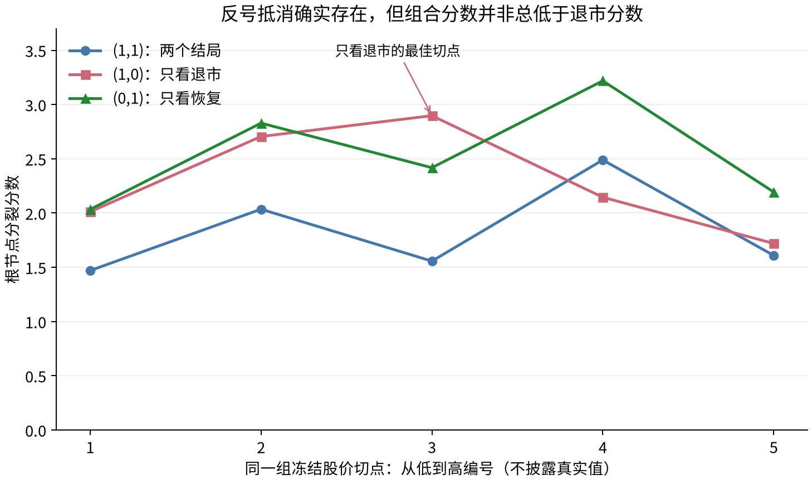

# 根节点结局权重核查：抵消存在，但尚不能确认为股价少被选择的主因

已实际执行用户建议的第2步。仅使用冻结训练矩阵和已有森林，未拟合新模型、未生成新企业预测、未读取2023／2024评价矩阵或2025年入组公司的结局。结论为：**反号抵消与权重改变带来的排名变化得到直接支持；“抵消是股价几乎不被选入的主要原因”尚未确认。** 没有因此修改 `ForestConfig` 或启动重训。

## 计算边界

训练仍为原309家公司、14个先退市、184个先恢复、111条事件标记为0的记录。事件0包含完整时限无事件与提前删失，不将其一律视作正常。保留原时间和删失；此次尚未调整为下一交易日预测。

完整队列上，对原75列逐一检查，74列存在符合节点支持约束的切分，共592个合格候选。`negative_equity_flag` 没有合格候选，排名为缺省，不填零伪造排序。三种权重使用完全相同的候选和约束：冻结的5个共享经验分位数切点、原生缺失路由、每子叶10条重抽样记录／5家公司／3条全部原因事件。不同变量因重复值和缺失路由可能少于或多于5个实际候选。

此外复用三个种子、每种子32棵q2树的原公司bootstrap样本，逐根节点比较三种权重。实际25变量资格集合与随机遍历次序不变，并额外报告允许全部75列参与的诊断；后者没有改变或写回任何树。

## 1. 完整队列：股价从第39升至第25，没有升至前列

| 原因权重（退市，恢复） | 股价最佳分裂分数 | 股价排名／有合格切分的变量数 | 排名第一的变量 |
| --- | ---: | ---: | --- |
| (1,1) | 2.4891 | 39／74 | 财报报告期陈旧度 `fin_period_age_scaled` |
| (1,0) | 2.8976 | 25／74 | 现金比率 `cash_ratio` |
| (0,1) | 3.2190 | 34／74 | 财报报告期陈旧度 `fin_period_age_scaled` |

每行重新选择该权重下的最佳股价切点，因此不能把三行分数差全归为同一个切点的抵消。完整74列×3权重结果在[变量排名CSV](results/full_cohort_variable_ranking.csv)，真实切点与缺失路由留在私有记录。

分裂分数是算法选择候选的量，不是AUC、概率或这里可直接作显著性检验的p值；变更权重后的分数／排名提高不等于时间外预测已经提高。

## 2. 同一切点：分子抵消和分母变化必须分别看

现有代码的准则是：

\[
S_w(c)=\frac{|w_D U_D(c)+w_R U_R(c)|}
{\sqrt{w_D^2V_D(c)+w_R^2V_R(c)}}.
\]

用相同股价候选中“只看退市”的最佳切点，实际计算为：

| 量 | 实际值 |
| --- | ---: |
| 退市偏差 $U_D$ | +5.4076 |
| 恢复偏差 $U_R$ | −16.2955 |
| 退市方差项 $V_D$ | 3.4828 |
| 恢复方差项 $V_R$ | 45.4200 |
| 组合分数 $S_{(1,1)}$ | 1.5570 |
| 退市分数 $S_{(1,0)}$ | 2.8976 |
| 恢复分数 $S_{(0,1)}$ | 2.4179 |

五个合格股价切点的两个偏差全部反号。这一切点的抵消比例定义为

\[
C=1-\frac{|U_D+U_R|}{|U_D|+|U_R|}=49.83\%.
\]

它表示相对两项绝对偏差之和的损失，不表示相对单独退市偏差的损失。这里 $|U_D+U_R|=10.8879$ 仍大于 $|U_D|=5.4076$；组合分数低于退市分数还与恢复项占总方差92.88%有关。准确分解为：

\[
\frac{S_{(1,1)}}{S_{(1,0)}}=
\frac{|U_D+U_R|}{|U_D|}
\sqrt{\frac{V_D}{V_D+V_R}}
=2.0135\times0.2669=0.5373.
\]

因此“分数受影响”的数学机制已验证，但不能把全部下降都叫作分子抵消。另一个事实是，在组合权重自己的最佳股价切点，组合分数2.4891反而高于退市分数2.1456。反号并不保证组合分数一定低于单一原因分数。

## 3. 已有96个根节点：排名改善，但仅新增一次股价胜出

在实际候选资格下，股价在32/96个根节点可参与，剩余64个不把“未提供”当成“评分落选”。

| 权重 | 32个可参与根节点中的股价排名中位数 | 排名四分位区间 | 股价胜出次数 |
| --- | ---: | --- | ---: |
| (1,1) | 13 | 7—16.25 | 0／32 |
| (1,0) | 6.5 | 5—10.25 | 1／32 |
| (0,1) | 11 | 7—13.25 | 0／32 |

排名分母随该bootstrap样本实际有合格切分的变量数略有变化；四分位区间反映这32个已有bootstrap根节点的变化，不是置信区间。

在额外允许全部75变量的诊断中，股价中位排名从40升至22.5，胜出从0／96变为2／96。即使解除资格限制并改用退市权重，股价仍很少是根节点最优变量。这不代表深层一定不会改变，本轮没有生长任何新分支。

“默认赢家的两个偏差应同号”没有得到支持：默认实际根节点赢家89／96都反号，完整队列第一名财报陈旧度也为退市−4.4296、恢复+40.1773。它虽然发生抵消，仍因净偏差及方差标准化后的分数较大胜出。不能仅凭同号／反号预测变量排名。

## 4. 为什么训练AUC有0.741，根节点排名却不靠前

这两种指标衡量不同目标。0.741是按连续股价排序的24个月退市端点IPCW AUC；根节点准则是在有限切点上把公司分成两组，比较全部观察事件时间上的风险集偏差。前者较好，不保证某一个二分切点在后者上排名第一。

此外，现金比率、换手率等变量可能有更强的单切点分数；14个退市事件导致bootstrap中估计支持变化明显。现有5个共享切点是否遗漏了有效价格区间仍未被本轮检验，不为获得股价第一而扩大切点搜索。

恢复事件多不自动证明任何变量的分数都由恢复决定；需要看各候选的实际偏差和方差。本文提供了股价的直接分解，不从184对14的事件总数推出普遍结论。同样，本轮没有计算原首次ST预警任务的分裂分数，不能断言那个任务因为事件语义不同而没有抵消。

## 5. 方法与后续边界

randomForestSRC的官方竞争风险说明已给出组合统计量和非负原因权重选项；本服务器安装的3.9.0文档也明确支持 `cause=c(1,0)` 与 `cause=c(0,1)`。当前保留 `logrankCR` 的修改风险集，仅比较原因权重；并未切换成处理其他原因作为删失的 `logrank`。[官方方法说明](https://www.randomforestsrc.org/articles/competing.html)、[官方接口文档](https://www.randomforestsrc.org/reference/rfsrc.html)。

因此，这可作为有价值的任务适配诊断与实证分析，不能把已有原因权重本身称为新算法创新。更准确的论文表述是：“在本ST后队列中，默认组合分裂存在原因间反号偏差；目标原因加权提高了股价的候选排名，但其对预测性能与解释稳定性的独立影响仍待匹配实验验证。”不宜写成“方向相反的竞争风险问题都应改用某一原因权重”。

若后续在修复后的数据上比较目标加权，一个森林仍可用相同叶内Aalen–Johansen同时输出两个相容的CIF。分别训练两个森林也能分别精确解释，但从两套森林各取一个CIF后，二者之和未必不超过1，不能直接拼接成统一竞争风险分布，也不能事后裁剪来掩盖此问题。

本轮完成第2步，没有执行第3步的数据重建或第4—6步的训练、基线与新年度检验。2025入组结局本次未读取，但**尚未实施独立封存流程**；“本次未读取”不等于已经封存或证明此前无人接触，不能据此宣称严格盲测。

## 执行与验证

主诊断计算约19.3秒，本地单进程完成；无需提交昂贵训练作业。96个原根节点的变量、切点、缺失路由及分数全部精确复现；165,534次分数与现有生产函数核对；162个选定候选另用逐事件时间、显式风险集循环独立核对。73项测试通过，含独立R校验，唯一警告为既有EBM缺失值可视化提示。未放宽数值容差、修改核心代码或历史产物。

复现入口：`python -m experiments.post_st_rule_features_v1.audit_root_weights --base 原冻结运行目录 --out 新私有目录`。脚本不读取评价数组，不调用森林 `fit`，输出目录已有时拒绝覆盖。代码、汇总CSV、图及哈希公开，具体切点、bootstrap候选细节和企业数据留在服务器。
