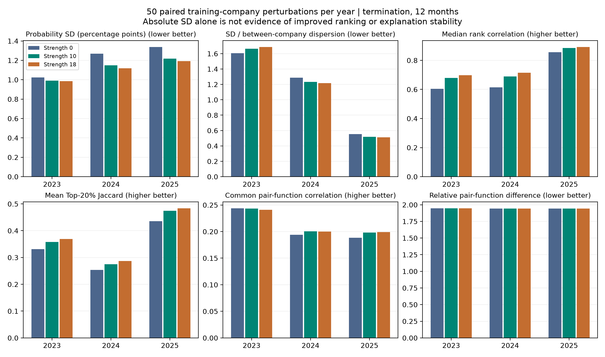

# 父节点收缩是否让模型更稳定：真实训练扰动验证

**结论：支持“收缩提高企业风险排名及筛查名单对训练扰动的稳定性”，但不支持笼统的“解释已经稳定可靠”或“所有预测指标都会改善”。** 收缩10在2023、2024、2025三个年度均提高排名相关性和Top20名单重合度；12个月合并年内AUC在50次配对扰动中有49次改善。然而合并AP和Brier平均略差，风险低估仍然存在，二元函数形状相关性依然很低。强度18进一步改善部分排序稳定性，同时继续压缩解释幅度，不能据此认定其最优。当前C039及其强度10未改变。本轮为已暴露队列上的探索性机制分析。

## 1. 实际完成了什么

- 冻结提交：`c21855e42bfca2ceff46412f657c8cfa6590b2c3`，在新增真实拟合前提交。
- 每年50次公司级有放回训练扰动，三个年度共150个配对任务；全部成功。
- 实际拟合450个32树原始森林，共14,400棵树；派生900个收缩成员，组成450个96树预测器。原始成员、派生成员和合并模型共1800份表示均验证。
- 每次比较的0、10、18来自同一套原始森林；74项变量、C039种子17/503/22、q2、深度4、共享切点、均衡覆盖及退市支持保护都保持不变。
- 训练年截止分别为2023/2024/2025年1月1日；评价企业固定为36/45/53家。2025年24个月性能始终NA。
- 拟合阶段仅得到评价X及ID，不读取评价结局。公司数据、预测、森林、完整函数和重抽样索引留服务器私有目录。

原训练集分别为309/345/390家，退市14/26/49家，恢复184/198/211家。外层重抽样的独立公司均值分别为195.72/219.72/246.48，独立退市公司均值为9.10/17.06/31.52，范围为6–12/13–21/26–39。重复公司不增加独立支持，内层保持原公司bootstrap实现。详见[方法与局限](METHODS_ZH.md)、[数据审计](DATA_AUDIT.csv)及[训练支持](TRAINING_SUPPORT.csv)。

下文性能数字是50套重抽样模型的指标均值，**不是原完整训练集C039模型的新正式成绩**。重抽样改变有效独立信息和树结构，不能把两种训练条件混为一谈。

## 2. 风险排序和名单确实更稳定

12个月退市，三个数依次为强度0 / 10 / 18。概率SD单位为百分点，排名相关为50个模型两两Spearman的中位数，Jaccard为前20%名单交并比的均值。

| 年度 | 企业预测SD均值↓ | 排名相关↑ | Top20名单Jaccard↑ |
|---|---|---|---|
| 2023 | 1.024 / 0.991 / 0.986 | 0.604 / 0.680 / 0.698 | 0.331 / 0.358 / 0.369 |
| 2024 | 1.269 / 1.150 / 1.118 | 0.614 / 0.689 / 0.715 | 0.253 / 0.275 / 0.287 |
| 2025 | 1.337 / 1.218 / 1.193 | 0.856 / 0.886 / 0.891 | 0.436 / 0.474 / 0.484 |

收缩10使平均概率SD下降约3.2%、9.4%、8.9%。排名和名单的改善意味着收益不完全是统一缩小概率所造成的表面现象；统一正比例缩放不会改变这些排名指标。但2024年Top20 Jaccard仍只有0.275，不能写成“名单已高度稳定”。

同时控制概率尺度后，“企业预测SD / 企业间平均预测离散度”为：

| 年度 | 0 | 10 | 18 |
|---|---:|---:|---:|
| 2023 | 1.607 | 1.662 | 1.685 |
| 2024 | 1.288 | 1.234 | 1.215 |
| 2025 | 0.554 | 0.518 | 0.510 |

2023年该比值反而增大。因此不能说所有稳定性定义下收缩都更好。24个月退市排名相关在2023为0.740→0.796、2024为0.830→0.864；恢复原因的排名及名单重合度也在各年度、两个预测时限下改善。2025年24个月仅报告预测稳定性，不报告性能。全部数据见[PREDICTION_STABILITY.csv](PREDICTION_STABILITY.csv)。

## 3. 有预测取舍，没有解决风险低估

以下在每个重抽样内，先平均三个种子的企业预测再算指标，最后汇总50次结果。年内AUC只比较同年度企业；pooled AUC/AP/Brier在合并预测上重算；Top20先按每年名额选择再合计。

| 12个月退市汇总指标 | 0 | 10 | 18 |
|---|---:|---:|---:|
| 年内AUC↑ | 0.7175 | 0.7333 | 0.7378 |
| pooled AUC↑ | 0.5983 | 0.5971 | 0.5967 |
| pooled AP↑ | 0.2431 | 0.2411 | 0.2400 |
| Brier↓ | 0.171715 | 0.171850 | 0.171903 |
| Top20平均捕获 / 25 | 9.56 | 9.88 | 10.00 |

小数捕获数是50次的均值，不代表某一次捕获了小数家企业。主比较10减0：年内AUC平均+0.01584，P5–P95为[0.00361,0.03990]，49次正、1次负；AP平均−0.00205，18次正、32次负；Brier平均+0.000135，36次变差、14次改善。Top20捕获平均+0.32，24次增加、8次减少、18次不变。

上述分位数是训练扰动分布，不是总体95%置信区间，也不构成确认性显著性证据。不能选择性引用AUC的有利方向忽略AP和Brier。

逐年退市结果如下（0→10；均为扰动均值）：

| 年度/时限 | AUC | AP | Brier | Top20捕获 |
|---|---|---|---|---|
| 2023/12月 | 0.6936→0.7148 | 0.3382→0.3524 | 0.10612→0.10599 | 1.68→1.82 / 4 |
| 2024/12月 | 0.7324→0.7537 | 0.6203→0.6378 | 0.32716→0.32759 | 5.70→5.86 / 16 |
| 2025/12月 | 0.7013→0.7037 | 0.2325→0.2366 | 0.08428→0.08435 | 2.18→2.20 / 5 |
| 2023/24月 | 0.7231→0.7371 | 0.5687→0.5722 | 0.28651→0.28520 | 4.30→4.22 / 12 |
| 2024/24月 | 0.6743→0.6868 | 0.6475→0.6606 | 0.34028→0.34204 | 6.14→6.36 / 20 |

逐年AP改善与pooled AP略降并不矛盾：合并指标还包含跨年度比较，对不同年份的风险尺度敏感，不能用年度AP平均代替。

24个月退市合并AP为0.5911→0.5997→0.6046，Brier为0.31638→0.31678→0.31707，仍存在取舍。恢复原因合并12个月年内AUC为0.5937→0.6033→0.6062、AP为0.0825→0.0869→0.0913、Brier为0.08006→0.07822→0.07791；24个月恢复的上述三项均值也改善。2023年12个月无恢复事件，单年恢复AUC/AP/事件覆盖率保留NA。

收缩10的12个月退市O/E均值在2023/2024/2025仍为6.66/10.93/1.57；2024年甚至由10.83略升。这里是每次O/E的平均，不等于观察率除以跨扰动平均预测。**该模块没有修正总体退市水平低估，也不是概率校准器。** 全部均值、分位数、原始重复结果和配对差值见[METRIC_DISTRIBUTIONS.csv](METRIC_DISTRIBUTIONS.csv)、[METRICS_ALL.csv](METRICS_ALL.csv)、[PAIRED_PERFORMANCE_DIFFERENCES.csv](PAIRED_PERFORMANCE_DIFFERENCES.csv)。

## 4. 解释仍精确，但二元交互稳定性证据弱

共同训练边际乘积参考下，12个月退市的二元项结果如下。幅度为各交互在参考样本上的平均绝对CIF贡献之和，单位百分点；它不是交互对总风险的净增加。

| 年度 | 共同交互形状相关：0 / 10 / 18 | 交互绝对幅度合计：0 / 10 / 18 |
|---|---|---|
| 2023 | 0.244 / 0.243 / 0.241 | 1.715 / 1.185 / 1.045 |
| 2024 | 0.194 / 0.201 / 0.200 | 2.278 / 1.599 / 1.419 |
| 2025 | 0.188 / 0.198 / 0.199 | 3.860 / 2.822 / 2.539 |

收缩10把交互绝对幅度压低约27%–31%，但形状相关只在2024、2025略升，2023略降。计入缺失项为零的归一化函数差异仍约1.94，改善很小。主效应形状相关从0.390/0.346/0.381微增至0.394/0.351/0.386；不能将这些水平描述为高稳定性。

跨重抽样的交互非零集合Jaccard约0.086/0.097/0.094。由于收缩不改变树结构，这些集合重合度在三种强度间相同。各年也没有单一交互在至少80%的扰动中均达到0.001 CIF的平均绝对幅度；这个阈值只是描述，不证明其余交互都没有信息。共同形状相关排除恒定函数，NA数完整记录；集合与幅度分析另保留遗漏函数，避免只看共同项。

每个96树模型的平均结构复杂度如下，三种强度完全一致：

| 年度 | 主效应函数 | 二元函数 | 空间单元 |
|---|---:|---:|---:|
| 2023 | 59.34 | 144.18 | 2898.96 |
| 2024 | 59.86 | 140.38 | 2905.10 |
| 2025 | 60.20 | 140.92 | 2999.42 |

所以收缩不会令完整解释表更小。局部贡献的绝对波动会随幅度下降，但归一化差异和形状结果仍需分开看。完整的两原因、两个时间点及局部指标见[FUNCTION_STABILITY.csv](FUNCTION_STABILITY.csv)、[LOCAL_EXPLANATION_STABILITY.csv](LOCAL_EXPLANATION_STABILITY.csv)、[COMPLEXITY.csv](COMPLEXITY.csv)。

## 5. 机制与数值核验

收缩10的平均叶权重约0.533/0.552/0.568；收缩18为0.398/0.416/0.432。每个32树成员平均约56.66/56.30/48.55个原本零退市事件的叶节点借到正退市风险；另有许多零事件叶的直接父节点也无退市，因此仍为零。借入概率没有改变任何公司的真实支持计数。

1800份表示在全部原始训练、评价样本、所有原生时间及两个原因上通过：最大逐项重构误差3.775×10⁻¹⁵，森林重载误差0，独立直接父节点AJ重放误差0；最大两原因CIF和0.990571，没有概率负值或时间下降。所有路径≤2，深度≤4，三种强度的树结构和空间单元数相同。未裁剪、删除函数、修改标签或重选样本。

外层扰动后少数树的in-bag退市支持只有1家公司；核对发现相应11个叶均为未分裂的根节点，不是违规产生的子节点。所有失败/重试记录、数值日志和哈希保留。

## 6. 执行、局限与决定

Slurm任务2693为计入正式总数的全预算试运行；2694完成剩余149个任务，正式批次含排队约309秒。oliver完成114个任务，lemon完成36个。单任务最高RSS约451MiB。函数汇总在本机执行，每年度约9–11秒，最高RSS约1.4GiB。这些是本轮实际环境耗时，不作为不同方法的公平速度排名。

首次pytest因既有ESWA依赖路径未加入环境而在收集阶段失败，修正环境后完整测试339项通过，日志保留。第二次只读哈希复核在准备重复创建已有注册文件时被保护机制中止；已改为严格比较既有内容，相同则复核通过，不覆盖注册文件。没有真实拟合、回传或数值核验失败。调度器本次回执中的CPU可用列表与先前池说明不一致，原始回执已保留；本轮未修改CPU白名单、亲和性策略或cgroup，也不把逻辑CPU列表当作物理核或同时活跃线程数。

本轮不变更模型。可将父节点收缩表述为**具有实测排序稳健性收益、但存在指标取舍的叶概率正则化模块**。不能把它写成已解决小样本、不均衡、校准偏差或交互解释不稳定的通用方法；它也不是q2精确分解成立的必要条件。
