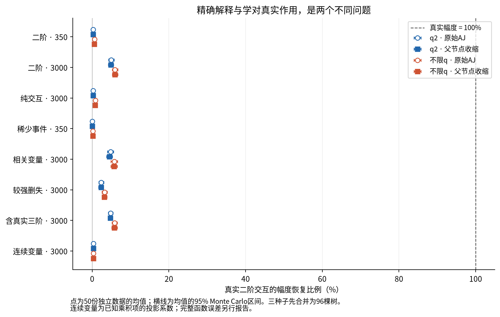
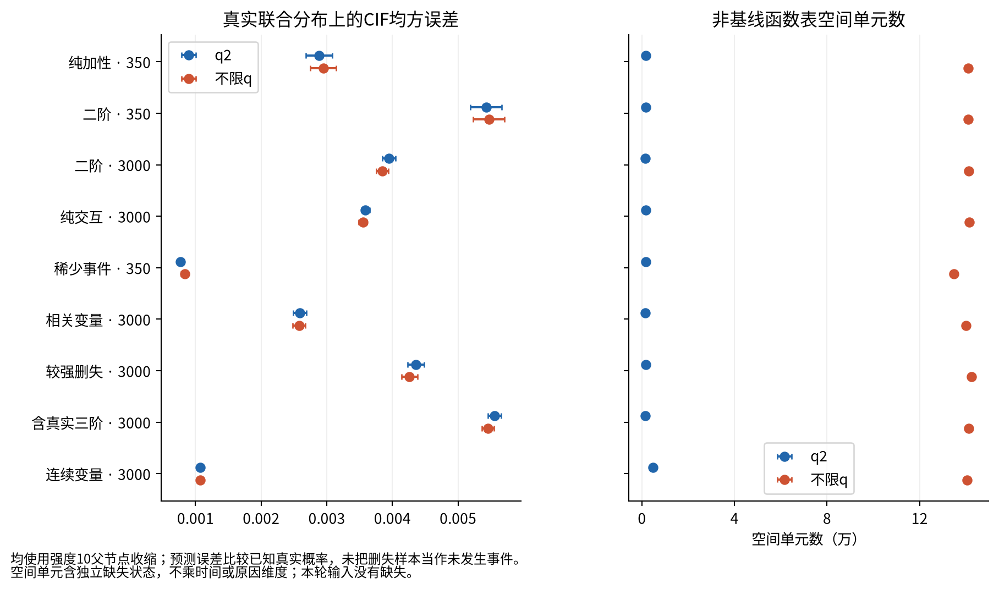
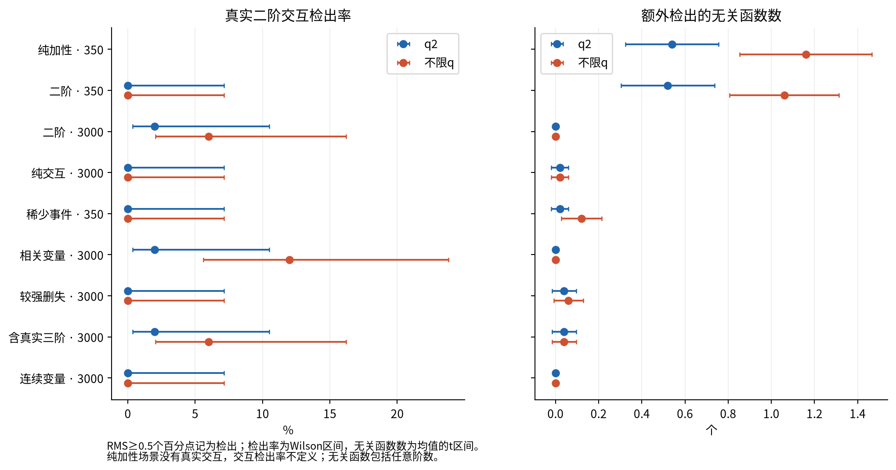
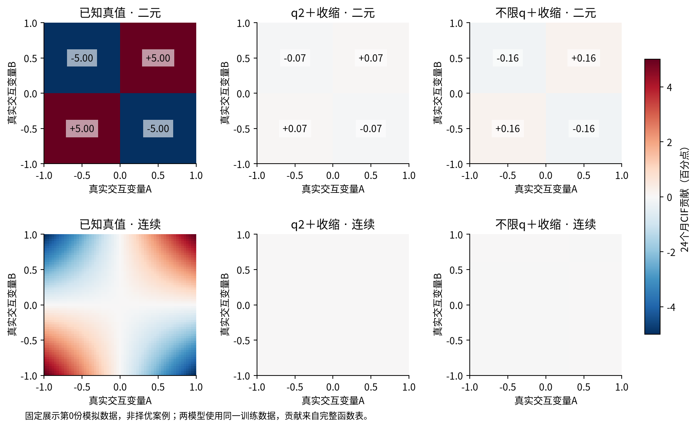

# 当前完整森林：结构与幅度恢复结果

本轮结论：**重要交互被明显学弱。解除q限制有所改善，但两种森林都没有可靠恢复真实交互幅度。q2的完整可审计表示和复杂度优势仍成立；不能据此声称它已经恢复了真实作用。**

## 执行与核验

沿用当前完整版本：83维、每树均衡覆盖25列、共享分位数切点、深度4、32树/种子、种子42/101/202、直接父节点AJ收缩10。对照只把path_budget=2改为None。主预测先平均三个种子，共96棵树。没有更换当前企业参考模型。

9个冻结场景×50份数据×2臂×3种子，共450项正式任务、2700次森林拟合，另有4次独立数值试运行拟合。450项全部完成：oliver304项、lemon146项；正式队列2530.04秒，约42.17分钟。没有失败正式任务、被丢弃的种子或按结果追加的搜索。

独立重新生成450份数据核对哈希，重新核验1238个不可变输入文件，检查7200个原始/收缩/合并预测器表示。最大完整重构误差6.21725×10⁻¹⁵；模型及函数重载预测误差为0。所有叶在全部原生时间点满足CIF约束。重构范围为全部训练/测试输入的两个评价时点，以及32个固定探针的所有原生时间点；不把探针检查表述为全部样本×全部原生时间的穷尽检查。

拟合代码冻结提交：`0e3bdefe72c7ba7440e01b724d9e5d02be89357c`。分析程序在首次正式效应检查前保存为`b473069ab65afdaf9fda936e8eb17e2d0cb568f4`；其后仅补充已有逐树诊断的加权恒等式表、图表排版和报告。详细方法见[METHODS_ZH.md](METHODS_ZH.md)，配置核验见[BASELINE_AUDIT_ZH.md](BASELINE_AUDIT_ZH.md)。

## 1. 真实交互到底恢复了多少

下表是24个月目标原因、三个种子合并后的结果，取50次数据重复均值。**幅度恢复100%才是沿真实函数方向完全恢复。这不是AUC、AP，也不是退市事件捕获率。** 检出次数指预设真实变量对的函数RMS≥0.5个百分点。

| 场景 | 训练N | 平均目标事件数 | q2幅度恢复 | 不限q幅度恢复 | q2/不限q检出次数 |
|---|---:|---:|---:|---:|---:|
| 纯加性 · 350 | 350 | 59.00 | — | — | — / — |
| 二阶 · 350 | 350 | 59.30 | 0.224% | 0.566% | 0/50 / 0/50 |
| 二阶 · 3000 | 3000 | 502.40 | 4.883% | 5.935% | 1/50 / 3/50 |
| 纯交互 · 3000 | 3000 | 502.28 | 0.244% | 0.799% | 0/50 / 0/50 |
| 稀少事件 · 350 | 350 | 20.48 | 0.044% | 0.156% | 0/50 / 0/50 |
| 相关变量 · 3000 | 3000 | 599.88 | 4.489% | 5.699% | 1/50 / 6/50 |
| 较强删失 · 3000 | 3000 | 336.62 | 2.314% | 3.186% | 0/50 / 0/50 |
| 含真实三阶 · 3000 | 3000 | 503.36 | 4.707% | 5.809% | 1/50 / 3/50 |
| 连续变量 · 3000 | 3000 | 503.02 | 0.284% | 0.328% | 0/50 / 0/50 |

普通二阶、N=3000场景的真实函数为0.05×z₀×z₁。在二元输入中，它贡献+5或−5个百分点。q2平均只学到约±0.244个百分点，不限q约±0.297个百分点。

q2恢复比例4.883%的95%均值区间为[4.210%,5.557%]；不限q为5.935%[5.233%,6.636%]。配对差值q2减不限q为−1.052个恢复比例百分点，95%区间[−1.247,−0.856]。两者都距100%很远。

有7个二阶场景的配对幅度差区间位于0以下；连续场景为−0.044个恢复比例百分点[−0.134,0.047]，没有清楚的q差异证据。多个场景和指标是有限机制分析，不能选择性包装成确认性显著结果。

### 检出和幅度必须一起看

大样本普通二阶场景：q2仅1/50次超过主要检出门槛，不限q3/50次。将门槛按预设敏感性分析降至0.25个百分点，变为18/50与30/50；提高至1个百分点，两者均为0/50。低检出率不只由门槛造成：连续的幅度恢复指标同样显示严重衰减。所有门槛结果完整保留，未选择最有利口径。

零次检出不等于真实检出概率严格为零。50次零检出的Wilson95%上界约为7.13%，原冻结t区间也原样保存，见[分析补充](ANALYSIS_ADDENDUM_ZH.md)。纯加性场景没有真实交互，召回率不定义。

纯交互场景没有可帮助首层分裂的对应主效应，q2和不限q恢复比例仅0.244%与0.799%。稀少事件场景平均20.48例目标事件，两者仅0.044%与0.156%。连续输入场景分别0.285%与0.328%，完整函数L2误差约0.01662，接近该真实函数自身RMS0.01667。

真实三阶项：q2按设计为零；不限q平均仅恢复约0.014%，区间包含零。说明当前深度、覆盖和搜索设置下，对照也未有效学到该三阶项；不能据此宣称更高阶交互没有价值。

## 2. 衰减发生在哪里

不是函数导出丢失了模型内容：全部贡献仍精确重构森林。主要问题已经存在于森林本身。

普通二阶、N=3000场景，每个完整预测器有96棵树：

| 逐树诊断 | q2 | 不限q |
|---|---:|---:|
| 有资格同时使用真实变量对的树，平均 | 8.76 | 8.76 |
| 具有非零真实交互系数的树，平均 | 5.68 | 7.52 |
| 有资格树中形成非零系数的比例 | 64.84% | 85.84% |
| 非零贡献树的加权平均幅度/真值 | 82.53% | 75.76% |
| 全森林幅度/真值 | 4.883% | 5.935% |

按全部树加权的恒等式为：

q2：9.125% × 64.840% × 82.532% = 4.883%。

不限q：9.125% × 85.845% × 75.763% = 5.935%。

最后一项采用所有非零贡献树加权汇总，不是把50次条件平均数随意相乘；恒等式最大算术误差2.09×10⁻¹⁷。原始审计见[interaction_attenuation_identity.csv](results/interaction_attenuation_identity.csv)。树数不是额外独立统计样本，区间仍以50份数据为单位。

这表明：共同的每树25列限制让约91%的树没有机会表达这个变量对；q2进一步减少有资格树中实际形成该交互的数量。形成交互的单棵树并非普遍只学到5%的幅度，弱化主要体现在整个森林的等权平均。

**这不是“均衡覆盖调度一定不好”的因果证明。** 本轮没有改变25列这一门槛，也没有比较IID25；同样的25列随机子集也有类似的低变量对覆盖概率。诊断说明当前系数在哪里衰减，并不保证放开所有变量就能同时改善预测、方差和可读性。

### 父节点收缩不是主要原因

同一raw森林派生的比较：N=3000普通二阶场景，q2从4.986%降至4.883%，不限q从5.950%降至5.935%。原始AJ已经没有恢复大部分真实幅度。N=350时q2从0.264%到0.224%，不限q从0.650%到0.566%；收缩存在额外影响，但不能解释整体衰减。全部raw/收缩对比见[signal_summary.csv](results/signal_summary.csv)和[shrinkage_paired_changes.csv](results/shrinkage_paired_changes.csv)。

## 3. 预测质量与表示复杂度的权衡

下表比较已知真实CIF的均方误差；越小越好。空间单元采用相同的完整非基线函数表口径，包含缺失状态，基线另1个单元。它是逻辑表规模，不能当作实际文件或内存字节数。

| 场景 | q2真实CIF MSE×10⁴ | 不限q MSE×10⁴ | q2平均空间单元 | 不限q平均空间单元 |
|---|---:|---:|---:|---:|
| 纯加性 · 350 | 28.846 | 29.474 | 1,723.02 | 141,094.86 |
| 二阶 · 350 | 54.301 | 54.707 | 1,719.78 | 141,091.80 |
| 二阶 · 3000 | 39.494 | 38.466 | 1,553.64 | 141,186.66 |
| 纯交互 · 3000 | 35.895 | 35.487 | 1,587.90 | 141,528.84 |
| 稀少事件 · 350 | 7.722 | 8.344 | 1,735.50 | 134,924.64 |
| 相关变量 · 3000 | 25.906 | 25.772 | 1,447.26 | 140,148.60 |
| 较强删失 · 3000 | 43.557 | 42.593 | 1,642.08 | 142,475.64 |
| 含真实三阶 · 3000 | 55.566 | 54.563 | 1,567.08 | 141,198.90 |
| 连续变量 · 3000 | 10.728 | 10.722 | 4,821.78 | 140,554.54 |

q2在三个N=350场景的MSE较低；五个二元N=3000场景中不限q较低；连续场景差值区间跨0。普通大样本二阶场景q2的MSE约比不限q高2.67%，配对差值为0.0001028[0.0000838,0.0001217]。同时，q2逻辑表单元从141186.66降至1553.64，减少98.90%。

该场景q2平均约71.06个主效应结构项、148.94个二阶结构项；不限q约83个主效应、1721.62个二阶、2413.32个三阶、744.24个四阶结构项。结构出现不等于具有显著或真实贡献。

实际两时点因子化函数文件平均为14821字节与56539字节，减少约73.79%，并非98.9%。连续场景的文件约64188与82916字节，差距更小。原生森林、逻辑表、因子化文件和实际内存应分开描述。

普通大样本场景的平均预测风险约17.99%，真实测试平均风险约17.98%，整体均值接近；交互幅度仍只恢复4.88%。**整体校准接近正确，并不保证变量作用和交互幅度正确。** 该场景期望Brier为0.146442与0.146340；这里利用已知概率计算期望Brier，不是企业样本的IPCW评价。

相关场景尤其要区分参考分布：q2联合测试MSE约0.002591，边际乘积参考下MSE约0.004286。两者评价的分布不同，不能互换，也不能将中心化函数理解为因果效应。

## 4. 真结构与稳定性并未得到充分支持

纯加性小样本场景，超过门槛的无关函数平均0.54个与1.16个；普通二阶小样本为0.52与1.06个。q2在这些场景减少了较大的伪函数。但普通大样本场景两者此指标均为0，q2没有独立的进一步改善；其真实交互检出率也很低。不能将较少的伪发现单独写成结构恢复成功。

普通大样本二阶场景的主效应集合平均Jaccard约0.712与0.785，分别只在47和49份有非空比较的数据上定义。二阶集合约0.083与0.137，仅8和17份数据有非空比较，其余经常两边都没有检出。连续场景的主要二阶集合均为空，不定义Jaccard，不能把“都没学到”称为100%稳定。

## 5. 固定完整函数案例

下图固定使用第0份模拟数据，不选最有利案例。全部面板使用相同的±5个百分点色标。图中是交互项对CIF的贡献，不是整个预测概率，也不是风险率或因果影响。这个单次案例不替代上述50次平均结果。

## 6. 研究判断

支持的主张：当前完整模型可稳定完成本轮模拟的训练与预测；概率合法、保存重载一致、完整低阶分解精确；q2显著限制表示规模，并在部分小样本场景改善预测误差、减少较大的伪函数。

不支持的主张：当前完整版本已经可靠恢复真实交互结构或幅度；低阶限制普遍改善解释稳定性；解除q就足以解决衰减；或父节点收缩是主要问题。当前结果也不能证明任何真实财务变量的因果作用。

**模型可以继续被描述为低阶、完整、可审计的预测器；“真实作用恢复可靠”目前应作为未实现目标。** 如果论文主张后者，这一轮提供的是明确的限制证据。它不否定已完成企业预测实验的数值结果，也不等于完整方法创新已经得到确认。

当前研究参考模型保持不变。本轮结束，不自动启动另一种结构或第二轮参数搜索。

## 工件索引与计算信息

- 冻结协议与逐参数差异：[frozen_protocol.json](frozen_protocol.json)、[parameter_differences.csv](parameter_differences.csv)。
- 每场景、每评价时点/原因、每种子/合并结果：[metric_summary.csv](results/metric_summary.csv)、[metrics_per_repetition.csv.gz](results/metrics_per_repetition.csv.gz)。本模拟没有2023/2024企业队列，day表示365/730天。
- 配对区间：[paired_q2_minus_unrestricted.csv](results/paired_q2_minus_unrestricted.csv)。
- 全部真函数与逐阶误差：[signal_summary.csv](results/signal_summary.csv)、[function_error_by_order.csv](results/function_error_by_order.csv)。
- 结构稳定性及种子波动：[structure_stability_summary.csv](results/structure_stability_summary.csv)、[seed_variation_summary.csv](results/seed_variation_summary.csv)。
- 每个预测器的复杂度、候选尝试数、时间与导出字节：[models_per_repetition.csv.gz](results/models_per_repetition.csv.gz)。`candidate_evaluations`沿用代码计数，指候选尝试，包含未满足叶支持条件者，不能改称全部真正评分次数。
- 执行与验证：[execution_receipt.json](execution_receipt.json)、[independent_validation.json](results/independent_validation.json)、[validation.csv.gz](results/validation.csv.gz)。
- 5400个正式native模型和7200个函数导出哈希：[model_artifact_hashes.csv.gz](results/model_artifact_hashes.csv.gz)。模型、阈值和逐条数据留在服务器。

每次正式单种子拟合平均耗时q2为2.89秒、不限q为8.52秒；收缩派生约1.64与6.00秒。本次单任务峰值RSS约1533.29 MiB。上述时间来自两机不同P/E/SMT负载，不能外推为固定加速倍数。完整测试拟合前168项通过，分析完成后169项通过；有一个既有EBM缺失值绘图提示，与本轮无缺失模拟无关。开发中两项新增断言问题及修正均保留记录，没有删除失败测试或放宽预测重构容差。

私有完整运行目录：`/home/oliver/MainDiskData/xai_rsf_structure_recovery_20261030_eqjtVhJ4/`。
