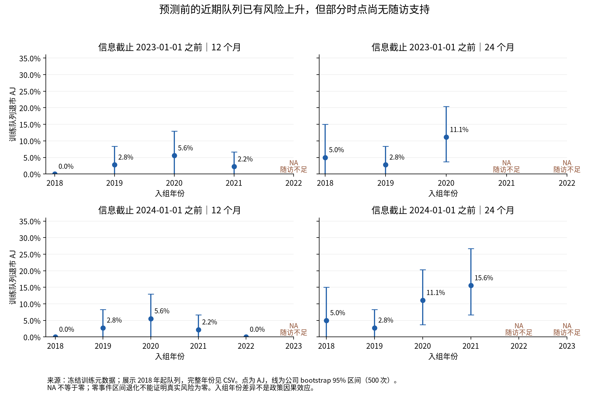

# 数据对齐与第0步诊断

本轮复用旧C输入和现有首次财务/审计类ST入组队列，全部非金融行业，每家公司一个入组记录；预测起点仍为公告后的下一交易日开盘前，恢复/退市采用公告日。两个原因是首次恢复与最终退市的竞争结局；这不是再次预测首次ST。

训练截止2023-01-01前：309家公司、14例已观察退市、184例恢复；截止2024-01-01前：345家公司、26例退市、198例恢复。12个月内目标事件只有5/9例。两个训练集有重叠，合并独立公司为345家，不能把309+345称为654家独立企业，或把14+26称为40个独立退市事件。输入均为83列旧C变量，字段顺序、X、公司组、sample_id、时间和事件均与保存模型对应输入核对。未更换年报版本、可得日或随访定义。

真实披露版本仍有继承限制。当前口径沿用旧输入的保守版本选择，不等于通过原始PDF逐值核验或完整PIT认证；研究者此前接受新年度源的另一轮结果亦保留。本轮没有用报告期制造可得日，没有把未知标签视为正常。

训练元数据的stop严格早于对应截止；按实际日历月计算AJ诊断，提前删失留在风险集直到其删失日。未到目标时点且风险集为空、剩余存活未耗尽时记NA，禁止延长水平尾部制造24个月估计。6个月为补充，12/24个月为主要诊断时点。

| 信息截止（不含） | 入组组 | 月 | 公司数 | 截至H退市 | H前删失 | H风险集 | 退市AJ |
| --- | --- | --- | --- | --- | --- | --- | --- |
| 2023-01-01 | pre_2021 | 12 | 232 | 4 | 0 | 162 | 1.72% |
| 2023-01-01 | post_2020 | 12 | 77 | 1 | 32 | 40 | 2.22% |
| 2023-01-01 | pre_2021 | 24 | 232 | 8 | 0 | 62 | 3.45% |
| 2023-01-01 | post_2020 | 24 | 77 | 6 | 49 | 0 | NA（无支持） |
| 2024-01-01 | pre_2021 | 12 | 232 | 4 | 0 | 162 | 1.72% |
| 2024-01-01 | post_2020 | 12 | 113 | 5 | 32 | 67 | 4.82% |
| 2024-01-01 | pre_2021 | 24 | 232 | 8 | 0 | 62 | 3.45% |
| 2024-01-01 | post_2020 | 24 | 113 | 18 | 44 | 15 | 21.98% |

2024年截止下，post_2020组24个月AJ为21.98%（公司bootstrap95%区间13.63%—31.28%），旧组为3.45%；差18.53个百分点，差值区间9.51—28.31。近期训练信息中已经有风险上升。2023年截止下近期队列24个月无支持，12个月差仅0.50个百分点、区间跨零；不能据此断言真实风险没有上升，更不能断言所有方法都不可能修正。

逐年看，2020入组队列24个月AJ为11.11%，2021队列在2024截止下为15.56%；2022队列已有7例退市但24个月仍无完整支持。2024截止时2023训练入组队列的6个月AJ为11.43%（4例），12/24个月仍无支持。近期混合队列AJ依赖组内非信息删失；不同年份风险与删失时长相关可能破坏这个假设，必须同时看逐年表，不能把混合21.98%当作所有近期公司的已知真实风险。

pre_2021/post_2020按入组年份分组，依据2020-12-31新规公布日作描述性切分；不同板块适用和过渡规则不同，这不是政策因果识别。参见[上交所正式通知](https://www.sse.com.cn/aboutus/mediacenter/hotandd/c/c_20201231_5294528.shtml)、[深交所公告](https://www.szse.cn/aboutus/trends/news/t20201231_584060.html)。

500次公司bootstrap、种子20261028；零事件队列的百分位区间可能退化为0，不代表真实风险为0。使用R survival::survfit独立核对（无事件队列用解析零值），最大误差1.23e-15。完整年份、事件数、删失数、可支持重抽样次数和区间见[cohort_aj.csv](results/cohort_aj.csv)。森林预测仍使用实际天数并逐公司查询12/24日历月，故整体训练日历月AJ与按天数平均查询可能有微小差别。

测试为2023年36家、2024年45家：24个月退市12/20例，恢复15/16例，其余9/9家完整无事件随访。2024入组日期为4月24日至5月6日，最后24个月随访到2026-05-06；本次不是用不足两年的记录假定正常。12个月退市4/16例。两个时点未知结局均0，所以IPCW权重均1，Brier与普通已知二元端点Brier相同。训练中提前删失仍然存在，不能套用测试的完整随访结论。

2025暴露审计只读取以前的汇总回执：`post_st_train2024_h12_v1/execution_receipt.json`已记录COMPLETE、9次正式拟合和2025测试。当前不读取新的2025公司结局、不重新评价；协议状态为SEALED_NO_NEW_EVALUATION，不能写“2025从未执行”或“独立盲测”。

原始来源、训练与预测文件SHA256见[source_hashes.csv](results/source_hashes.csv)；每个正式模型/函数文件哈希见[model_hashes.csv](results/model_hashes.csv)。原结果文件的三个冻结哈希在执行回执中保留并重新核对一致。
