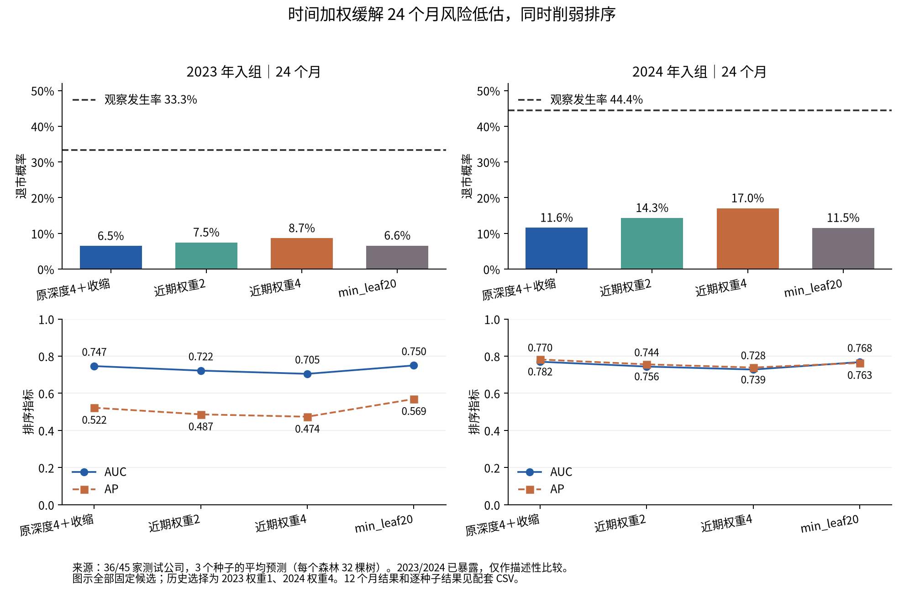

# 训练队列诊断、时间加权 AJ 与叶节点大小实验

**完成：时间加权只部分缓解低估，同时损失排序；增大叶节点没有一致预测收益。原深度4＋收缩结果保持不变，研究判断为 INCONCLUSIVE。**

本轮先冻结训练队列 AJ 诊断，再冻结有限比较和历史选择规则。只使用预测时点之前的结局选择权重；2023/2024 结果已多次暴露，均为描述性、PROVISIONAL。2025 以前已有实际评价，本轮封存，不能恢复为独立测试。

24个月的全部固定候选，均为三个种子预测平均后重新计算指标：

| 入组年 | 方案 | AUC | AP | Brier↓ | 预测均值 | 观察发生率 | 低估差/百分点↓ | Top20捕获 | Top25捕获 |
| --- | --- | --- | --- | --- | --- | --- | --- | --- | --- |
| 2023 | 原深度4＋收缩 | 0.7465 | 0.5223 | 0.2860 | 6.47% | 33.33% | 26.87 | 4/12 | 4/12 |
| 2023 | 近期权重2 | 0.7222 | 0.4866 | 0.2805 | 7.46% | 33.33% | 25.87 | 4/12 | 4/12 |
| 2023 | 近期权重4 | 0.7049 | 0.4740 | 0.2745 | 8.65% | 33.33% | 24.68 | 4/12 | 5/12 |
| 2023 | min_leaf20 | 0.7500 | 0.5695 | 0.2850 | 6.58% | 33.33% | 26.75 | 4/12 | 4/12 |
| 2024 | 原深度4＋收缩 | 0.7700 | 0.7820 | 0.3396 | 11.58% | 44.44% | 32.86 | 8/20 | 9/20 |
| 2024 | 近期权重2 | 0.7440 | 0.7559 | 0.3212 | 14.32% | 44.44% | 30.12 | 8/20 | 9/20 |
| 2024 | 近期权重4 | 0.7280 | 0.7388 | 0.3050 | 17.05% | 44.44% | 27.40 | 8/20 | 9/20 |
| 2024 | min_leaf20 | 0.7680 | 0.7634 | 0.3406 | 11.55% | 44.44% | 32.90 | 7/20 | 9/20 |

2024 年近期权重4把平均风险从11.58%提高到17.05%，Brier从0.3396降到0.3050，但AUC从0.7700降到0.7280、AP从0.7820降到0.7388；仍明显低于描述性观察发生率44.44%。Top20仍捕获8/20。2023年历史规则选择不加权，不能根据已暴露的2023结果改选权重。

- [数据对齐、训练 AJ 与暴露核查](DATA_ALIGNMENT_AUDIT_ZH.md)
- [冻结设计、实际任务与数值诊断](TRAINING_DIAGNOSTICS_ZH.md)
- [12/24个月、分箱、覆盖及历史选择](RESULTS_ZH.md)
- [完整解释与支持度](INTERPRETABILITY_COMPARISON_ZH.md)
- [逐步方案判断及研究结论](METHOD_INNOVATION_DECISION_ZH.md)
- [复现入口](RUN_ZH.md)、[冻结协议](frozen_protocol.json)、[执行回执](execution_receipt.json)

20/20调度任务成功；34次新森林拟合（4个小试、24个历史验证、6个正式min_leaf20），另外按固定树分区导出加权叶模型；正式产出24个种子模型和8套96树完整函数表。全量测试139项通过。企业明细、预测、模型参数、阈值及函数表保留于服务器：`/home/oliver/MainDiskData/xai_rsf_temporal_leaf_20261028__kvhg19v`。
