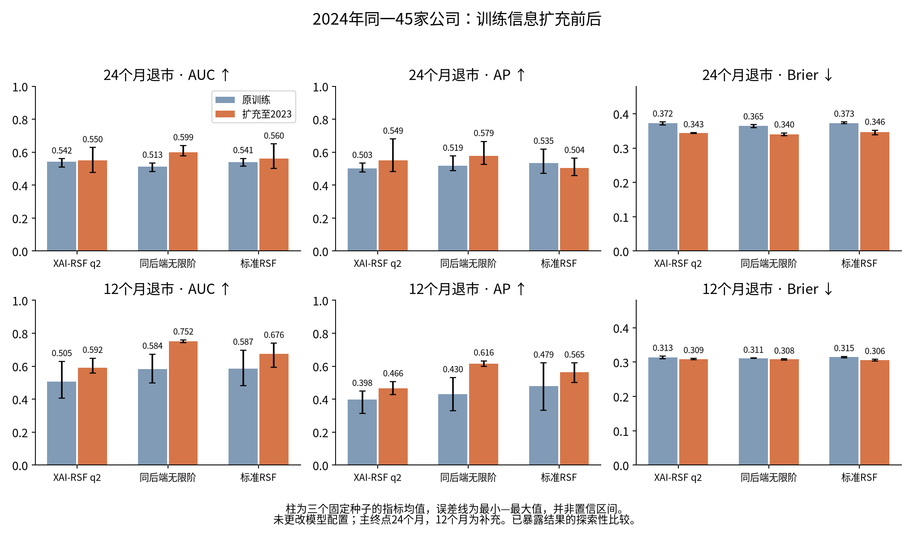

# 新旧训练信息下的2024年结果

同一45家非金融企业，原入组特征、公告终点及评价规则逐项一致。24个月20个先退市、16个先完整恢复、9个无首次转归；12个月15个先退市、4个先完整恢复、26个时限内无首次转归。全部测试端点已知，IPCW权重均为1。每家公司一行，记录等权与公司等权相同。

下表是各自三个种子的指标均值，AUC范围是种子最小—最大值，并非置信区间。AP越高越好，Brier越低越好。`old`对应原309家／14退市，`new`对应345家／26退市。固定种子编号相同不代表新增公司后bootstrap样本相同。没有筛除种子、显著性检验或完整训练不确定性估计。

## 24个月先退市：三种子指标均值与AUC范围

| model | version | auc_mean | auc_min | auc_max | ap_mean | brier_mean | risk_mean_mean |
| --- | --- | --- | --- | --- | --- | --- | --- |
| 标准RSF（randomForestSRC） | 原训练 | 0.5407 | 0.5140 | 0.5620 | 0.5354 | 0.3731 | 0.0861 |
| 同后端无限阶森林 | 原训练 | 0.5133 | 0.4820 | 0.5340 | 0.5186 | 0.3652 | 0.0984 |
| XAI-RSF q2 | 原训练 | 0.5420 | 0.5100 | 0.5600 | 0.5026 | 0.3720 | 0.0898 |
| 标准RSF（randomForestSRC） | 扩充至2023 | 0.5600 | 0.5020 | 0.6500 | 0.5041 | 0.3463 | 0.1258 |
| 同后端无限阶森林 | 扩充至2023 | 0.5987 | 0.5780 | 0.6400 | 0.5788 | 0.3404 | 0.1310 |
| XAI-RSF q2 | 扩充至2023 | 0.5500 | 0.4760 | 0.6280 | 0.5493 | 0.3434 | 0.1302 |

## 12个月先退市：三种子指标均值与AUC范围

| model | version | auc_mean | auc_min | auc_max | ap_mean | brier_mean | risk_mean_mean |
| --- | --- | --- | --- | --- | --- | --- | --- |
| 标准RSF（randomForestSRC） | 原训练 | 0.5867 | 0.4822 | 0.6978 | 0.4789 | 0.3145 | 0.0276 |
| 同后端无限阶森林 | 原训练 | 0.5837 | 0.4978 | 0.6733 | 0.4296 | 0.3113 | 0.0324 |
| XAI-RSF q2 | 原训练 | 0.5052 | 0.4067 | 0.6289 | 0.3985 | 0.3129 | 0.0317 |
| 标准RSF（randomForestSRC） | 扩充至2023 | 0.6756 | 0.5933 | 0.7400 | 0.5649 | 0.3063 | 0.0369 |
| 同后端无限阶森林 | 扩充至2023 | 0.7519 | 0.7422 | 0.7600 | 0.6164 | 0.3077 | 0.0336 |
| XAI-RSF q2 | 扩充至2023 | 0.5919 | 0.5578 | 0.6489 | 0.4661 | 0.3088 | 0.0351 |

## 24个月先完整恢复：三种子指标均值与AUC范围

| model | version | auc_mean | auc_min | auc_max | ap_mean | brier_mean | risk_mean_mean |
| --- | --- | --- | --- | --- | --- | --- | --- |
| 标准RSF（randomForestSRC） | 原训练 | 0.6552 | 0.6422 | 0.6724 | 0.5319 | 0.2529 | 0.5504 |
| 同后端无限阶森林 | 原训练 | 0.5366 | 0.4418 | 0.6164 | 0.4244 | 0.2756 | 0.5636 |
| XAI-RSF q2 | 原训练 | 0.4404 | 0.4052 | 0.4763 | 0.3502 | 0.2817 | 0.5447 |
| 标准RSF（randomForestSRC） | 扩充至2023 | 0.7270 | 0.6401 | 0.7802 | 0.6068 | 0.2353 | 0.5254 |
| 同后端无限阶森林 | 扩充至2023 | 0.6602 | 0.6379 | 0.6897 | 0.5188 | 0.2420 | 0.5140 |
| XAI-RSF q2 | 扩充至2023 | 0.5079 | 0.4591 | 0.5582 | 0.3837 | 0.2615 | 0.5148 |

## 12个月先完整恢复：三种子指标均值与AUC范围

| model | version | auc_mean | auc_min | auc_max | ap_mean | brier_mean | risk_mean_mean |
| --- | --- | --- | --- | --- | --- | --- | --- |
| 标准RSF（randomForestSRC） | 原训练 | 0.4756 | 0.4085 | 0.5854 | 0.1227 | 0.0964 | 0.1777 |
| 同后端无限阶森林 | 原训练 | 0.3740 | 0.2866 | 0.5000 | 0.0877 | 0.0968 | 0.1823 |
| XAI-RSF q2 | 原训练 | 0.4573 | 0.3780 | 0.5488 | 0.1215 | 0.0936 | 0.1850 |
| 标准RSF（randomForestSRC） | 扩充至2023 | 0.5549 | 0.4024 | 0.6402 | 0.1458 | 0.0903 | 0.1643 |
| 同后端无限阶森林 | 扩充至2023 | 0.4878 | 0.3902 | 0.6707 | 0.1307 | 0.0881 | 0.1507 |
| XAI-RSF q2 | 扩充至2023 | 0.4695 | 0.4207 | 0.5549 | 0.1228 | 0.0909 | 0.1711 |

## 如何解释变化

主终点24个月：q2 AUC均值0.5420→0.5500，改善很小；AP 0.5026→0.5493，Brier 0.3720→0.3434。新q2种子AUC为0.476—0.628，不能把均值变化当成稳健显著提升。无限阶森林AUC 0.5133→0.5987；标准RSF 0.5407→0.5600，但标准RSF的AP 0.5354→0.5041下降，结果并非所有指标一致改善。

12个月作为预先定义的补充终点：q2 AUC 0.5052→0.5919，无限阶0.5837→0.7519，标准RSF0.5867→0.6756。不能因补充终点改善较多就改称它为本次主要终点。q2与无限阶还同时不同在变量覆盖和切点组织，差距不能单独归因于二阶限制。

恢复24个月AUC均值：q2 0.4404→0.5079，仍接近随机；标准RSF 0.6552→0.7270。不能把退市与恢复表现合成一个笼统的“模型成功”结论。

完整逐种子、集成、训练表观指标在 `results/metrics.csv`；旧新2024对照在 `results/old_new_metrics.csv`。训练表观结果不代表泛化；旧实验未经重训或覆盖。
