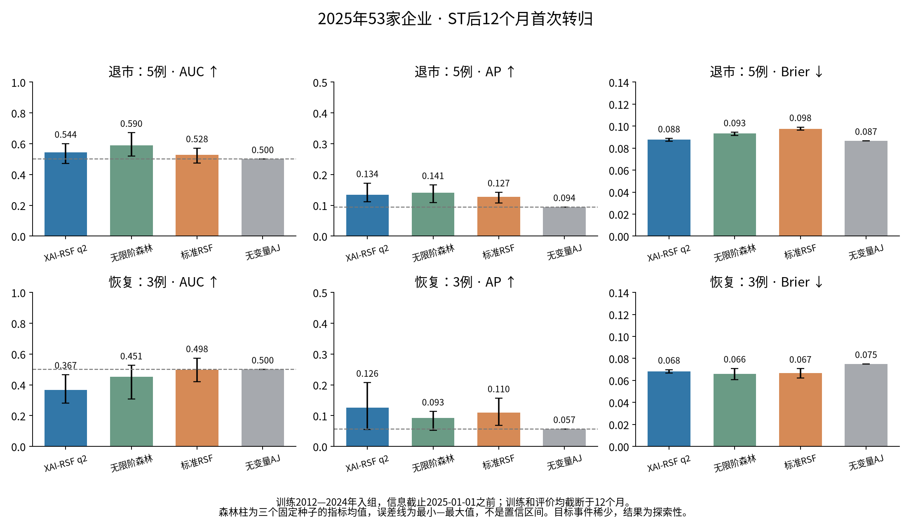

# 2025年12个月预测结果

本轮真正重训的是12个月随访模型，不是从24个月拟合结果中取一个12月截面。训练2012—2024入组，截止2025-01-01之前；评价2025年53家新入组公司。目标为先最终退市X或先完整恢复A，仍为两个相容的竞争风险CIF。

12个月已知结局：退市5/53（9.43%）、恢复3/53（5.66%）、无首次转归45/53。这里的45家不等于恢复正常，可能仍处于风险警示；未知结局0。每家公司一条记录，公司等权与记录等权相同，测试IPCW权重均为1。

## 退市：三种子指标均值与AUC范围

| model | auc_mean | auc_min | auc_max | ap_mean | brier_mean | risk_mean_mean |
| --- | --- | --- | --- | --- | --- | --- |
| 标准RSF（randomForestSRC） | 0.5278 | 0.4750 | 0.5708 | 0.1275 | 0.0976 | 0.0429 |
| 同后端无限阶森林 | 0.5903 | 0.5208 | 0.6708 | 0.1411 | 0.0934 | 0.0447 |
| XAI-RSF q2 | 0.5444 | 0.4708 | 0.6000 | 0.1342 | 0.0876 | 0.0564 |

## 恢复：三种子指标均值与AUC范围

| model | auc_mean | auc_min | auc_max | ap_mean | brier_mean | risk_mean_mean |
| --- | --- | --- | --- | --- | --- | --- |
| 标准RSF（randomForestSRC） | 0.4978 | 0.4200 | 0.5733 | 0.1101 | 0.0665 | 0.1491 |
| 同后端无限阶森林 | 0.4511 | 0.3067 | 0.5267 | 0.0927 | 0.0658 | 0.1401 |
| XAI-RSF q2 | 0.3667 | 0.2800 | 0.4667 | 0.1262 | 0.0682 | 0.1591 |

范围是三个种子的最小—最大值，不是置信区间。未选择最好种子。样本只有5个退市和3个恢复事件，指标易受个别公司排序影响，不能宣称模型间差异显著。

## 固定三种子集成与无变量AJ：退市

| model | auc | ap | brier | risk_mean | ipcw_observed_incidence |
| --- | --- | --- | --- | --- | --- |
| XAI-RSF q2 | 0.5333 | 0.1166 | 0.0875 | 0.0564 | 0.0943 |
| 同后端无限阶森林 | 0.5792 | 0.1326 | 0.0932 | 0.0447 | 0.0943 |
| 标准RSF（randomForestSRC） | 0.5333 | 0.1240 | 0.0975 | 0.0429 | 0.0943 |
| 训练AJ无变量基线 | 0.5000 | 0.0943 | 0.0866 | 0.0597 | 0.0943 |

## 固定三种子集成与无变量AJ：恢复

| model | auc | ap | brier | risk_mean | ipcw_observed_incidence |
| --- | --- | --- | --- | --- | --- |
| XAI-RSF q2 | 0.3800 | 0.1181 | 0.0678 | 0.1591 | 0.0566 |
| 同后端无限阶森林 | 0.4667 | 0.0896 | 0.0651 | 0.1401 | 0.0566 |
| 标准RSF（randomForestSRC） | 0.4800 | 0.0918 | 0.0652 | 0.1491 | 0.0566 |
| 训练AJ无变量基线 | 0.5000 | 0.0566 | 0.0750 | 0.2036 | 0.0566 |

集成先平均三个种子的CIF，再重算AUC/AP/Brier，不能混称为指标均值。AJ由训练集估计，不使用2025发生率拟合。

q2退市AUC均值0.544，固定集成AUC0.533；AP均值0.134，集成0.117。无变量AJ的AP为0.0943。q2 Brier均值0.08765、集成0.08754，均略高于AJ的0.08664；当前没有展示概率预测优于无变量基线。无限阶排序略高，但Brier也高于AJ。恢复仅3例，q2 AUC均值0.367，仍不支持可靠恢复预测。

q2平均退市预测5.64%，观察9.43%；平均恢复预测15.91%，观察5.66%。不能因为退市概率差距比旧实验小，就认定校准改进来自算法。

## 与前轮比较的边界

上一轮评价2024入组、主要观察24个月，本轮评价2025入组且训练／评价均改成12个月。公司、事件比例、训练年份、风险集和随访长度均改变。尤其Brier从旧约0.343变成约0.088，主要不能按数字大小直接解释为巨大性能改善；必须看本轮AJ基线。AP也受发生比例影响，不把旧0.549与本轮0.134直接比较为方法退步幅度。

完整逐种子、集成及训练表观指标见 `results/metrics.csv`；表观训练指标不是验证结果。
