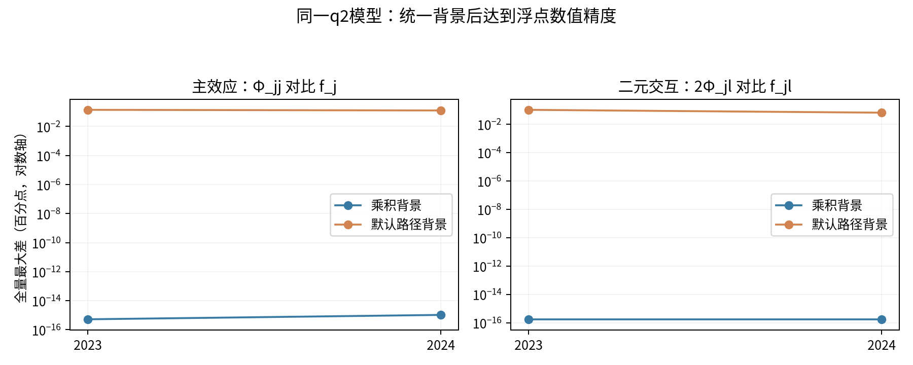
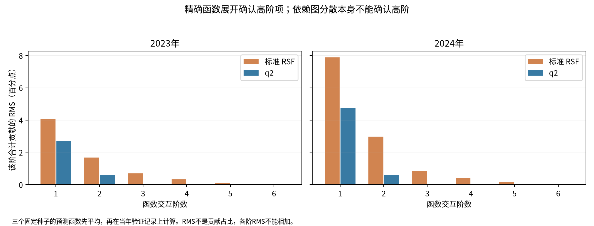

# 默认 TreeSHAP 与完整函数分解的解释消融

复用当前2023/2024的q2深度4＋父节点收缩模型及已冻结标准RSF，共12个已训练森林；六个年度—种子任务，无企业模型重训、无新校准、原预测不变。

- [结果与结论](RESULTS_ZH.md)
- [协议、理论对齐条件和软件限制](PROTOCOL_ZH.md)
- [逐种子数值检查](results/numerical_checks.csv)
- [三种子平均函数的对齐误差](results/ensemble_alignment.csv)
- [实际高阶贡献及分摊](results/high_order_allocation.csv)
- [执行凭据](execution_receipt.json)
- [交付复核：原件哈希、发布校验、报告重放和完整测试](results/delivery_validation.json)
- [实际环境版本](results/environment.json)



乘积背景下验证`Φ_jj=f_j`、`Φ_jl=f_jl/2`。默认无背景的TreeSHAP采用树路径计数，因此与该中心化分解存在参考口径差异；两者仍能精确加回相同预测。q2普通SHAP也可能出现纵向分散，不能用分散单独判断高阶交互。



官方SHAP 0.54.1的原生interventional交互接口不支持本实验所需调用。使用完全不改变预测的精确乘积区域权重适配，并以独立的联盟阶乘计算及已保存原生函数双重核验，不以随机打散背景或把原生函数直接除以2冒充独立实测。

企业级依赖图、对齐散点、完整函数值与真实阈值留服务器。研究结论仅是解释代数与背景语义对齐；不据此宣称预测更优、SHAP错误或方法创新已获证明。默认版本和已取消的时间加权实验状态均不改变。

## 复现入口

```bash
# RUN必须是新的私有目录，含audit/scratch/input/code/results/private/reports空子目录。
python -m experiments.shap_alignment_v1.prepare --run "$RUN" --repo "$REPO"
# 使用现有两机池，保存模型只读；未适配/未验证的R或Python环境不能直接替换。
hetero-run "$RUN/worker.py"
python -m experiments.shap_alignment_v1.report --run "$RUN" --job JOB_ID \
  --pool-result /absolute/path/to/tasks.jsonl.results-JOB_ID.json
```

本次实际执行使用修正后不可变`code_v3`快照。两次适配小试失败记录及修复说明保留：叶节点无效阈值的NA占位、R文本输出损失切点精度。正式六任务全部通过，未放宽误差门槛。R输入树切点与叶输出必须使用binary64侧文件，不能拿JSON展示值代替。
